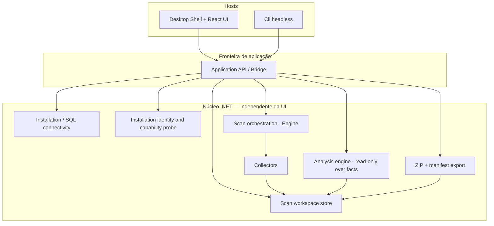
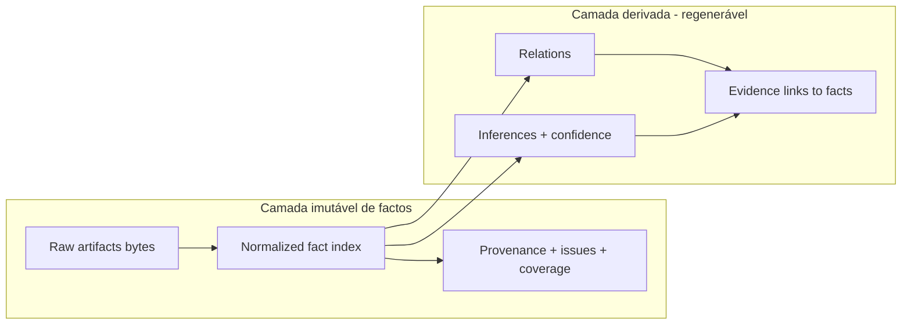
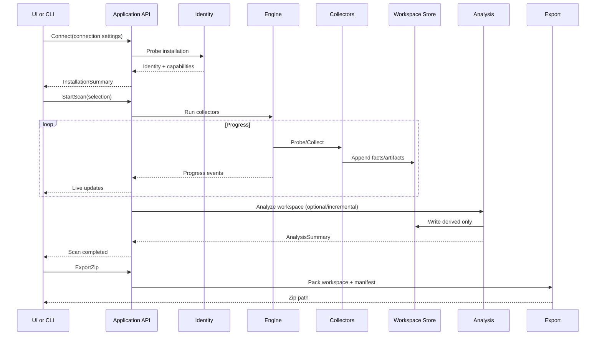
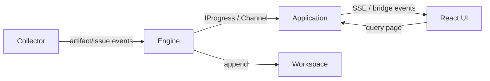

# Proposta de arquitetura da aplicação — PhcKnowledgeScanner

| Campo | Valor |
| --- | --- |
| **Estado** | Proposta histórica de 2026-10-30; várias ideias foram implementadas, outras foram substituídas por decisões posteriores |
| **Data** | 2026-10-30 |
| **Âmbito** | Estudo e definição; sem alteração de código nesta etapa |
| **Relação com** | Complementa `docs/architecture.md` (fundação de recolha já esboçada) |

> Documento de conceção inicial, anterior à implementação atual. Não usar como descrição normativa do produto nem como lista de trabalho pendente sem confronto com `PROJECT-STATUS.md`, ADRs e código atual.

---

## 1. Visão e princípios

O PhcKnowledgeScanner é uma aplicação de **recolha, exploração e análise técnica** de instalações PHC heterogéneas. Deve:

1. Ligar a SQL Server e identificar a instalação.
2. Descobrir e recolher elementos técnicos sem assumir schema universal.
3. Analisar os dados recolhidos **sem alterar** os originais.
4. Apresentar exploração rica (dashboard, explorador, grafos, code explorer).
5. Exportar ZIP estruturado com manifesto.

### Princípios obrigatórios (arquitetura)

| Princípio | Implicação arquitetural |
| --- | --- |
| Preservar originais | Camada de *facts* imutável após escrita; análise só lê e produz *derived* |
| Factos ≠ inferências | Tipos/contratos e UI com discriminação explícita (`Fact` / `Relation` / `Inference`) |
| Sem generalização indevida | Collectors e análise versionados por evidência e contexto de instalação |
| Proveniência | Todo elemento tem origem (collector, objeto fonte, timestamp, hash quando aplicável) |
| UI sem lógica de recolha/análise | UI consome DTOs/API; não executa SQL PHC nem parsers de domínio |
| Motor independente da UI | CLI (e futuros hosts headless) usam o mesmo motor que o desktop |

---

## 2. Comparação das tecnologias de interface

### 2.1 Opção A — .NET 10 + WebView2 + React

Aplicação desktop Windows: shell .NET hospeda WebView2; UI em React (TypeScript); motor de recolha/análise em .NET.

| Aspeto | Avaliação |
| --- | --- |
| Qualidade visual / flexibilidade | Excelente — ecossistema web maduro para dashboards |
| Dashboards modernos | Excelente — charts, grids virtuais, layouts responsivos |
| Grafos / dependências | Excelente — Cytoscape.js, React Flow, D3, etc. |
| Code explorer + highlighting | Excelente — Monaco ou CodeMirror (nível IDE) |
| Pesquisa / grandes volumes | Muito boa — virtualização + índices no motor; UI só pagina |
| Comunicação UI ↔ motor | Boa — bridge WebView2 (`PostWebMessage`) e/ou HTTP local no processo |
| Offline | Sim — assets embutidos no host; sem CDN em runtime |
| Distribuição EXE | Boa — host .NET + runtime WebView2 (presente na maioria dos Windows 10/11) |
| Instalação / atualização | Média — possível single-file + dependência WebView2 Evergreen |
| Memória / desempenho | Média–alta memória (Chromium embutido); OK se artefacto pesado ficar no motor |
| Complexidade de desenvolvimento | Alta — duas stacks (C# + React/TS) e contrato de bridge |
| Manutenção longo prazo | Boa se contratos de API forem estáveis; custo de dual-stack |
| Windows / ambientes PHC | Alinhada — PHC é tipicamente Windows; WebView2 é cenário suportado |

**Pontos fortes:** encaixa diretamente nos requisitos 6–10 (UI rica, código, grafos, cópia).  
**Pontos fracos:** dual-stack; disciplina rigorosa para não deixar lógica de domínio escapar para o React.

### 2.2 Opção B — WPF ou WinUI 3

UI nativa .NET, sem (ou com uso pontual de) motor web.

| Aspeto | WPF | WinUI 3 |
| --- | --- | --- |
| Qualidade visual moderna | Média (possível, esforço alto) | Boa (Fluent), mas menos “produto web” |
| Dashboards | Média — menos bibliotecas ricas | Média |
| Grafos | Fraca–média — poucas libs maduras | Fraca–média |
| Code highlighting | Média — AvalonEdit / controlos custom | Média |
| Pesquisa / volume | Boa se virtualização for cuidada | Boa |
| Comunicação UI ↔ motor | Excelente (in-process) | Excelente |
| Offline / EXE | Excelente | Boa (packaging App SDK) |
| Complexidade | Média | Média–alta (Windows App SDK) |
| Manutenção | WPF estável mas “legado moderno” | WinUI evolui; tooling por vezes frágil |
| Ambientes PHC | Excelente | Excelente |

**Pontos fortes:** uma linguagem; IPC trivial; distribuição clássica.  
**Pontos fracos:** custo elevado para atingir paridade com Monaco + mapa de dependências interativo; risco de UI “aceitável” em vez de “rica”.

### 2.3 Opção C — Avalonia UI

UI .NET multiplataforma (Windows / Linux / macOS).

| Aspeto | Avaliação |
| --- | --- |
| Qualidade visual | Boa, com esforço de design system |
| Dashboards / grafos / code | Média — ecossistema menor que web; highlighting e grafos mais limitados |
| Comunicação / offline / EXE | Excelente (in-process) |
| Multiplataforma | Excelente — **pouco valor** se o alvo real são PCs com PHC (Windows) |
| Complexidade / manutenção | Média; comunidade menor que WPF/React |
| Ambientes PHC | Windows OK; benefício cross-platform pouco justificado |

**Pontos fortes:** .NET unificado; útil se no futuro houver análise fora de Windows.  
**Pontos fracos:** não é a melhor escolha para o nível de exploração visual pedido *agora*.

### 2.4 Alternativa relevante — Blazor Hybrid (WebView2 + Blazor)

Mesmo contentor WebView2 que a opção A, mas UI em **C#/Razor** em vez de React.

| Aspeto | Avaliação |
| --- | --- |
| Dashboards / grafos / código | Boa–muito boa (JS interop para Monaco/grafos quando preciso) |
| Stack | Uma linguagem dominante (C#) |
| Ecossistema de UI “produto” | Mais fraco que React para componentes avançados |
| Risco | Mistura Blazor + JS interop pode tornar-se híbrida *de facto* |

Útil se a equipa quiser **minimizar dual-stack** sem abdicar de WebView2. Para o nível de Code Explorer + Dependency Map pedidos, React tende a ser mais direto; Blazor é runner-up sólido.

### 2.5 Alternativa descartada (agora) — browser externo + API local

UI só no browser contra `localhost`. Flexível, mas pior UX de “aplicação instalada”, mais superfície de segurança e fricção em ambientes de cliente. Pode reaparecer como modo headless/API, não como UX principal.

---

## 3. Matriz de avaliação

Escala: **5** = muito adequado ao produto · **1** = inadequado.  
Pesos refletem a visão (UI rica + motor independente + Windows/PHC).

| Critério | Peso | A WebView2+React | B WPF | B WinUI | C Avalonia | Blazor Hybrid |
| --- | --- | ---: | ---: | ---: | ---: | ---: |
| Qualidade visual / flexibilidade | 5 | 5 | 3 | 4 | 3 | 4 |
| Dashboards modernos | 5 | 5 | 3 | 3 | 3 | 4 |
| Grafos / dependências | 5 | 5 | 2 | 2 | 2 | 4 |
| Code explorer + highlighting | 5 | 5 | 3 | 3 | 3 | 4 |
| Pesquisa / grandes volumes | 4 | 4 | 4 | 4 | 4 | 4 |
| Comunicação UI ↔ motor | 4 | 4 | 5 | 5 | 5 | 4 |
| Offline | 4 | 5 | 5 | 5 | 5 | 5 |
| Distribuição EXE | 4 | 4 | 5 | 4 | 4 | 4 |
| Instalação / atualização | 3 | 3 | 4 | 3 | 3 | 3 |
| Memória / desempenho | 3 | 3 | 4 | 4 | 4 | 3 |
| Complexidade de desenvolvimento | 4 | 2 | 4 | 3 | 3 | 3 |
| Manutenção longo prazo | 4 | 4 | 3 | 3 | 3 | 4 |
| Windows / ambientes PHC | 5 | 5 | 5 | 5 | 4 | 5 |
| **Score ponderado** | | **172** | **142** | **143** | **136** | **162** |

*Nota:* a linha “Complexidade” usa 5 = *baixa* complexidade (mais favorável). Opção A penaliza dual-stack de propósito.

---

## 4. Recomendação fundamentada

### Recomendação principal: **Opção A — .NET 10 + WebView2 + React (TypeScript)**

**Porquê**

1. Os requisitos 6–10 (dashboard, explorador, mapa, code explorer com highlighting e cópia) são o diferencial do produto face a um “exportador ZIP”. O ecossistema web é o mais eficiente para os entregar com qualidade.
2. O motor permanece 100% .NET (`Engine`, collectors, análise, export) — a UI é um **cliente** do motor, não o contrário.
3. O CLI atual continua a ser um host headless válido: mesma orquestração, sem WebView2.
4. Offline e Windows alinham com instalações PHC típicas; WebView2 Evergreen está amplamente presente.
5. A complexidade dual-stack é real, mas **gerível** se o contrato UI↔motor for a fronteira sagrada (DTOs versionados, sem SQL/parsers no React).

### Runner-up: **Blazor Hybrid**

Escolher Blazor se a equipa priorizar **uma só linguagem** e aceitar JS interop pontual para Monaco/grafos. Score próximo; decisão de equipa, não só técnica.

### Não recomendado como UI principal (nesta visão de produto)

- **WPF / WinUI / Avalonia** como stack exclusiva — adequadas a ferramentas internas simples; desalinhadas do nível de exploração visual pedido sem custo desproporcional ou WebView embutido *de qualquer forma*.

### Decisão vs sugestão

| Item | Tipo |
| --- | --- |
| Motor .NET independente da UI; CLI preservado | **Decisão proposta** (alinhada à fundação atual) |
| UI rica desktop via WebView2 + React | **Recomendação** — aguarda validação |
| Blazor Hybrid como alternativa | **Sugestão** se dual-stack for rejeitado |
| Biblioteca concreta (Monaco vs CodeMirror, React Flow vs Cytoscape) | **Em aberto** — escolher na fase de UI |

---

## 5. Arquitetura lógica proposta

### 5.1 Separação de responsabilidades



| Responsabilidade | Onde vive | Não faz |
| --- | --- | --- |
| Interface gráfica | Desktop shell + React | Recolha, SQL PHC, inferências |
| Comunicação UI ↔ motor | Bridge / Application API | Regras de negócio PHC |
| Ligação e identificação | Connectivity + Identity services | UI, export |
| Orquestração da recolha | `Engine` (+ facade de aplicação) | Persistência de UI state |
| Collectors | Módulos `ICollector` | Análise inferencial |
| Modelo / armazenamento | Scan workspace (disco; ver §7) | Mutar factos após commit |
| Análise automática | Analysis (camada *derived*) | Alterar artefactos originais |
| Exportação ZIP | `Export` | Decidir o que é “verdade” de negócio |

### 5.2 Modelo de informação: factos vs análise



Contrato conceptual (não implementado):

- **Fact** — observado na instalação (ou metadado de sistema), com proveniência.
- **Relation** — ligação entre factos com evidência (ex.: referência textual SQL encontrada).
- **Inference** — conclusão automática, com `confidence`, `evidenceIds`, `validationState` (`Unvalidated` / `Accepted` / `Rejected`).
- A UI **deve** rotular estas categorias; nunca apresentar inferência como facto.

### 5.3 Fluxo de uma sessão



---

## 6. Organização sugerida dos projetos

Evolução **incremental** a partir da solução atual. Nomes são proposta; criação só após validação.

```text
src/
  PhcKnowledgeScanner.Abstractions/     # existente — contratos partilhados
  PhcKnowledgeScanner.Engine/           # existente — orquestração
  PhcKnowledgeScanner.Export/           # existente — ZIP
  PhcKnowledgeScanner.Cli/              # existente — host headless

  # Propostos (fases seguintes — não criar agora)
  PhcKnowledgeScanner.Connectivity/     # SQL connection, auth modes, health
  PhcKnowledgeScanner.Installation/     # identity, version, capabilities
  PhcKnowledgeScanner.Workspace/        # persistência do scan (facts/index)
  PhcKnowledgeScanner.Analysis/         # derived layer only
  PhcKnowledgeScanner.Application/      # facade/API usada por Cli e Desktop
  PhcKnowledgeScanner.Desktop/          # shell WebView2 + hosting
  ui/web/                               # React+TS (pacote front, não “lógica PHC”)

  PhcKnowledgeScanner.Collectors.*/     # extrair por área quando justificado
```

| Camada | Projetos | Nota |
| --- | --- | --- |
| Contratos | Abstractions (+ DTOs de API se necessário) | Sem dependências de UI |
| Domínio de execução | Engine, Collectors, Connectivity, Installation, Workspace, Analysis, Export | Zero referência a Desktop/React |
| Aplicação | Application | Casos de uso; progress streams |
| Hosts | Cli, Desktop | Adaptadores; Desktop só traduz bridge ↔ Application |
| UI | `ui/web` | Consome API; sem collectors |

**Regra de dependências:** `Desktop` / `Cli` → `Application` → núcleo.  
`ui/web` **não** referencia projetos .NET (comunicação só via bridge/HTTP).

Não copiar a fragmentação excessiva do Scanner V1: novos projetos só com responsabilidade e ciclo de vida claros (ADR 0002).

---

## 7. Modelo de comunicação entre interface e motor

### 7.1 Contrato Application API

A UI e o CLI falam com a **mesma** fachada de aplicação, tipicamente:

- `Connect` / `Disconnect` / `TestConnection`
- `GetInstallationSummary`
- `ListCollectors` / `ProbeCollectors`
- `StartScan` / `CancelScan` / `GetScanStatus`
- `QueryFacts` / `GetArtifactContent` (paginado; streaming para ficheiros grandes)
- `QueryRelations` / `QueryInferences`
- `Search` (índice no motor)
- `ExportZip`
- Subscrição a **eventos** de progresso e de novos elementos

### 7.2 Bridge no Desktop (WebView2 + React)

Duas variantes compatíveis (escolher na implementação):

| Variante | Como | Prós | Contras |
| --- | --- | --- | --- |
| **A1 — WebMessages** | `PostWebMessageAsJson` / `WebMessageReceived` | Simples, tudo in-process | Menos ergonómico para streams longos; payloads grandes |
| **A2 — HTTP/SSE ou WebSocket local** | Kestrel loopback só no processo (ex. `127.0.0.1` porta efémera + token) | Natural para React (fetch, SSE); bom para progresso | Superfície local a endurecer (bind, auth token, CORS estrito) |

**Recomendação de desenho:** Application API em .NET + **A2 (HTTP local + SSE)** para progresso/queries, com token de sessão gerado pelo shell; WebMessages só para bootstrap (URL + token). Alternativa aceitável: só WebMessages na MVP se o volume for baixo.

O CLI invoca a mesma Application API **in-process**, sem HTTP.

### 7.3 Autorização da fronteira

- A UI nunca recebe connection strings em logs de front.
- Segredos ficam no host .NET (DPAPI / credential store — decisão em aberto).
- React só vê DTOs já redigidos quando política o exigir.

---

## 8. Estratégia de atualizações em tempo real

### 8.1 Progresso da recolha



Eventos mínimos:

- `ScanStarted` / `CollectorStarted` / `CollectorCompleted` / `ScanCompleted` / `ScanFailed`
- `ArtifactDiscovered` (id, categoria, nome, tamanho — **não** o payload completo)
- `IssueRaised`
- `CoverageUpdated` (contagens por categoria)

A UI atualiza dashboard e árvores com **metadados**; o conteúdo completo (código) carrega-se sob demanda no Code Explorer.

### 8.2 Incrementalidade

1. Collectors escrevem no **workspace em disco** à medida que avançam (evitar buffer total em RAM — alinhado a decisão pendente de volume).
2. O índice de factos atualiza-se incrementalmente.
3. Análise pode correr:
   - **no fim** (mais simples), ou
   - **incremental** por categoria (mais complexo; fase posterior).
4. Export ZIP lê o workspace consolidado + manifesto (cobertura do que correu / falhou / omitiu).

### 8.3 Consistência na UI

- Cada scan tem `scanId` e `workspacePath`.
- A UI trata eventos com `scanId` para ignorar eventos stale após cancelamento.
- “Resultados parciais” são cidadãos de primeira classe (`Partial` / issues), não erros escondidos.

---

## 9. Visão das áreas de UI (consumo estruturado)

| Área | Consome | Notas |
| --- | --- | --- |
| **Dashboard** | Identity, coverage, issues, analysis indicators | Sem SQL direto |
| **Explorador técnico** | Fact index por categoria | Paginação / virtualização |
| **Mapa de dependências** | Relations (+ evidence) | Layout no front; dados no motor |
| **Code Explorer** | Artifact bytes + metadata + provenance | Highlighting no front; bytes originais do store |
| **Análise técnica** | Inferences + evidence + confidence + validation | UI distingue visualmente de factos |

Preservação: o Code Explorer **não** reformata para guardar; formatação é só de apresentação. “Copiar integral / seleção” opera sobre o texto original carregado.

---

## 10. Principais riscos e compromissos técnicos

| Risco | Compromisso / mitigação |
| --- | --- |
| Dual-stack C# + React | Contratos versionados; ADRs de fronteira; partilha de OpenAPI/JSON schema gerado a partir de DTOs .NET (proposta) |
| Memória WebView2 | Não enviar dumps grandes pela bridge; servir por id + range/stream |
| Heterogeneidade PHC | Probe/capabilities; collectors resilientes; sem schema universal |
| Confundir facto/inferência | Modelo de dados + UI labeling obrigatório |
| Análise “poluir” originais | Workspace com pastas/tabelas separadas `facts/` vs `derived/` |
| Segurança SQL / segredos | Segredos só no host; redação no export (política em aberto) |
| Tentação de lógica no React | Code review gate: parsers PHC / SQL só em .NET |
| Dependência WebView2 em PCs antigos | Documentar pré-requisito Evergreen; bootstrapper opcional |
| Scope creep UI antes do motor | Entregar collectors + workspace antes do polish visual completo |
| Acoplamento ao Scanner V1 | Continua proibido; só referência documental |

---

## 11. Decisões que precisam da vossa validação

Antes de implementar UI ou novos projetos:

1. **UI stack:** confirmar **WebView2 + React**, ou preferir **Blazor Hybrid**, ou outra?
2. **Bridge:** HTTP local + SSE (recomendado) vs só WebMessages na primeira UI?
3. **Workspace store:** filesystem estruturado + índice SQLite vs só ficheiros vs outro?
4. **Análise:** MVP só no fim do scan vs incremental desde o início?
5. **Desktop packaging:** single-file EXE, instalador (MSIX/Setup), ou ambos?
6. **Ordem de entrega:** (a) collectors + CLI + workspace, (b) Application API, (c) Desktop UI — confirmar se UI pode esperar após primeiros collectors.
7. **Segredos:** DPAPI / Windows Credential Manager / ficheiro local cifrado?
8. **Pacote knowledge offline (`.cursor/knowledge`):** só referência de desenvolvimento vs consumido em runtime? (já em `open-decisions.md`)

Itens já listados em `docs/open-decisions.md` (auth SQL, fail-fast, encoding, etc.) mantêm-se válidos e cruzam com Connectivity/Collectors.

---

## 12. Relação com o estado atual do repositório

| Existente | Papel na arquitetura alvo |
| --- | --- |
| `Abstractions` / `ICollector` | Mantém-se como base dos collectors |
| `Engine` | Núcleo de orquestração; eventos de progresso a evoluir |
| `Export` | Continua; passa a empacotar workspace completo |
| `Cli` | Host headless permanente (não substituído pelo Desktop) |
| Collectors PHC | Implementados para as famílias atualmente suportadas; ver código e `PROJECT-STATUS.md` |

Nada disto implica alterar código nesta etapa.

---

## 13. Resumo executivo

Recomenda-se uma arquitetura em **camadas**, com **motor .NET 10 independente** (recolha, workspace, análise derivada, export) e **dois hosts**: CLI headless (já esboçado) e **Desktop WebView2 + React** para a experiência rica pedida (dashboard, explorador, grafos, code explorer).

A UI comunica apenas via **Application API** (preferência: HTTP loopback + eventos SSE), consome factos/relações/inferências já estruturados e **não** contém lógica de recolha nem de análise. Factos permanecem imutáveis; a análise escreve só camada *derived* com evidências e confiança.

**Alternativa** se rejeitarem dual-stack: Blazor Hybrid. **WPF/WinUI/Avalonia** como UI principal não são recomendados para o nível de visualização deste produto.

**Estado atual (2026-11-10):** a aplicação foi implementada e evoluiu para WPF + CLI, com collectors reais, workspace SQLite, análise relacional e exportador IKP 0.1. Esta proposta mantém-se como registo de decisões exploratórias de 2026-10-30; a arquitetura atual é descrita por `architecture.md`, ADRs, `PROJECT-STATUS.md` e código.
