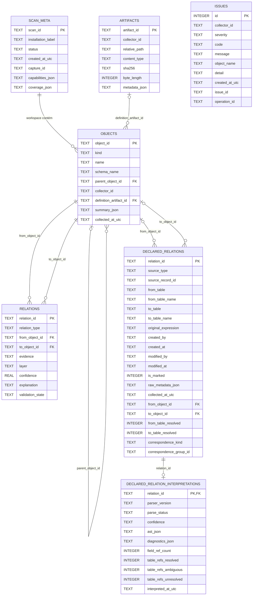
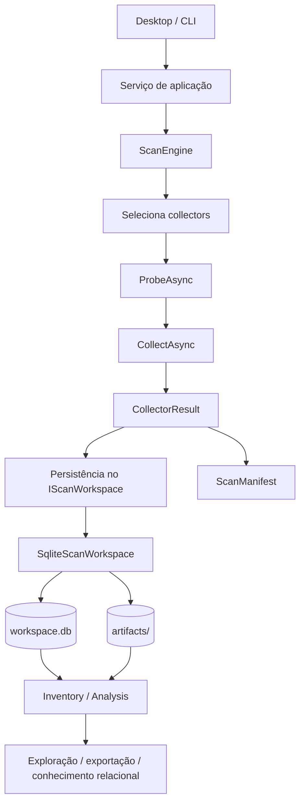

# Diagramas do projeto — modelo ER e diagrama de classes

**Data da revisão:** 2026-11-17  
**Âmbito:** dois modelos distintos: (1) ER/classes do Scanner efetivamente implementados em `PhcKnowledgeScanner/`; (2) modelo lógico conceptual da plataforma central PHC Knowledge, revisão de domínio 0.2.  
**Tipo:** documentação de arquitetura; os diagramas da plataforma são conceptuais e não representam tabelas ou classes já implementadas.

Este documento contém dois diagramas complementares:

1. **Modelo ER** — estrutura persistida no `workspace.db` SQLite.
2. **Diagrama de classes** — principais contratos e componentes de execução, desde os collectors até à aplicação e ao workspace.

> **Nota de leitura:** o modelo ER representa as relações lógicas entre registos. O schema SQLite atual não declara constraints `FOREIGN KEY` para estas ligações. As cardinalidades abaixo descrevem a semântica usada pelo código, não constraints garantidas pelo motor SQLite.

---

## 1. Diagrama entidade-relacionamento (ER)

O workspace representa uma captura/execução e agrega inventário técnico, artefactos, issues, relações derivadas e relações declaradas PHC. As interpretações das relações declaradas são persistidas separadamente dos factos originais.

### 1.1 Leitura das entidades

| Entidade | Responsabilidade |
|---|---|
| `scan_meta` | Metadados da execução/workspace. Guarda `scan_id`, `capture_id`, estado, catálogo de capabilities e coverage serializados em JSON. |
| `objects` | Inventário de objetos SQL e personalizações PHC. O `object_id` é a chave do registo dentro do workspace. |
| `artifacts` | Manifesto dos conteúdos recolhidos em ficheiros no diretório `artifacts/`; guarda hash SHA-256, tamanho e metadados. |
| `issues` | Avisos, erros e diagnósticos produzidos pelos collectors. `operation_id` e `issue_id` permitem relacionar o diagnóstico com a operação lógica. |
| `relations` | Relações derivadas entre objetos, com evidência, camada, confiança e estado de validação. |
| `declared_relations` | Factos de relações declaradas PHC provenientes de REL/DTL. Mantêm a expressão original e o estado de resolução dos extremos. |
| `declared_relation_interpretations` | Resultado da análise de uma expressão declarada: AST, estado, confiança, diagnósticos e métricas de referências. |

### 1.2 Relações e cuidados de interpretação

- Um objeto pode apontar para outro objeto como pai através de `parent_object_id` (relação recursiva).
- Um objeto pode referenciar o artefacto que contém a sua definição através de `definition_artifact_id`.
- Uma relação derivada liga dois objetos por `from_object_id` e `to_object_id`. O tipo e a evidência explicam a natureza dessa ligação.
- Uma relação declarada pode ter os extremos resolvidos para objetos do inventário; os IDs são opcionais porque a resolução pode ser ambígua ou inexistente.
- Uma interpretação referencia a relação declarada por `relation_id), mantendo o facto original independente do resultado do parser.
- `capabilities_json` e `coverage_json` são documentos JSON embutidos em `scan_meta`, não tabelas relacionais autónomas.
- `collector_id` identifica a origem operacional, mas não existe uma tabela `collectors` no workspace.
- `issues.collector_id` e `issues.operation_id` são referências informativas; não são foreign keys para tabelas de catálogo.

---

## 2. Diagrama de classes

O diagrama seguinte mostra o caminho principal de execução e consulta. Foram incluídos contratos e classes que estruturam o fluxo; não representa todos os collectors concretos, DTOs de interface ou classes auxiliares.

### 2.1 Responsabilidades por camada

| Camada | Componentes centrais | Responsabilidade |
|---|---|---|
| Abstractions | `ICollector`, `ScanContext`, `CollectorResult`, `IScanWorkspace`, records | Contratos partilhados e modelos de dados. |
| Collectors | Implementações de `ICollector` para SQL Server e PHC | Recolha read-only, emissão de objetos, artefactos, issues e coverage. |
| Engine | `ScanEngine` | Seleção, probe, execução dos collectors, agregação de resultados e manifesto. |
| Workspace | `SqliteScanWorkspace` | Persistência SQLite e ficheiros de artefactos; abertura de workspaces existentes, incluindo modo read-only. |
| Analysis | `RelationalKnowledgeProjector` e serviços de interpretação | Projeção de evidência relacional e interpretação de relações declaradas, sem confundir factos com inferências. |
| Application | serviços de scan, inventário, sessão e exportação | Orquestração de casos de uso consumidos pela interface. |
| Desktop / CLI | aplicações de entrada | Interfaces de utilização; não detalhadas neste diagrama de classes. |

### 2.2 Fluxo principal de execução

---

## 3. O que estes diagramas não representam

- **Atualização 2026-11-10:** o Object Index IKP 0.1 está implementado no projector/exporter; `SourceIdentity`, `MetadataFingerprint`, estados individuais de definição e `operationId` são projetados no pacote, não devem ser confundidos com colunas já persistidas no `TechnicalObjectRecord` do workspace SQLite. A validação real cobriu 8/21 kinds presentes na captura `CSDefault202603`.
- A identidade lógica multi-captura e a linhagem da plataforma. O workspace atual representa uma captura e não mantém histórico de entidades entre instalações/capturas.
- As tabelas internas da base de dados PHC de origem. O ER é do workspace SQLite do Scanner, não do ERP PHC.
- Todas as classes concretas, componentes visuais, configurações de DI, DTOs ou detalhes internos dos collectors.
- Constraints relacionais impostas pela base de dados: as ligações assinaladas são referências lógicas inferidas dos campos e dos métodos de leitura/escrita atuais.

## 4. Fontes de implementação consultadas

- `PhcKnowledgeScanner/src/PhcKnowledgeScanner.Workspace/SqliteScanWorkspace.cs` — schema SQLite e persistência.
- `PhcKnowledgeScanner/src/PhcKnowledgeScanner.Abstractions/Workspace/IScanWorkspace.cs` — contrato do workspace.
- `PhcKnowledgeScanner/src/PhcKnowledgeScanner.Abstractions/Collectors/ICollector.cs`, `ScanContext.cs`, `CollectorResult.cs` — contrato de recolha.
- `PhcKnowledgeScanner/src/PhcKnowledgeScanner/Engine/ScanEngine.cs` — orquestração (o caminho exato no repositório é `PhcKnowledgeScanner/src/PhcKnowledgeScanner.Engine/ScanEngine.cs`).
- Records em `PhcKnowledgeScanner/src/PhcKnowledgeScanner.Abstractions/Inventory/`, `Coverage/` e `Manifest/`.
- Serviços em `PhcKnowledgeScanner/src/PhcKnowledgeScanner.Application/Services/`.
- `PhcKnowledgeScanner/src/PhcKnowledgeScanner.Analysis/Knowledge/RelationalKnowledgeProjector.cs` e respetivo contrato.

**Validação:** diagramas elaborados por inspeção estática do código atual. Não foram alterados código, schema SQLite, collectors ou dados de captura. Não foi executado build/teste nesta tarefa.

## Atualização de estado — 2026-11-10

Este diagrama descreve principalmente o workspace e os contratos do Scanner, não o modelo físico da futura plataforma central. O Object Index e o exportador IKP 0.1 já estão implementados no Scanner; o PHC Knowledge ainda não tem modelo relacional/API próprios em `src/`. Não interpretar as entidades conceptuais deste documento como tabelas já criadas na base central. A próxima implementação da plataforma é Receive / Validate / Archive.

---

## 5. Modelo lógico da plataforma central — domínio 0.2

Esta secção é independente do ER SQLite apresentado na secção 1 e do diagrama de classes do Scanner apresentado na secção 2. Representa o modelo lógico proposto para a futura plataforma central PHC Knowledge.

**Não é o schema físico SQL Server Express nem descreve código já existente.** As cardinalidades e constraints são regras conceptuais a transformar em desenho relacional e testes antes da implementação.

### 5.1 Diagrama ER conceptual

```mermaid
erDiagram
    ORGANIZATION ||--o{ INSTALLATION : owns
    INSTALLATION ||--o{ ENVIRONMENT : contains
    ENVIRONMENT ||--o{ DATABASE_LOCATION : has_history

    CAPTURE ||--o{ PACKAGE_RECEIPT : received_as
    PACKAGE_RECEIPT ||--o{ PACKAGE_ARTIFACT : contains
    CAPTURE ||--o{ CAPTURE_CONTEXT_ASSIGNMENT : context_history
    DATABASE_LOCATION ||--o{ CAPTURE_CONTEXT_ASSIGNMENT : assigned_to
    CAPTURE ||--o{ CAPTURE_ASSOCIATION_CANDIDATE : suggests

    CAPTURE ||--o{ OBSERVATION : observes
    OBSERVATION ||--o{ OBSERVATION_ARTIFACT : supported_by
    PACKAGE_ARTIFACT ||--o{ OBSERVATION_ARTIFACT : referenced_by

    INSTALLATION ||--o{ ENTITY_IDENTITY : owns
    OBSERVATION ||--o{ IDENTITY_MATCH : evaluated_by
    ENTITY_IDENTITY ||--o{ IDENTITY_MATCH : candidate_identity
    ENTITY_IDENTITY ||--o{ IDENTITY_ENVIRONMENT_STATE : state_in
    ENVIRONMENT ||--o{ IDENTITY_ENVIRONMENT_STATE : tracks
    ENTITY_IDENTITY ||--o{ ENTITY_IDENTITY_LIFECYCLE_EVENT : lifecycle

    CAPTURE ||--o{ DECLARED_RELATION : declares
    DECLARED_RELATION ||--o{ RELATION_INTERPRETATION : interpreted_as

    STANDARD_CATALOG ||--o{ CATALOG_VERSION : versions
    CATALOG_VERSION ||--o{ CATALOG_ENTRY_VERSION : contains
    CATALOG_ENTRY ||--o{ CATALOG_ENTRY_VERSION : versioned_as

    ORGANIZATION ||--o{ ORGANIZATION_KNOWLEDGE_ENTRY : owns_private
    ORGANIZATION_KNOWLEDGE_ENTRY ||--o{ ORGANIZATION_KNOWLEDGE_VERSION : versions

    INSTALLATION ||--o{ INSTALLATION_LINEAGE_EVENT : source_or_target

    ORGANIZATION {
        uniqueidentifier OrganizationId PK
        string Name
        string Status
    }
    INSTALLATION {
        uniqueidentifier InstallationId PK
        uniqueidentifier OrganizationId FK
        string Name
        string Status
    }
    ENVIRONMENT {
        uniqueidentifier EnvironmentId PK
        uniqueidentifier InstallationId FK
        string Name
        string EnvironmentType
    }
    DATABASE_LOCATION {
        uniqueidentifier DatabaseLocationId PK
        uniqueidentifier EnvironmentId FK
        string ServerName
        string DatabaseName
        datetime2 ActiveFrom
        datetime2 ActiveTo
    }
    CAPTURE {
        uniqueidentifier CaptureId PK
        datetime2 CapturedAtUtc
        string SourceVersion
    }
    PACKAGE_RECEIPT {
        uniqueidentifier PackageReceiptId PK
        uniqueidentifier CaptureId FK
        string PackageId
        string ZipSha256
        datetime2 ReceivedAtUtc
        string ValidationStatus
    }
    PACKAGE_ARTIFACT {
        uniqueidentifier PackageArtifactId PK
        uniqueidentifier PackageReceiptId FK
        string RelativePath
        string Sha256
        bigint ByteLength
    }
    CAPTURE_CONTEXT_ASSIGNMENT {
        uniqueidentifier AssignmentId PK
        uniqueidentifier CaptureId FK
        uniqueidentifier DatabaseLocationId FK
        string Status
        datetime2 AssignedAtUtc
        string Reason
    }
    CAPTURE_ASSOCIATION_CANDIDATE {
        uniqueidentifier CandidateId PK
        uniqueidentifier CaptureId FK
        uniqueidentifier DatabaseLocationId FK
        string Evidence
        string Status
    }
    OBSERVATION {
        uniqueidentifier ObservationId PK
        uniqueidentifier CaptureId FK
        string SourceObjectId
        string ObjectKind
        string DefinitionFingerprint
        string MetadataFingerprint
    }
    OBSERVATION_ARTIFACT {
        uniqueidentifier ObservationId FK
        uniqueidentifier PackageArtifactId FK
        string ArtifactRole
    }
    ENTITY_IDENTITY {
        uniqueidentifier EntityIdentityId PK
        uniqueidentifier InstallationId FK
        string Status
    }
    IDENTITY_MATCH {
        uniqueidentifier IdentityMatchId PK
        uniqueidentifier ObservationId FK
        uniqueidentifier EntityIdentityId FK
        string Status
        string Evidence
        datetime2 DecidedAtUtc
    }
    IDENTITY_ENVIRONMENT_STATE {
        uniqueidentifier EntityIdentityId FK
        uniqueidentifier EnvironmentId FK
        string State
        datetime2 EvaluatedAtUtc
    }
    ENTITY_IDENTITY_LIFECYCLE_EVENT {
        uniqueidentifier EventId PK
        uniqueidentifier EntityIdentityId FK
        string EventType
        datetime2 OccurredAtUtc
        string Evidence
    }
    DECLARED_RELATION {
        uniqueidentifier DeclaredRelationId PK
        uniqueidentifier CaptureId FK
        string SourceRecordId
        string OriginalExpression
        string RawMetadata
    }
    RELATION_INTERPRETATION {
        uniqueidentifier InterpretationId PK
        uniqueidentifier DeclaredRelationId FK
        string ParserVersion
        string ParseStatus
        string Ast
        string Diagnostics
    }
    STANDARD_CATALOG {
        uniqueidentifier StandardCatalogId PK
        string Name
    }
    CATALOG_VERSION {
        uniqueidentifier CatalogVersionId PK
        uniqueidentifier StandardCatalogId FK
        string Version
        string Status
    }
    CATALOG_ENTRY {
        uniqueidentifier CatalogEntryId PK
        string EntryKey
        string EntryType
    }
    CATALOG_ENTRY_VERSION {
        uniqueidentifier CatalogEntryVersionId PK
        uniqueidentifier CatalogVersionId FK
        uniqueidentifier CatalogEntryId FK
        string Content
    }
    ORGANIZATION_KNOWLEDGE_ENTRY {
        uniqueidentifier OrganizationKnowledgeEntryId PK
        uniqueidentifier OrganizationId FK
        string EntryType
        string Status
    }
    ORGANIZATION_KNOWLEDGE_VERSION {
        uniqueidentifier OrganizationKnowledgeVersionId PK
        uniqueidentifier OrganizationKnowledgeEntryId FK
        string Content
        datetime2 CreatedAtUtc
    }
    INSTALLATION_LINEAGE_EVENT {
        uniqueidentifier LineageEventId PK
        uniqueidentifier SourceInstallationId FK
        uniqueidentifier TargetInstallationId FK
        string EventType
        string ConfirmationStatus
        datetime2 OccurredAtUtc
    }
```

**Restrições conceptuais relevantes (a concretizar em SQL Server):**

- `UNIQUE(CaptureId, SourceObjectId)` em Observation.
- `PackageId` identifica univocamente a receção lógica do pacote; reuso com checksum diferente é conflito de integridade.
- Uma Capture pode ter várias atribuições históricas, mas apenas uma ativa.
- Uma Observation pode ter vários IdentityMatch candidatos, mas no máximo um confirmado e ativo.
- `UNIQUE(EntityIdentityId, EnvironmentId)` em IdentityEnvironmentState.
- `UNIQUE(CatalogVersionId, CatalogEntryId)` em CatalogEntryVersion.
- Índices únicos filtrados são uma opção de implementação SQL Server para garantir unicidade de registos ativos; o desenho físico ainda não está fechado.
- DeclaredRelation não usa SourceObjectId isolado como chave: uma captura pode conter várias ocorrências de relações declaradas.
- A relação InstallationLineageEvent → Installation representa papel de origem/destino; no desenho físico deverá ser explicitada por duas FKs distintas.

### 5.2 Diagrama de classes conceptual da plataforma

```mermaid
classDiagram
    direction TB

    class Organization {
      +OrganizationId
      +Name
      +Status
    }
    class Installation {
      +InstallationId
      +OrganizationId
      +Name
      +Status
    }
    class Environment {
      +EnvironmentId
      +InstallationId
      +EnvironmentType
    }
    class DatabaseLocation {
      +DatabaseLocationId
      +EnvironmentId
      +ServerName?
      +DatabaseName
      +ActiveFrom
      +ActiveTo?
    }
    class Capture {
      +CaptureId
      +CapturedAtUtc
      +SourceVersion
    }
    class PackageReceipt {
      +PackageReceiptId
      +PackageId
      +ZipSha256
      +ReceivedAtUtc
      +ValidationStatus
    }
    class Observation {
      +ObservationId
      +CaptureId
      +SourceObjectId
      +ObjectKind
      +DefinitionFingerprint
      +MetadataFingerprint
    }
    class EntityIdentity {
      +EntityIdentityId
      +InstallationId
      +Status
    }
    class IdentityMatch {
      +IdentityMatchId
      +ObservationId
      +EntityIdentityId?
      +Status
      +Evidence
      +Decide()
      +Reject()
    }
    class IdentityEnvironmentState {
      +EntityIdentityId
      +EnvironmentId
      +State
      +EvaluatedAtUtc
    }
    class CaptureContextAssignment {
      +AssignmentId
      +CaptureId
      +DatabaseLocationId
      +Status
      +Reason
      +Confirm()
      +Revoke()
    }
    class CaptureAssociationCandidate {
      +CandidateId
      +CaptureId
      +DatabaseLocationId?
      +Evidence
      +Status
    }
    class PackageArtifact {
      +PackageArtifactId
      +PackageReceiptId
      +RelativePath
      +Sha256
    }
    class ObservationArtifact {
      +ObservationId
      +PackageArtifactId
      +ArtifactRole
    }
    class DeclaredRelation {
      +DeclaredRelationId
      +CaptureId
      +SourceRecordId
      +OriginalExpression
    }
    class RelationInterpretation {
      +InterpretationId
      +ParserVersion
      +ParseStatus
      +Ast
      +Diagnostics
    }
    class EntityIdentityLifecycleEvent {
      +EventId
      +EntityIdentityId
      +EventType
      +OccurredAtUtc
    }
    class InstallationLineageEvent {
      +LineageEventId
      +SourceInstallationId
      +TargetInstallationId
      +EventType
      +ConfirmationStatus
    }
    class StandardCatalog {
      +StandardCatalogId
      +PublishVersion()
    }
    class CatalogVersion {
      +CatalogVersionId
      +Version
      +Status
    }
    class CatalogEntry {
      +CatalogEntryId
      +EntryKey
      +EntryType
    }
    class CatalogEntryVersion {
      +CatalogEntryVersionId
      +Content
    }
    class OrganizationKnowledgeEntry {
      +OrganizationKnowledgeEntryId
      +OrganizationId
      +Status
    }
    class OrganizationKnowledgeVersion {
      +OrganizationKnowledgeVersionId
      +Content
    }

    class PackageIngestionService {
      +ReceiveAsync()
      +ValidateAsync()
      +ArchiveAsync()
    }
    class ObservationMaterializationService {
      +MaterializeAsync(captureId)
    }
    class ContextAssignmentService {
      +SuggestAsync(captureId)
      +AssignAsync(captureId, databaseLocationId)
      +CorrectAsync(assignmentId, reason)
    }
    class IdentityResolutionService {
      +FindCandidatesAsync(observationId)
      +ConfirmMatchAsync(matchId)
      +RejectMatchAsync(matchId)
    }
    class ContextReevaluationService {
      +ReevaluateAffectedAsync(assignmentId)
    }
    class HistoricalComparisonService {
      +CompareAsync(captureId)
    }
    class CatalogCurationService {
      +ProposeAsync()
      +ReviewAsync()
      +PublishVersionAsync()
    }
    class KnowledgeRetrievalService {
      +SearchAsync(query, context)
      +RetrieveEvidenceAsync()
    }

    Organization "1" --> "many" Installation
    Installation "1" --> "many" Environment
    Environment "1" --> "many" DatabaseLocation
    Capture "1" --> "many" PackageReceipt
    Capture "1" --> "many" Observation
    Capture "1" --> "many" CaptureContextAssignment
    DatabaseLocation "1" --> "many" CaptureContextAssignment
    Capture "1" --> "many" CaptureAssociationCandidate
    PackageReceipt "1" --> "many" PackageArtifact
    Observation "1" --> "many" ObservationArtifact
    PackageArtifact "1" --> "many" ObservationArtifact
    Installation "1" --> "many" EntityIdentity
    Observation "1" --> "many" IdentityMatch
    EntityIdentity "1" --> "many" IdentityMatch
    EntityIdentity "1" --> "many" IdentityEnvironmentState
    Environment "1" --> "many" IdentityEnvironmentState
    EntityIdentity "1" --> "many" EntityIdentityLifecycleEvent
    Capture "1" --> "many" DeclaredRelation
    DeclaredRelation "1" --> "many" RelationInterpretation
    StandardCatalog "1" --> "many" CatalogVersion
    CatalogVersion "1" --> "many" CatalogEntryVersion
    CatalogEntry "1" --> "many" CatalogEntryVersion
    Organization "1" --> "many" OrganizationKnowledgeEntry
    OrganizationKnowledgeEntry "1" --> "many" OrganizationKnowledgeVersion
    InstallationLineageEvent ..> Installation : source and target

    PackageIngestionService ..> Capture
    PackageIngestionService ..> PackageReceipt
    ObservationMaterializationService ..> Observation
    ContextAssignmentService ..> CaptureContextAssignment
    ContextAssignmentService ..> CaptureAssociationCandidate
    IdentityResolutionService ..> IdentityMatch
    IdentityResolutionService ..> EntityIdentity
    ContextReevaluationService ..> IdentityMatch
    ContextReevaluationService ..> HistoricalComparisonService
    CatalogCurationService ..> StandardCatalog
    CatalogCurationService ..> OrganizationKnowledgeEntry
    KnowledgeRetrievalService ..> Observation
    KnowledgeRetrievalService ..> EntityIdentity
    KnowledgeRetrievalService ..> CatalogEntryVersion
    KnowledgeRetrievalService ..> OrganizationKnowledgeVersion
```

### 5.3 Regras de leitura do modelo da plataforma

1. **Receção não é associação:** PackageReceipt/Capture podem existir sem Organization, Installation ou Environment atribuídos.
2. **Observation não é identidade:** Observation é materializada a partir do Object Index e pode permanecer sem EntityIdentity.
3. **Contexto é corrigível com histórico:** CaptureContextAssignment é versionado por decisões; uma correção não reescreve o pacote nem a Observation.
4. **Identidade pertence à Installation:** uma EntityIdentity pode ser reconhecida em vários Environments da mesma Installation após confirmação, mas não é fundida automaticamente entre Installations.
5. **Ausência não é remoção:** IdentityEnvironmentState só pode chegar a Removed com contexto, compatibilidade e coverage adequados.
6. **Facto não é interpretação:** DeclaredRelation preserva REL/DTL; RelationInterpretation preserva a leitura versionada.
7. **Standard não é privado:** catálogo standard é publicado centralmente; conhecimento privado pertence à Organization.
8. **RAG é consumidor futuro:** KnowledgeRetrievalService representa uma fronteira conceptual de consulta; não implica motor RAG, embeddings ou vector store nesta fase.

### 5.4 Limites e decisões ainda reservadas

O diagrama não fecha:
- estados exatos e transições de CaptureContextAssignment;
- regra de unicidade física de DatabaseLocation quando ServerName é desconhecido;
- colunas de auditoria, concurrency tokens e política de retenção;
- desenho append-only de eventos ambientais;
- estratégia de reavaliação incremental;
- permissões detalhadas e workflow de curadoria;
- índices, tipos SQL, particionamento, storage de ZIPs ou ORM.

Estes pontos são obrigatórios no desenho lógico/físico antes de criar o schema central SQL Server Express.
