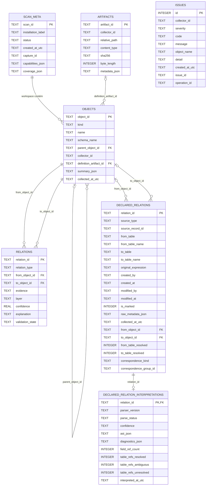
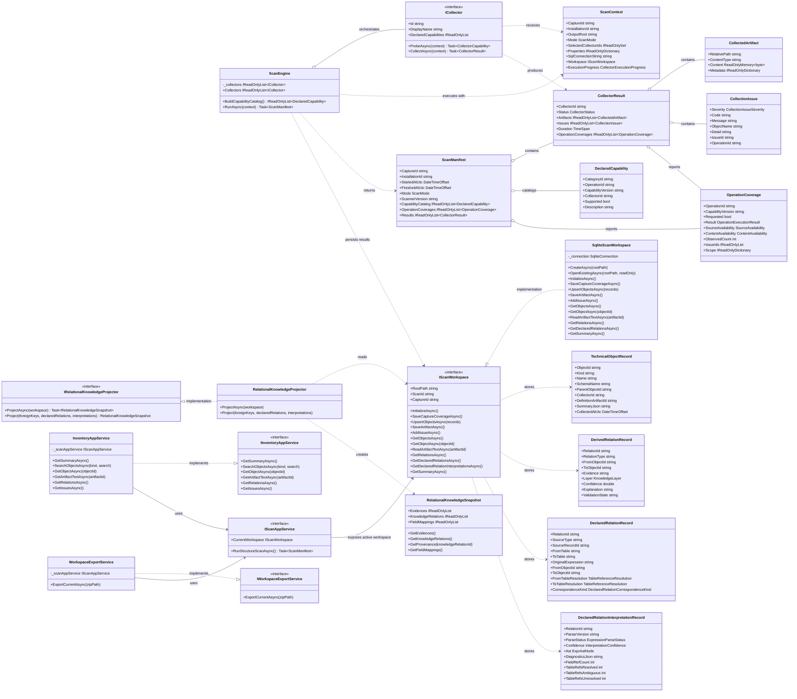
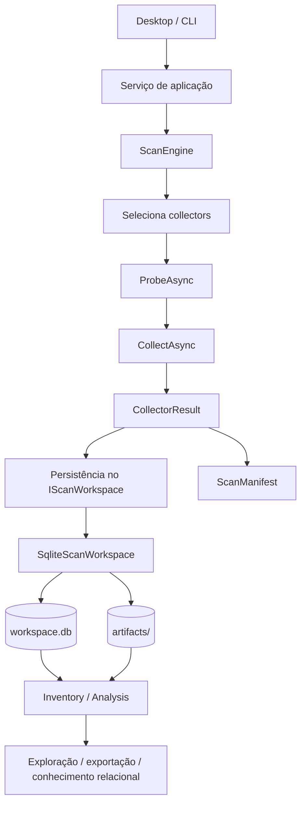
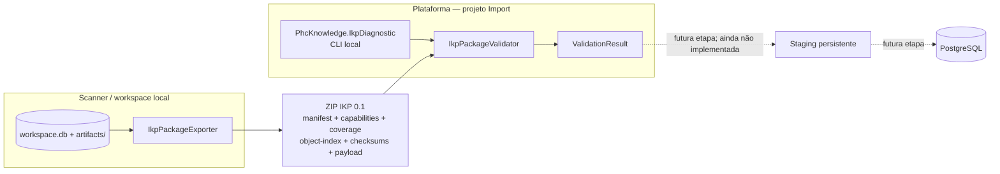
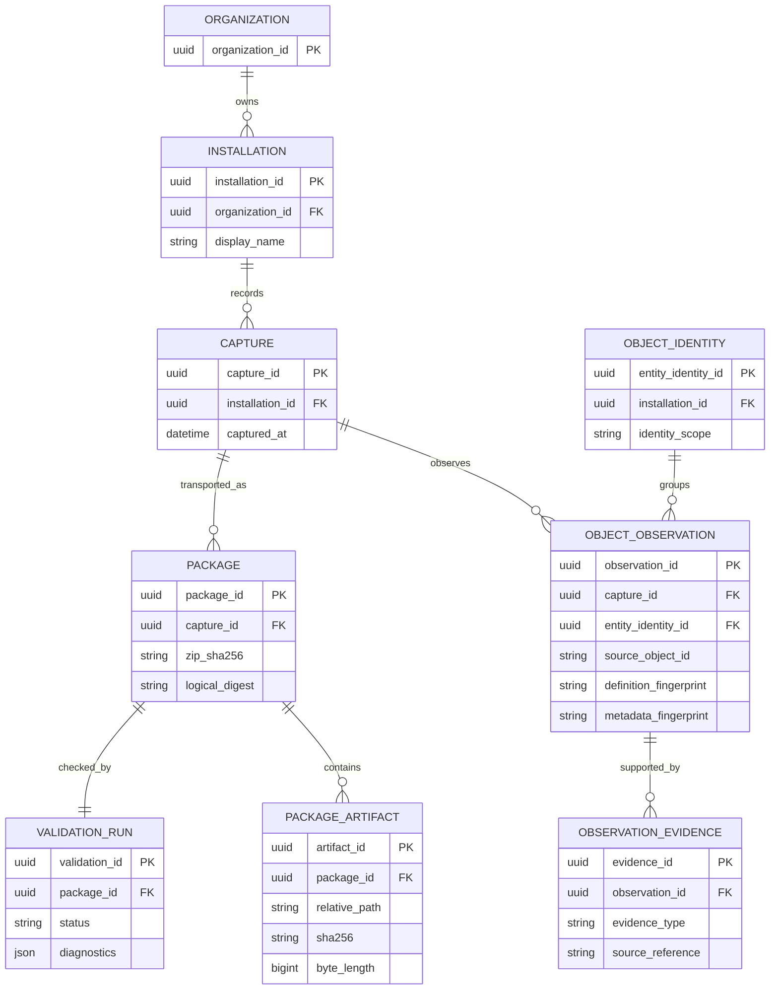
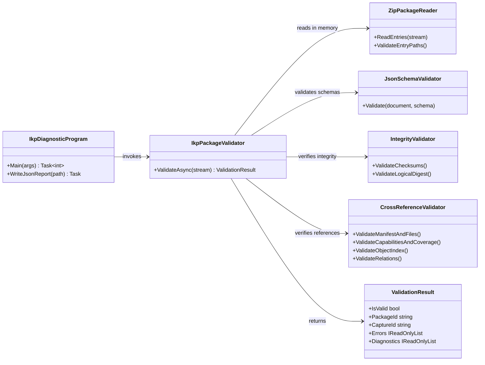

# Diagramas do projeto — modelo ER e diagrama de classes

**Data:** 2026-11-06  
**Âmbito:** estado atual do código em `PhcKnowledgeScanner/`  
**Tipo:** documentação de arquitetura derivada da implementação existente

Este documento contém dois diagramas complementares:

1. **Modelo ER** — estrutura persistida no `workspace.db` SQLite.
2. **Diagrama de classes** — principais contratos e componentes de execução, desde os collectors até à aplicação e ao workspace.

> **Nota de leitura:** o modelo ER representa as relações lógicas entre registos. O schema SQLite atual não declara constraints `FOREIGN KEY` para estas ligações. As cardinalidades abaixo descrevem a semântica usada pelo código, não constraints garantidas pelo motor SQLite.

---

## 1. Diagrama entidade-relacionamento (ER)

O workspace representa uma captura/execução e agrega inventário técnico, artefactos, issues, relações derivadas e relações declaradas PHC. As interpretações das relações declaradas são persistidas separadamente dos factos originais.

### 1.1 Leitura das entidades

| Entidade | Responsabilidade |
|---|---|
| `scan_meta` | Metadados da execução/workspace. Guarda `scan_id`, `capture_id`, estado, catálogo de capabilities e coverage serializados em JSON. |
| `objects` | Inventário de objetos SQL e personalizações PHC. O `object_id` é a chave do registo dentro do workspace. |
| `artifacts` | Manifesto dos conteúdos recolhidos em ficheiros no diretório `artifacts/`; guarda hash SHA-256, tamanho e metadados. |
| `issues` | Avisos, erros e diagnósticos produzidos pelos collectors. `operation_id` e `issue_id` permitem relacionar o diagnóstico com a operação lógica. |
| `relations` | Relações derivadas entre objetos, com evidência, camada, confiança e estado de validação. |
| `declared_relations` | Factos de relações declaradas PHC provenientes de REL/DTL. Mantêm a expressão original e o estado de resolução dos extremos. |
| `declared_relation_interpretations` | Resultado da análise de uma expressão declarada: AST, estado, confiança, diagnósticos e métricas de referências. |

### 1.2 Relações e cuidados de interpretação

- Um objeto pode apontar para outro objeto como pai através de `parent_object_id` (relação recursiva).
- Um objeto pode referenciar o artefacto que contém a sua definição através de `definition_artifact_id`.
- Uma relação derivada liga dois objetos por `from_object_id` e `to_object_id`. O tipo e a evidência explicam a natureza dessa ligação.
- Uma relação declarada pode ter os extremos resolvidos para objetos do inventário; os IDs são opcionais porque a resolução pode ser ambígua ou inexistente.
- Uma interpretação referencia a relação declarada por `relation_id), mantendo o facto original independente do resultado do parser.
- `capabilities_json` e `coverage_json` são documentos JSON embutidos em `scan_meta`, não tabelas relacionais autónomas.
- `collector_id` identifica a origem operacional, mas não existe uma tabela `collectors` no workspace.
- `issues.collector_id` e `issues.operation_id` são referências informativas; não são foreign keys para tabelas de catálogo.

---

## 2. Diagrama de classes

O diagrama seguinte mostra o caminho principal de execução e consulta. Foram incluídos contratos e classes que estruturam o fluxo; não representa todos os collectors concretos, DTOs de interface ou classes auxiliares.

### 2.1 Responsabilidades por camada

| Camada | Componentes centrais | Responsabilidade |
|---|---|---|
| Abstractions | `ICollector`, `ScanContext`, `CollectorResult`, `IScanWorkspace`, records | Contratos partilhados e modelos de dados. |
| Collectors | Implementações de `ICollector` para SQL Server e PHC | Recolha read-only, emissão de objetos, artefactos, issues e coverage. |
| Engine | `ScanEngine` | Seleção, probe, execução dos collectors, agregação de resultados e manifesto. |
| Workspace | `SqliteScanWorkspace` | Persistência SQLite e ficheiros de artefactos; abertura de workspaces existentes, incluindo modo read-only. |
| Analysis | `RelationalKnowledgeProjector` e serviços de interpretação | Projeção de evidência relacional e interpretação de relações declaradas, sem confundir factos com inferências. |
| Application | serviços de scan, inventário, sessão e exportação | Orquestração de casos de uso consumidos pela interface. |
| Desktop / CLI | aplicações de entrada | Interfaces de utilização; não detalhadas neste diagrama de classes. |

### 2.2 Fluxo principal de execução

---

## 3. O que estes diagramas não representam

- O **object-index IKP 0.1** ainda em desenho/validação. Não se deve interpretar `TechnicalObjectRecord` como se já contivesse `SourceIdentity`, `MetadataFingerprint`, `DefinitionStatus` ou `operationId` ao nível do objeto.
- A identidade lógica multi-captura e a linhagem da plataforma. O workspace atual representa uma captura e não mantém histórico de entidades entre instalações/capturas.
- As tabelas internas da base de dados PHC de origem. O ER é do workspace SQLite do Scanner, não do ERP PHC.
- Todas as classes concretas, componentes visuais, configurações de DI, DTOs ou detalhes internos dos collectors.
- Constraints relacionais impostas pela base de dados: as ligações assinaladas são referências lógicas inferidas dos campos e dos métodos de leitura/escrita atuais.

## 4. Fontes de implementação consultadas

- `PhcKnowledgeScanner/src/PhcKnowledgeScanner.Workspace/SqliteScanWorkspace.cs` — schema SQLite e persistência.
- `PhcKnowledgeScanner/src/PhcKnowledgeScanner.Abstractions/Workspace/IScanWorkspace.cs` — contrato do workspace.
- `PhcKnowledgeScanner/src/PhcKnowledgeScanner.Abstractions/Collectors/ICollector.cs`, `ScanContext.cs`, `CollectorResult.cs` — contrato de recolha.
- `PhcKnowledgeScanner/src/PhcKnowledgeScanner/Engine/ScanEngine.cs` — orquestração (o caminho exato no repositório é `PhcKnowledgeScanner/src/PhcKnowledgeScanner.Engine/ScanEngine.cs`).
- Records em `PhcKnowledgeScanner/src/PhcKnowledgeScanner.Abstractions/Inventory/`, `Coverage/` e `Manifest/`.
- Serviços em `PhcKnowledgeScanner/src/PhcKnowledgeScanner.Application/Services/`.
- `PhcKnowledgeScanner/src/PhcKnowledgeScanner.Analysis/Knowledge/RelationalKnowledgeProjector.cs` e respetivo contrato.

**Validação:** diagramas elaborados por inspeção estática do código atual. Não foram alterados código, schema SQLite, collectors ou dados de captura. Não foi executado build/teste nesta tarefa.

---

## 5. Extensão arquitetural — pipeline IKP e importação (2026-11-08)

A secção original descreve o modelo persistido do **workspace SQLite do Scanner** e as classes do Scanner. Não deve ser interpretada como modelo de dados da plataforma central. Esta extensão acrescenta a fronteira de transporte/importação já implementada e distingue-a explicitamente do staging ainda não construído.

### 5.1 Modelo lógico do pacote e validação

O pacote IKP é um ZIP imutável de transporte. Os cinco documentos de raiz e os artefactos de payload são conteúdo do pacote, não tabelas SQLite nem entidades já persistidas na plataforma.

### 5.2 ER conceptual da futura plataforma — não implementado

Este diagrama é uma vista de domínio para orientar a próxima fase. **Não representa tabelas existentes nem migrações implementadas.** O PR #2 apenas valida o pacote em memória; não cria registos persistentes.

As entidades acima são **proposta conceptual**, não decisão de schema aprovada. A sequência real de implementação continua: validar pacote real → definir staging → persistir captura/pacote → associação a instalação e identidade → observações e histórico. A associação a uma instalação não deve ser inferida apenas do nome da base de dados ou de um fingerprint de origem.

### 5.3 Diagrama de classes — importação atualmente implementada

O diagrama representa responsabilidades lógicas do validador; não pretende enumerar todos os tipos internos nem afirmar que cada responsabilidade corresponde necessariamente a uma classe pública autónoma. A ferramenta de diagnóstico é um consumidor local do mesmo validador, não uma via de importação alternativa.

### 5.4 Limites atuais e invariantes

- O projeto `PhcKnowledge.Import` não referencia assemblies do Scanner.
- A validação ocorre em memória; não extrai o ZIP para o filesystem.
- Não existe ainda staging persistente, associação de instalação, ingestão PostgreSQL, identidade lógica multi-captura nem publicação de conhecimento.
- `PackageId` identifica o pacote físico; `CaptureId` identifica a captura. Não substituem `InstallationId`, que pertence à plataforma.
- `SourceObjectId` é uma referência ao objeto dentro da captura; não é identidade permanente.
- Factos REL/DTL e interpretações permanecem separados.
- A validação bem-sucedida prova conformidade estrutural e integridade do pacote; não prova que todos os collectors recolheram todos os dados possíveis da instalação.

