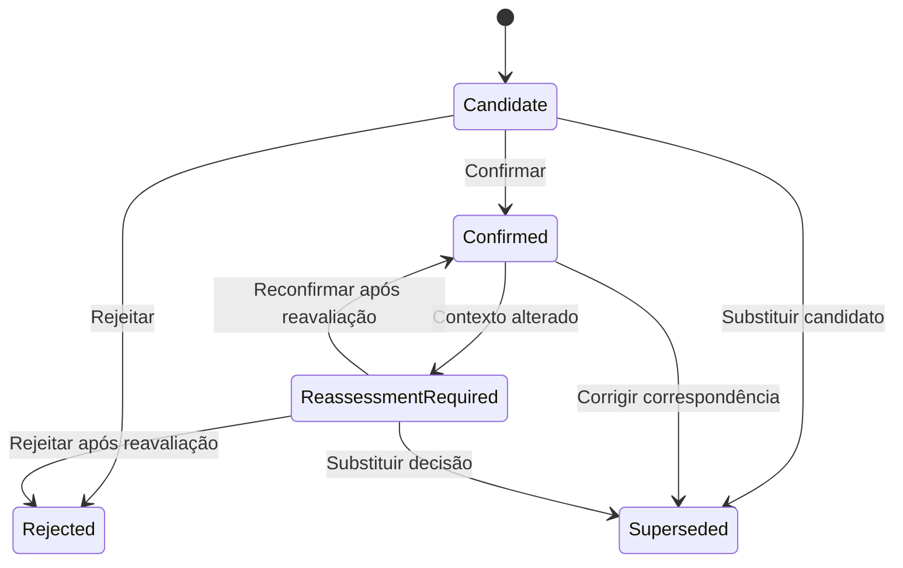
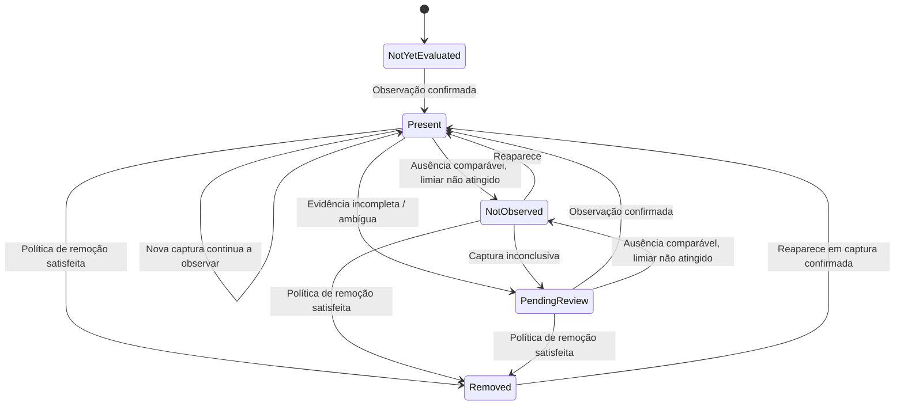

# PHC Knowledge 0.2 — Estados e transições de contexto, identidade e presença

| Campo | Valor |
|---|---|
| Data | 2026-11-17 |
| Estado | **Proposta normativa para validação funcional; ainda não é schema físico** |
| Branch | `architecture/domain-model-0.2-review` |
| Dependências | `domain-model-0.2-decisions.md`, `observation-identity-and-lineage-contract.md` |
| Persistência prevista | Microsoft SQL Server Express |

Este documento fecha uma proposta coerente de estados e transições para os três ciclos de vida que não devem ser confundidos: associação de contexto de uma Capture, correspondência de uma Observation com uma EntityIdentity e estado de presença de uma EntityIdentity num Environment.

As regras abaixo são de domínio. Não fixam ainda tabelas, colunas, ORM, índices físicos ou implementação de jobs.

## 1. Princípios invariáveis

1. A captura, o pacote, os artefactos e as Observations são evidência de origem imutável.
2. Contexto, identidade e presença são conclusões da plataforma, com autor, data, motivo e proveniência.
3. Uma correção cria uma nova decisão e preserva a anterior; não reescreve a evidência original.
4. Não se infere identidade apenas por nome, fingerprint, semelhança estrutural ou localização.
5. Não se infere remoção apenas porque uma Observation não aparece numa captura.
6. Reavaliações são versionadas e limitadas aos elementos afectados.
7. Estados atuais são projeções do histórico de decisões/eventos. O histórico não é apagado nem reutilizado para guardar o estado de outro ciclo de vida.

## 2. CaptureContextAssignment

### 2.1 Estados

A sugestão de contexto e a atribuição confirmada são conceitos distintos.

| Estado da sugestão (CaptureAssociationCandidate) | Significado |
|---|---|
| `Proposed` | Candidato sugerido automaticamente ou por utilizador, ainda não confirmado |
| `Accepted` | Aceite; a aceitação origina uma CaptureContextAssignment |
| `Rejected` | Rejeitado com motivo |
| `Expired` | Deixou de ser aplicável, por exemplo após uma atribuição diferente |

| Estado da atribuição (CaptureContextAssignment) | Significado |
|---|---|
| `Active` | Decisão atualmente válida para a Capture |
| `Superseded` | Substituída por uma nova atribuição |
| `Revoked` | Retirada sem atribuição substituta |

Uma Capture sem atribuição ativa está **Unassigned** por ausência de atribuição ativa; não é necessário criar uma atribuição artificial com estado Pending.

### 2.2 Transições permitidas

```mermaid
stateDiagram-v2
    [*] --> Unassigned
    Unassigned --> Active: Confirmar atribuição
    Active --> Active: Corrigir (novo registo; anterior Superseded)
    Active --> Unassigned: Retirar associação (anterior Revoked)
```

O diagrama representa o estado agregado da Capture. `Superseded` e `Revoked` são estados terminais do registo de atribuição antigo; uma nova atribuição é sempre outro registo.

### 2.3 Regras de decisão

- A atribuição aponta para uma DatabaseLocation existente e, por essa via, resolve Environment, Installation e Organization.
- A confirmação exige uma ação explícita autorizada. Uma sugestão automática nunca ativa contexto por si só.
- A primeira confirmação cria uma atribuição `Active`.
- Uma correção de contexto executa atomicamente: (a) fechar a atribuição anterior como `Superseded`; (b) criar a nova atribuição `Active`; (c) registar autor, instante, motivo, evidência e referência à decisão anterior; (d) emitir um pedido de reavaliação.
- A retirada sem substituição fecha a atribuição como `Revoked`; a Capture regressa a `Unassigned`.
- Uma Capture só pode ter uma atribuição `Active`. Não se permite sobreposição temporal nem duas decisões ativas.
- Quando DatabaseName é conhecido e ServerName é desconhecido, pode ser criada uma DatabaseLocation provisória com ServerName = null, no contexto confirmado de Environment/Installation.
- Quando ServerName for posteriormente conhecido, a localização provisória é enriquecida com essa informação, preservando o histórico e a evidência da alteração; não se cria outra DatabaseLocation apenas por esta descoberta.
- A actualização exige evidência suficiente de que se trata da mesma localização lógica. Uma mudança real de servidor/localização, e não mero enriquecimento de informação, continua a ser tratada como mudança técnica distinta.
- ServerName nunca é inferido nem preenchido por aproximação.
- PackageReceipt, Capture, PackageArtifact e Observation não são alterados pela atribuição ou correção de contexto.

### 2.4 Reavaliação controlada

Cada decisão ativa deve ter uma revisão/versão de contexto identificável. As correspondências e comparações calculadas devem registar a revisão de contexto usada.

Quando o contexto muda:
1. identificar apenas as Observations, IdentityMatches, estados ambientais e comparações que dependem daquela Capture;
2. marcar resultados dependentes como necessitando reavaliação, sem apagar o resultado anterior;
3. executar novamente a resolução apenas no novo âmbito Installation/Environment;
4. preservar os resultados anteriores, a revisão de contexto antiga, a nova revisão, o autor e o motivo;
5. publicar o novo resultado como uma nova versão de avaliação.

Uma reatribuição para outra Installation invalida a utilização das correspondências anteriores nessa Installation. Não transfere nem funde EntityIdentity entre Installations. A nova Installation exige nova resolução de identidade. Uma reatribuição entre DatabaseLocations da mesma Installation também exige reavaliação, porque o Environment pode ter mudado.

Falhas ou interrupções do processo de reavaliação não revertem a decisão de contexto; deixam a reavaliação pendente/retentável e não apresentam resultados antigos como se tivessem sido calculados no novo contexto.

## 3. IdentityMatch e EntityIdentity

### 3.1 Estados de IdentityMatch

| Estado | Significado |
|---|---|
| `Candidate` | Correspondência proposta para uma EntityIdentity existente; ainda não decidida |
| `Confirmed` | Correspondência explicitamente confirmada e válida na revisão de contexto registada |
| `Rejected` | Candidato rejeitado, com motivo |
| `Superseded` | Decisão substituída por outra decisão explícita |
| `ReassessmentRequired` | A decisão anterior dependia de contexto entretanto alterado; não pode ser usada como correspondência atual até reavaliação |

### 3.2 Transições permitidas

`Rejected` e `Superseded` são terminais para aquele registo. Uma nova hipótese gera outro IdentityMatch. Uma correspondência em `ReassessmentRequired` não conta como correspondência atual confirmada.

### 3.3 Regras de confirmação

- IdentityMatch candidato aponta para uma EntityIdentity da mesma Installation que resulta do contexto confirmado da Observation.
- Não se confirma uma correspondência enquanto a Capture não tiver CaptureContextAssignment ativo.
- A confirmação exige evidência e decisão explícita; um score automático pode ordenar candidatos, mas não substitui a decisão.
- No máximo uma IdentityMatch pode estar `Confirmed` e atual por Observation.
- Se já existir uma correspondência confirmada, a substituição exige uma operação explícita que registe a decisão anterior como `Superseded` e confirme a nova, na mesma transação lógica.
- A rejeição de um candidato não cria automaticamente uma EntityIdentity.
- Criar uma nova EntityIdentity é uma decisão distinta: o utilizador autorizado declara que a Observation representa uma entidade lógica nova na Installation contextualizada. A plataforma cria a identidade e associa a Observation através de uma decisão confirmada, registando a origem da criação.
- EntityIdentity pertence a uma única Installation. A linhagem entre Installations pode sugerir candidatos, mas nunca permite confirmar uma correspondência cruzada entre Installations.
- Uma alteração de contexto coloca as correspondências dependentes em `ReassessmentRequired`; não as reatribui silenciosamente à nova Installation.
- A evidência original e todas as decisões anteriores permanecem consultáveis.

### 3.4 Identidade sem correspondência

Uma Observation sem correspondência confirmada permanece sem EntityIdentity. Pode ter zero ou vários candidatos. Não existe estado implícito `NewIdentity` e não se cria uma EntityIdentity provisória apenas para preencher uma relação.

## 4. IdentityEnvironmentState

### 4.1 Semântica dos estados

| Estado | Significado | Condição |
|---|---|---|
| `Present` | A EntityIdentity foi observada neste Environment | Existe Observation ligada por correspondência confirmada, com contexto válido |
| `NotObserved` | Uma captura comparável não observou a identidade, mas a evidência ainda não satisfaz a política de remoção | Ausência válida, abaixo do limiar de remoção |
| `PendingReview` | Não é seguro concluir presença nem ausência | Contexto, compatibilidade, coverage, identidade ou evidência são ambíguos/incompletos |
| `Removed` | A plataforma concluiu que a identidade deixou de estar presente neste Environment | Ausência confirmada segundo a política de remoção e com evidência suficiente |

A inexistência de um registo de estado significa **NotYetEvaluated**. Não é um quinto estado persistido e não equivale a NotObserved.

### 4.2 Transições permitidas

Uma captura inconclusiva não deve apagar uma conclusão `Removed` já estabelecida. O estado só regressa a `Present` perante nova observação ligada por correspondência confirmada; o evento de reaparecimento fica registado.

### 4.3 Condições para avaliar ausência

A ausência só pode ser considerada comparável quando todas as condições seguintes forem verdadeiras:

1. A Capture tem atribuição de contexto ativa e confirmada para o Environment avaliado.
2. A operação que observa o tipo de objeto é suportada e semanticamente compatível com a captura de referência.
3. A operação foi solicitada e executada com resultado `Succeeded` (ou outro resultado que uma política explícita classifique como completo; `SucceededWithWarnings` não é automaticamente completo).
4. A disponibilidade da estrutura e do conteúdo é adequada à categoria.
5. O scope da operação cobre o mesmo universo lógico relevante.
6. A Observation/EntityIdentity pode ser comparada sem ambiguidade de identidade.
7. Não existem issues que invalidem a conclusão de ausência.

Se qualquer condição falhar, o resultado é `PendingReview`, não `NotObserved` nem `Removed`.

### 4.4 Política conservadora de remoção — decisão aprovada

<badge>Decisão funcional confirmada em 2026-11-17</badge>

A plataforma exige **duas capturas consecutivas, completas e comparáveis**, ambas sem observar a EntityIdentity no mesmo Environment, para tornar uma remoção elegível. Mesmo depois de cumprido este critério, **a transição para `Removed` exige sempre confirmação humana explícita e auditada**.

- A primeira ausência comparável gera `NotObserved`.
- A segunda ausência consecutiva, também completa e comparável, torna a remoção elegível para confirmação humana; não altera automaticamente o estado para `Removed`.
- Após a segunda ausência, o estado permanece em `PendingReview` até um utilizador autorizado confirmar ou rejeitar a remoção.
- A confirmação humana regista ator, instante, motivo, evidências e as duas Captures que sustentam a decisão.
- Se a remoção for rejeitada, a identidade não passa a `Removed`; a decisão e a evidência ficam no histórico. Uma avaliação posterior pode voltar a propor a remoção se existirem novas capturas completas e comparáveis.
- Uma observação confirmada antes da decisão humana repõe `Present` e reinicia a sequência de ausências.
- Uma captura incompleta/ambígua gera `PendingReview` e não conta como ausência consecutiva.
- O limiar de duas capturas é política versionada, não constante espalhada pelo código.
- Nenhum processo automático, job ou regra de comparação pode confirmar a remoção por si só.

A decisão aprovada é, portanto: **2 ausências consecutivas completas e comparáveis + confirmação humana obrigatória sempre**.

### 4.5 Estado ambiental vs ciclo de vida global

- `Removed` significa removido daquele Environment, não eliminado globalmente.
- A mesma EntityIdentity pode continuar `Present` noutro Environment da mesma Installation.
- Desativação global da identidade é um acontecimento separado em EntityIdentityLifecycleEvent.
- A ausência em Production não implica ausência em Test/Development.
- A plataforma não elimina fisicamente EntityIdentity, Observations ou eventos históricos.

## 5. Eventos, auditoria e consistência

<badge>Decisão funcional confirmada em 2026-11-17</badge>

O modelo aprovado combina **histórico append-only de eventos** com **projeções persistentes do estado atual**. Os eventos constituem o registo histórico autoritativo das alterações relevantes; as projeções servem as consultas operacionais do portal.

### 5.1 Âmbito dos eventos

Devem gerar eventos todas as alterações relevantes de estado, decisões humanas e avaliações automáticas, incluindo resultados que não alterem o estado projetado quando sejam relevantes para auditoria, explicabilidade ou reavaliação.

Exemplos mínimos por ciclo:

| Ciclo | Eventos |
|---|---|
| Contexto | ContextAssignmentConfirmed, ContextAssignmentSuperseded, ContextAssignmentRevoked, ContextReevaluationRequested, ContextReevaluationCompleted, ContextReevaluationFailed |
| Identidade | IdentityCandidateCreated, IdentityMatchConfirmed, IdentityMatchRejected, IdentityMatchSuperseded, IdentityMatchReassessmentRequired, EntityIdentityCreated |
| Estado ambiental | EnvironmentPresenceEvaluated, EnvironmentPresenceReappeared, EnvironmentRemovalProposed, EnvironmentRemovalConfirmed, EnvironmentRemovalRejected, EnvironmentReviewRequested |

A lista é extensível; o catálogo e os payloads definitivos serão fechados no desenho físico. Eventos de avaliação devem registar também resultados inconclusivos ou sem transição de estado, quando necessários para explicar por que razão uma decisão não foi tomada.

Cada evento deve identificar entidade/ciclo, instante UTC, ator (utilizador ou processo), tipo e versão do evento, motivo, evidência, correlação e revisão de contexto/capability/política usada quando aplicável. Os eventos são imutáveis: não são editados nem eliminados por operações normais da aplicação. Correcções são representadas por novos eventos que referenciam os anteriores.

### 5.2 Projeções do estado atual

As entidades operacionais mantêm projeções persistentes do estado atual, consultadas diretamente pelo portal. As projeções não substituem nem apagam o histórico; são representações derivadas e reconstruíveis a partir dos eventos.

A reconstrução deve:
- permitir gerar novamente uma projeção a partir do histórico relevante;
- preservar a versão do projetor e das regras necessárias para reproduzir a interpretação;
- ser executável sem duplicar eventos ou produzir efeitos externos;
- permitir validar o resultado reconstruído antes de o publicar como estado operacional.

Isto **não impõe Event Sourcing integral** a todo o domínio. Captures, PackageReceipts, Observations, PackageArtifacts e outros registos de aquisição mantêm os seus próprios registos persistentes; só os ciclos de decisão/estado definidos no domínio usam o padrão de eventos e projeções conforme necessário.

### 5.3 Consistência transacional

A gravação do evento e a atualização da projeção correspondente devem ocorrer **na mesma transação SQL**. A operação confirma ambas ou nenhuma; não pode deixar um evento confirmado sem a atualização correspondente, nem uma projeção alterada sem o evento que a justifica.

As operações devem ainda respeitar as seguintes invariantes:
- não pode haver duas atribuições de contexto ativas para a mesma Capture;
- não pode haver duas correspondências confirmadas atuais para a mesma Observation;
- não pode haver dois estados atuais concorrentes para a mesma combinação EntityIdentity + Environment;
- uma confirmação de identidade tem de validar a Installation da atribuição de contexto no momento da confirmação;
- reavaliações devem ser idempotentes para a mesma revisão de contexto e versão de política.

Qualquer processamento posterior ou efeito externo deve ser desencadeado de forma fiável a partir do registo transacional, sem enfraquecer a atomicidade do evento e da projeção. Os mecanismos concretos (por exemplo, outbox, fila, jobs, retries) ficam para o desenho técnico.

## 6. Matriz de decisões para aprovação

| Tema | Proposta nesta revisão | Estado |
|---|---|---|
| Atribuição de contexto | Active / Superseded / Revoked; candidatos separados | Proposta |
| Correção de contexto | Fecho da anterior + criação da nova + reavaliação controlada | Alinhada com decisão confirmada |
| Contexto sem atribuição | Unassigned por ausência de atribuição ativa | Proposta |
| IdentityMatch | Candidate / Confirmed / Rejected / Superseded / ReassessmentRequired | Proposta |
| Criação de EntityIdentity | Ação explícita, nunca automática por ausência de match | Alinhada com decisão confirmada |
| IdentityEnvironmentState | Present / NotObserved / PendingReview / Removed; ausência de registo = NotYetEvaluated | Proposta |
| Limiar de remoção | Duas capturas consecutivas completas e comparáveis + confirmação humana obrigatória | **Aprovado em 2026-11-17** |
| Eventos | Todas as alterações relevantes, decisões e avaliações em histórico append-only; projeções reconstruíveis; evento e projeção na mesma transação SQL | **Aprovado em 2026-11-17** |
| Reavaliação | Apenas dependências afectadas, versionada e idempotente | Alinhada com decisão confirmada |

## 7. Fora do âmbito

- Schema SQL Server, nomes definitivos de tabelas/colunas e tipos SQL.
- Índices filtrados, constraints físicas, particionamento e estratégia ORM.
- UI de aprovação, permissões detalhadas e papéis administrativos.
- Algoritmo de scoring de candidatos ou matching automático.
- Implementação de jobs, filas ou SignalR.
- RAG, embeddings ou vector store.

Estes elementos só devem ser desenhados depois de aprovadas as regras funcionais desta proposta.
