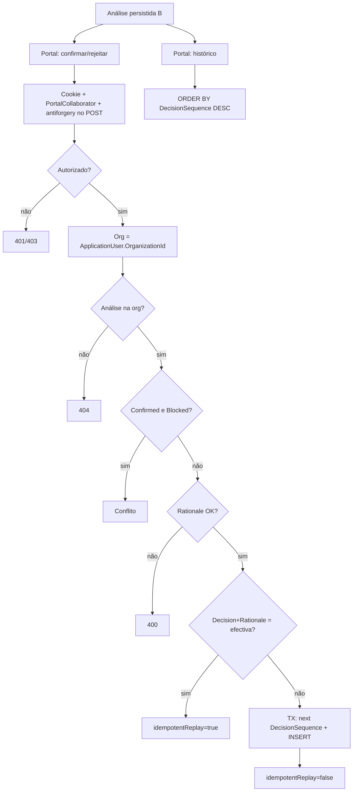
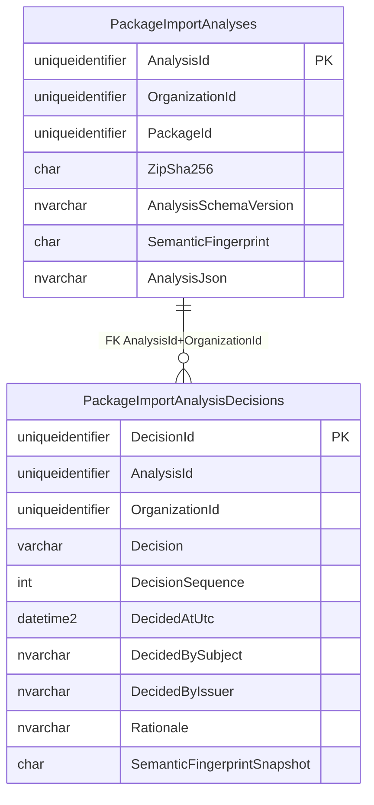

# Incremento C — Desenho técnico consolidado
## Confirmação explícita de `PackageImportAnalysis`

| Campo | Valor |
|---|---|
| Data | 2026-11-19 |
| Branch de referência | `main` (pós PR #19) |
| Estado | Desenho técnico consolidado; **não implementado** |
| Âmbito | Análise e especificação apenas |

> Este documento é a referência canónica do Incremento C. Consolida a proposta inicial revista com as decisões arquiteturais e de produto aprovadas. Não autoriza implementação até aprovação explícita da sequência de execução.

Separação obrigatória: **receção ≠ análise ≠ confirmação ≠ materialização ≠ contexto de instalação**.

**Decisão de produto (confirmação):** apenas um **utilizador humano** autenticado no Portal (ASP.NET Core Identity + cookie) e autorizado por uma **política interna** da aplicação pode confirmar ou rejeitar uma análise. Não há confirmação automática por serviços/aplicações (M2M), nem IdP externo obrigatório para esta operação, nem cliente Scanner→Knowledge para confirmação automática.

---

## 1. Estado atual confirmado e evidências

### 1.1 Factos verificados no código / publicação

| Facto | Evidência |
|---|---|
| Incrementos A+B na `main` | PR #19 — `PHC Knowledge — IKP Package Analysis (Increments A+B)`; merge `98a0b200cf99098bc37eddf754c3d0bb360ca309` |
| Análise tipada + persistência append-only | `PackageImportAnalysis`, `dbo.PackageImportAnalyses` (`004_package_import_analyses.sql`), `InsertOrGetExistingAsync` |
| Identidade física da análise | `AnalysisId` PK em `PackageImportAnalyses` |
| Identidade lógica | UNIQUE `(OrganizationId, PackageId, ZipSha256, AnalysisSchemaVersion)` |
| Resolução package-scoped actual (IKP JWT) | `IkpPackageAnalysisService` usa receipt Completed + `PackageImportAnalysisSchema.Version` |
| Superfície IKP HTTP | `POST/GET /api/v1/ikp/packages/{packageId}/analysis` com políticas JWT `IkpRead` / `IkpUpload` quando JWT activo |
| JWT IKP | Opcional; default `Authentication:Jwt:Enabled = false` no exemplo; com JWT off, rotas IKP → `503` |
| Portal Identity | `ApplicationUser` (`IdentityUser<Guid>`), cookie `PhcKnowledge.Portal`, `PortalCookiePrincipalValidator`, antiforgery |
| Roles Portal existentes | `Administrator` / `Collaborator` |
| Org do utilizador Portal | `ApplicationUser.OrganizationId` (org canónica; imutável após criação) |
| DTO público de análise | `IkpPackageAnalysisDto` **ainda não** inclui `AnalysisId` (código actual); exposição aditiva **aprovada** (§6.3) |
| Confirmação | **não existe** |
| Install | scripts `001`–`004` em `SqlScriptApplicator` / `.csproj` |
| Padrão de texto longo | `LastErrorMessage NVARCHAR(2000)` em `002_package_receipt_attempts.sql` |
| FK composta org+id | **não** usada hoje; FKs existentes são por `ReceiptId` simples |

### 1.2 Validação A+B já realizada (não reexecutada neste documento)

| Evidência | Resultado |
|---|---|
| `PhcKnowledge.Import.Tests` | **224 passed** |
| `SqlServerPackageImportAnalysisTests` | **3/3** |
| `SqlServerInstallBootstrapTests` | **9/9** |
| Migration 004 | Integrada no Install/preflight/bootstrap; BD de teste apenas |
| Build Release (estabilização pós-merge) | Sucesso, 0 erros |

Limitações de cobertura (trabalho futuro): deadlock SQL 1205 real; E2E do `SqlScriptApplicator` do Install; recuperação/rearranque do Host; suite SQL completa. Detalhe: `phase-report-ikp-package-analysis-a-2026-11-19.md`.

### 1.3 Autenticação Portal (base para C)

Factos no Host actual:

- Login: `POST /api/portal/auth/login` — email/password via Identity; cookie `PhcKnowledge.Portal`.
- Revalidação: `PortalCookiePrincipalValidator` (utilizador existe, `IsActive`, `SecurityStamp`).
- Escrita Portal: antiforgery (`X-CSRF-TOKEN` + cookie `PhcKnowledge.AntiForgery`).
- Políticas Portal: `PortalAuthenticated`, `PortalCollaborator`, `PortalAdministrator` (scheme cookie apenas).
- Identificador estável do utilizador: `ApplicationUser.Id` (`Guid`).

A superfície IKP JWT é **independente** e **não** é o mecanismo de autenticação do Incremento C.

### 1.4 Assunto separado (fora do fecho de C)

A dependência de JWT dos endpoints IKP de **upload** e **análise** (`/api/v1/ikp/…`) permanece **por decidir** como tema próprio: com JWT desligado, essas rotas respondem `503`. Este documento **não** redesenha upload, integrações externas, JWT para outras operações, Keycloak, BFF nem Scanner.

### 1.5 Dependências abertas específicas de C

Nenhuma dependência de desenho específica de C permanece aberta para estes cinco pontos. A implementação continua pendente.

Fechado: paths Portal (§6.1); policy `PortalCollaborator` (§7.1); `AnalysisId` em `IkpPackageAnalysisDto` (§6.3); body allowlist + identidade → `400` (§6.4); comprimentos SQL de identidade (§4.2); perfis iguais (§7.1); `DecidedByIssuer = phcknowledge.portal` (§7.2); idempotência Decision+Rationale (§5); leitura estado/histórico Admin|Collaborator (§7.1).

---

## 2. Decisões arquiteturais aprovadas

1. Entidade independente append-only `PackageImportAnalysisDecision`.
2. Relação `PackageImportAnalysis 1 ── * PackageImportAnalysisDecision`.
3. Sem estado de confirmação em `PackageImportAnalyses`; análise imutável.
4. Ordenação lógica por `DecisionSequence` (não por `DecidedAtUtc` / `DecisionId`).
5. Histórico ordenado por **`DecisionSequence DESC`**; a decisão efectiva é a de maior sequência.
6. Idempotência: mesma `Decision` **e** mesma `Rationale` (comparação determinística §5.4) face à efectiva → no-op; `idempotentReplay: true`.
7. Nova linha (`idempotentReplay: false`) quando muda a `Decision`, ou quando a `Decision` é igual mas a `Rationale` é diferente; elegibilidade sempre antes da idempotência.
8. Elegibilidade: `Ready` / `ReadyWithWarnings` → confirm/reject; `Blocked` → só reject; confirm de `Blocked` → conflito (`409` ou equivalente Portal).
9. `Rationale NVARCHAR(2000)`: obrigatória em `Rejected`; opcional em `Confirmed`; sem truncagem silenciosa.
10. `SemanticFingerprintSnapshot` copiado da análise persistida (nunca do cliente).
11. Sem `InstallationId` / Customer / Environment neste incremento.
12. **Autenticação humana de C:** ASP.NET Core Identity + cookie Portal + antiforgery nas escritas.
13. **Autorização de C:** reutilizar a policy existente **`PortalCollaborator`** (scheme `PortalCookie`; roles `Administrator` **ou** `Collaborator`) para escrita **e** para leitura de estado/histórico (§7.1); **não** scope OAuth `ikp.confirm` nem JWT; **não** criar policy nova salvo limitação concreta da existente.
14. `OrganizationId` só da identidade autenticada no servidor (`ApplicationUser.OrganizationId`); cross-org → inexistente (`404`); integridade SQL (FK composta).
15. Referência canónica de decisão: `AnalysisId`; exposição aditiva em `IkpPackageAnalysisDto` (§6.3); leitura interna por `AnalysisId + OrganizationId`.
16. Autor: `(DecidedByIssuer = phcknowledge.portal, DecidedBySubject = ApplicationUser.Id)`; body de escrita só `decision` + `rationale`; propriedades de identidade/proveniência → **HTTP 400** (§6.4).
17. **Confirmação exclusivamente humana.** Sem M2M, sem Client Credentials, sem `ActorType`, sem `phc_actor_type`.
18. Um único domínio/repositório de decisões; a superfície Portal **invoca** esse domínio — sem segundo mecanismo de persistência.
19. Paths HTTP canónicos Portal em §6.1; confirmação **fora** de `/api/v1/ikp/*`.
20. Fora de C: materialização, Capture/Observation, Identity Matching, RAG, UI Portal completa, Scanner, IKP schema, alteração de `AnalysisJson`/fingerprint; redesenho de upload/JWT IKP.

---

## 3. Modelo de domínio

```text
PackageImportAnalysis (imutável)
        │ 1
        │
        │ *
PackageImportAnalysisDecision (append-only)
```

### 3.1 `PackageImportAnalysisDecision`

| Campo | Significado |
|---|---|
| `DecisionId` | Identificador da linha de decisão (PK) |
| `AnalysisId` | Análise concreta confirmada/rejeitada |
| `OrganizationId` | Organização do utilizador autenticado (deve coincidir com a da análise) |
| `Decision` | `Confirmed` \| `Rejected` |
| `DecisionSequence` | Sequência monotónica por `AnalysisId` (1, 2, 3, …); **ordem lógica** |
| `DecidedAtUtc` | Instantâneo UTC produzido pelo **servidor** |
| `DecidedBySubject` | `ApplicationUser.Id` em formato GUID `D` (`NVARCHAR(36)`) |
| `DecidedByIssuer` | Constante estável **`phcknowledge.portal`** (`NVARCHAR(64)`; origem Portal; não configurável por pedido; não IdP) |
| `Rationale` | Justificação; `NVARCHAR(2000)`; obrigatória se `Rejected` |
| `SemanticFingerprintSnapshot` | Cópia do fingerprint da análise no momento da decisão |

Não usar email nem `DisplayName` como identificador de auditoria.
Não FK obrigatória para `AspNetUsers` (o histórico permanece legível se o utilizador for desactivado/removido).
Não existem `ActorType` nem campos de identidade fornecidos pelo cliente.

### 3.2 Estado efectivo e histórico

- Sem decisões ⇒ estado lógico `Unconfirmed` (não persistido).
- Com decisões ⇒ maior `DecisionSequence` para esse `AnalysisId`.
- Histórico: **`DecisionSequence DESC`**.
- `DecidedAtUtc` não ordena o histórico.
- Sem UPDATE/DELETE do histórico na lógica normal da aplicação.

### 3.3 Imutabilidade da análise

A decisão **nunca** actualiza `AnalysisJson`, `SemanticFingerprint`, readiness, nem qualquer coluna de `PackageImportAnalyses`.

---

## 4. Modelo SQL proposto

### 4.1 Migration futura (não criar nesta fase)

`005_package_import_analysis_decisions.sql`

### 4.2 Integridade composta `(AnalysisId, OrganizationId)`

**Problema:** FK composta `(AnalysisId, OrganizationId)` exige UNIQUE/PK candidato exactamente nessas colunas em `PackageImportAnalyses`. A PK só em `AnalysisId` não basta.

**Solução na migration `005` (sem reescrever a semântica de `004`):**

1. UNIQUE em `PackageImportAnalyses (AnalysisId, OrganizationId)`.
2. Tabela de decisões com:

```text
CONSTRAINT FK_PackageImportAnalysisDecisions_Analysis_Org
  FOREIGN KEY (AnalysisId, OrganizationId)
  REFERENCES dbo.PackageImportAnalyses (AnalysisId, OrganizationId)
```

Restantes constraints:

3. `UNIQUE (AnalysisId, DecisionSequence)`.
4. Check: `Decision IN ('Confirmed','Rejected')`.
5. Check: `DecisionSequence >= 1`.
6. Check: `LEN(SemanticFingerprintSnapshot) = 64`.
7. `Rationale NVARCHAR(2000) NULL` — regras em §4.4.
8. `DecidedBySubject NVARCHAR(36) NOT NULL` — `ApplicationUser.Id` no formato GUID `D` (36 caracteres).
9. `DecidedByIssuer NVARCHAR(64) NOT NULL` — constante `phcknowledge.portal` (não configurável pelo cliente).
10. Sem UPDATE/DELETE na lógica normal da aplicação.

### 4.3 Índices de leitura

- `UNIQUE (AnalysisId, DecisionSequence)`
- Índice `(OrganizationId, AnalysisId, DecisionSequence DESC)`

### 4.4 `Rationale`

`NVARCHAR(2000)` (padrão `LastErrorMessage`).

Validação de conteúdo (independente da comparação de idempotência §5.4):

| Caso | Regra |
|---|---|
| `Rejected` | Obrigatório; não pode ser `null`, vazio, nem composto apenas por whitespace; comprimento do texto original ≤ 2000 |
| `Confirmed` | Opcional; se enviado, comprimento do texto original ≤ 2000 (inclui literais vazios/whitespace se o cliente os enviar) |
| Mais de 2000 | Rejeitar; **não** truncar |

O texto **original validado** é o que se persiste e entra no histórico — **sem** `Trim` nem outras reescritas.

### 4.5 Install / Host (futuro)

- `005` em `SqlScriptApplicator` após `004`; Content no Install; mensagens 001–005.
- Preflight: colunas de decisões (incl. `DecidedBySubject NVARCHAR(36)`, `DecidedByIssuer NVARCHAR(64)`) + UNIQUE `(AnalysisId, OrganizationId)`.

---

## 5. Estratégia de `DecisionSequence`

### 5.1 Regras

1. Primeira decisão efectiva → `DecisionSequence = 1`.
2. Nova decisão efectiva (mudança de `Decision`, ou mesma `Decision` com `Rationale` diferente) → `MAX(DecisionSequence)+1`.
3. Mesma análise + mesma `Decision` + mesma `Rationale` que a efectiva → sem INSERT; `idempotentReplay: true`.
4. A decisão anterior **nunca** é actualizada nem eliminada.
5. Sequência + INSERT na **mesma** transação serializada.
6. Elegibilidade (§2.8) **antes** da resolução de idempotência.

### 5.2 UNIQUE não basta sozinho

Concorrência pode ler o mesmo `MAX`; tratar 2601/2627 com releitura/retry limitado (padrão conceptual do Incremento B: `Serializable` + unicidade + retry 1205).

### 5.3 Algoritmo transaccional

```text
BEGIN TRAN (Serializable)
  1. Resolver utilizador Portal autenticado + OrganizationId
     (ApplicationUser; falha → 401/403 conforme política)
  2. Ler análise por AnalysisId + OrganizationId
     → ausente: rollback → 404
  3. Validar elegibilidade (Blocked + Confirmed → conflito)
  4. Validar rationale (§4.4: max 2000, sem truncar; sem reescrever o texto)
  5. Copiar SemanticFingerprint → snapshot
  6. DecidedBySubject = ApplicationUser.Id (string)
     DecidedByIssuer = "phcknowledge.portal"
     DecidedAtUtc = relógio do servidor (UTC)
  7. Ler decisão efectiva: TOP 1 … ORDER BY DecisionSequence DESC
  8. Se Decision == efectiva.Decision E Rationale exactamente igual (§5.4):
        COMMIT sem INSERT → sucesso, idempotentReplay=true
  9. nextSeq = ISNULL(MAX(DecisionSequence),0)+1
 10. INSERT (Rationale = texto original validado §4.4; sem truncagem nem Trim)
 11. Conflito 2601/2627: reler; idempotente (§5.4) ou retentar nextSeq (limite)
 12. COMMIT → sucesso, idempotentReplay=false
```

Deadlock **1205**: retry limitado análogo a `SqlServerDeadlockRetry` (máx. 4; delays curtos), só nesta operação.

### 5.4 Comparação determinística de `Rationale` (idempotência)

Para decidir se dois pedidos têm a “mesma justificação”:

1. Comparação **ordinal e exacta** do texto original (`StringComparison.Ordinal` / equivalente SQL determinístico byte-a-byte da string).
2. **Não** aplicar normalizações implícitas: sem `Trim`, sem conversão de maiúsculas/minúsculas, sem normalização Unicode (NFC/NFKC), sem colapsar espaços internos ou exteriores, nem equivalentes.
3. Diferenças de espaços **iniciais ou finais** representam justificações **diferentes** (nova `DecisionSequence`).
4. A validação de conteúdo vazio ou composto apenas por whitespace (§4.4, obrigatória em `Rejected`) é **independente** desta comparação — não redefine equivalência para idempotência.
5. O texto **original validado** é preservado na persistência e no histórico; não truncar.

Assim: mesma decisão + texto de justificação exactamente igual → replay; mesma decisão + qualquer diferença no texto (incluindo espaços nas extremidades ou casing) → nova `DecisionSequence`.

---

## 6. Superfície Portal (confirmação)

### 6.1 Operações e paths HTTP canónicos

A confirmação/rejeição e a consulta de estado/histórico são operações da **superfície Portal**, **separadas** da API IKP/JWT (`/api/v1/ikp/*`). Protecção:

- Autenticação: cookie `PhcKnowledge.Portal` (Identity humana); **sem** JWT externo.
- Autorização: policy existente **`PortalCollaborator`** (§7.1) — `Administrator` ou `Collaborator`.
- Escrita (`POST`): **antiforgery** (padrão Portal existente).
- Isolamento: `OrganizationId` do `ApplicationUser` autenticado; análise inexistente ou de outra org → **404**.

| Operação | Método | Path canónico | Auth |
|---|---|---|---|
| Consultar decisão efectiva | `GET` | `/api/portal/package-import-analyses/{analysisId}/decision` | Cookie + `PortalCollaborator` |
| Consultar histórico (`DecisionSequence DESC`) | `GET` | `/api/portal/package-import-analyses/{analysisId}/decisions` | Cookie + `PortalCollaborator` |
| Registar confirmação/rejeição | `POST` | `/api/portal/package-import-analyses/{analysisId}/decisions` | Cookie + `PortalCollaborator` + antiforgery |

Estas operações **invocam o mesmo domínio e repositório** de `PackageImportAnalysisDecision` — sem duplicar regras nem segunda persistência.

**Proibido:** colocar confirmação/rejeição em `/api/v1/ikp/*`, incluindo no `POST …/analysis` IKP (execução/persistência da análise A+B).

### 6.2 Resolução package-scoped (se exposta no Portal)

Alinhar com B: não escolher silenciosamente outra `AnalysisSchemaVersion`.

1. Organização = `ApplicationUser.OrganizationId`.
2. Receipt Completed da org + `packageId` (404 se ausente).
3. Análise com `(OrganizationId, PackageId, ZipSha256_do_receipt, PackageImportAnalysisSchema.Version)`.
4. Ausência → 404 (sem fallback de schema).

### 6.3 Exposição de `AnalysisId`

**Aprovado — aditivo em `IkpPackageAnalysisDto`:**

- Incluir `analysisId` (ou propriedade equivalente no contrato JSON) no DTO público `IkpPackageAnalysisDto`.
- O valor deve ser o `AnalysisId` **real** da linha persistida em `PackageImportAnalyses` — **não** gerar um novo identificador no mapeamento.
- Ajustar o fluxo de serviço/mapeamento A+B para preservar o identificador persistido ao devolver a análise (hoje o domínio `PackageImportAnalysis` não transporta `AnalysisId`; a implementação deve corrigir essa perda sem alterar a semântica restante de A+B).
- O Portal usa esse identificador nos paths canónicos de §6.1.
- Leitura interna de análise/decisão: sempre por **`AnalysisId + OrganizationId`**.
- Alteração **aditiva**: preservar os restantes campos e contratos de A+B; clientes antigos podem ignorar o campo novo.

### 6.4 Corpo do pedido de decisão (canónico)

**Contrato de escrita (`POST`) — allowlist exclusiva:**

| Propriedade | Semântica |
|---|---|
| `decision` | `confirmed` \| `rejected` |
| `rationale` | Texto opcional ou obrigatório conforme §4.4 |

Qualquer outra propriedade que represente **identidade ou proveniência do decisor** — incluindo, sem limitar a, `decidedBySubject`, `decidedByIssuer`, `userId`, `organizationId`, `subject`, `issuer`, `email` como identidade, `actorType`, ou equivalentes — resulta em **HTTP 400**.

**Não** ignorar silenciosamente propriedades de identidade (conhecidas ou desconhecidas nesse sentido). **Não** persistir valores fornecidos pelo cliente para identidade.

A identidade válida obtém-se **exclusivamente** do `ApplicationUser` autenticado no servidor (`DecidedBySubject` / `DecidedByIssuer` / `OrganizationId`).

**Estratégia técnica prevista (implementação; não neste documento de código):** a desserialização JSON por omissão do ASP.NET Core tipicamente **ignora** propriedades desconhecidas. Por isso a validação **não** pode depender só de um DTO tipado com `decision`/`rationale`. A implementação deve inspeccionar o payload bruto (por exemplo `JsonDocument` / `JsonElement`, model binder customizado, ou passo explícito sobre o corpo) e:

1. Aceitar apenas as propriedades da allowlist (`decision`, `rationale`) para o contrato de negócio.
2. Se existir qualquer propriedade de identidade/proveniência (lista acima e equivalentes), responder **400** antes de persistir.
3. Garantir o mesmo resultado mesmo quando o binder tipado teria descartado o campo.

Detalhe exacto do parser fica à implementação, desde que o resultado observável seja **400** e não ignore silencioso.

### 6.5 Resposta (sem `AnalysisJson`)

Campos conceptuais obrigatórios no resultado de escrita (e no estado efectivo, quando aplicável):

| Campo | Semântica |
|---|---|
| `analysisId` | Análise referenciada |
| `packageId` | Contexto |
| `decision` | `confirmed` \| `rejected` \| `unconfirmed` (só leitura sem decisões) |
| `decisionSequence` | Quando existe efectiva |
| `decidedAtUtc` | Servidor |
| `decidedBySubject` | `ApplicationUser.Id` string |
| `decidedByIssuer` | Sempre `phcknowledge.portal` |
| `rationale` | Se gravado |
| `semanticFingerprintSnapshot` | Snapshot |
| `idempotentReplay` | Obrigatório na **escrita** |

`organizationId` e `storageKey` não entram no contrato público (padrão IKP actual).

### 6.6 `idempotentReplay`

| Valor | Significado |
|---|---|
| `false` | Nova linha / nova `DecisionSequence` |
| `true` | Pedido repetiu a efectiva; sem INSERT |

Não se aplica às consultas de histórico (listam decisões reais).

### 6.7 Histórico

Lista ordenada por **`DecisionSequence DESC`**; primeiro elemento = efectiva. Cada item inclui `decisionId`, `decision`, `decisionSequence`, `decidedAtUtc`, `decidedBySubject`, `decidedByIssuer`, `rationale` (se houver), `semanticFingerprintSnapshot`.

### 6.8 Códigos / resultados HTTP (orientação)

Alinhar ao estilo Portal/IKP existente onde fizer sentido: sucesso com ou sem nova linha; `400` validação (incl. campos de identidade no body); `401` não autenticado; `403` autenticado sem role Admin|Collaborator; `404` análise/org; conflito para confirm de `Blocked`; antiforgery inválido → `400` (padrão Portal actual).

---

## 7. Autorização e identidade

### 7.1 Política interna de confirmação e leitura

- Capacidade funcional: **confirmar/rejeitar** e **consultar estado/histórico**.
- Mecanismo: ASP.NET Authorization no scheme **`PortalCookie`** + Identity; **não** scope OAuth `ikp.confirm`.
- **Policy a reutilizar:** `PortalCollaborator` (já existente no Host).

**Facto confirmado no código actual:** `PortalCollaborator` exige utilizador autenticado no scheme cookie e role `Collaborator` **ou** `Administrator` (`RequireRole(Collaborator, Administrator)`). Portanto cobre ambos os perfis do Incremento C.

**Não** criar uma policy nova específica para C, salvo se a implementação revelar uma limitação concreta da policy existente.

**Perfis autorizados (escrita e leitura) — aprovado:**

`Administrator` e `Collaborator` têm **exactamente as mesmas** capacidades no Incremento C (consultar estado, consultar histórico, confirmar e rejeitar, sujeitos à elegibilidade):

| Estado da análise | `Administrator` | `Collaborator` |
|---|---|---|
| `Ready` | Confirmar ou rejeitar | Confirmar ou rejeitar |
| `ReadyWithWarnings` | Confirmar ou rejeitar | Confirmar ou rejeitar |
| `Blocked` | Apenas rejeitar | Apenas rejeitar |

**Leitura de estado e histórico:** ambos os perfis autenticados podem consultar estado efectivo e histórico das decisões da **sua** organização. Cross-org → `404` / inexistente. Não consultar análises ou decisões de outra organização.

A decisão escrita fica sempre associada ao **utilizador humano** que a executou (`DecidedBySubject` / `DecidedByIssuer = phcknowledge.portal`), independentemente do perfil.

Elegibilidade por estado (§2 / §5) aplica-se no domínio além das roles. Não misturar roles Portal com scopes JWT IKP para C.

### 7.2 Identidade auditável

| Campo | Fonte no servidor |
|---|---|
| `DecidedBySubject` | `ApplicationUser.Id.ToString("D")` — 36 caracteres; coluna `NVARCHAR(36)` |
| `DecidedByIssuer` | Constante **`phcknowledge.portal`** — coluna `NVARCHAR(64)`; estável; não configurável por pedido; não fornecida pelo cliente; independente de IdP externo |
| `OrganizationId` | `ApplicationUser.OrganizationId` |
| `DecidedAtUtc` | Relógio do servidor |

Validar identidade **antes** de INSERT. Utilizador inactivo / cookie rejeitado pelo validator → sem decisão. Body com identidade → **400** (§6.4).

### 7.3 O que C não usa

- JWT Bearer / claims `iss` / `sub` como mecanismo obrigatório de confirmação.
- Scope OAuth `ikp.confirm`.
- Keycloak, BFF ou IdP externo para autenticar a confirmação.
- Identidade fornecida pelo body do pedido.

---

## 8. Isolamento organizacional

1. Organização = `ApplicationUser.OrganizationId` do cookie autenticado.
2. Carregar análise por `AnalysisId` **e** `OrganizationId`; mismatch → `404`.
3. FK composta SQL impede org divergente na linha de decisão.
4. Sem leakage cross-org.

Modelo alinhado à org canónica da plataforma (uma organização proprietária; conhecimento sobre várias implementações PHC).

---

## 9. Concorrência e idempotência

| Cenário | Comportamento |
|---|---|
| Dois `Confirmed` iguais (mesma rationale) | Um INSERT; o outro idempotent replay |
| `Confirmed` e `Rejected` simultâneos | Sequências distintas; maior sequência = efectiva |
| Mesma Decision + mesma Rationale que a efectiva | Sem nova linha; `idempotentReplay: true` |
| Mesma Decision + Rationale diferente | Nova linha; novo `DecisionSequence` |
| Rejected → Confirmed / Confirmed → Rejected | Nova linha; rationale obrigatória no reject |
| Confirm de `Blocked` | Conflito; sem escrita |

Garantias: TX serializada; UNIQUE `(AnalysisId, DecisionSequence)`; retry 2601/2627/1205; append-only.

---

## 10. Fluxos principais





---

## 11. Critérios de aceitação

1. Só decide sobre análise existente da organização do utilizador Portal autenticado.
2. Toda decisão referencia `AnalysisId` concreto.
3. `AnalysisJson` / `SemanticFingerprint` da análise imutáveis.
4. Histórico append-only com `DecisionSequence` monotónico.
5. Histórico `DecisionSequence DESC`; efectiva = maior sequência.
6. Mesma Decision + mesma Rationale (§5.4) → sem linha; `idempotentReplay: true`.
7. Mudança de Decision ou de Rationale → nova linha; `idempotentReplay: false`; elegibilidade antes da idempotência.
8. Nova análise / nova schema version não herda confirmação.
9. `Blocked` não confirmável; rejeitável.
10. `Rationale` conforme §4.4.
11. Snapshot só da análise persistida.
12. Sem Installation / materialização / Identity Matching neste incremento.
13. Escrita e leitura: cookie + policy `PortalCollaborator` (Admin|Collaborator); escrita com antiforgery; org isolation.
14. Cross-org → `404`.
15. Consultas de confirmação não abrem ZIP nem reanalisam.
16. Package-scoped (se existir) não escolhe outra `AnalysisSchemaVersion`.
17. FK composta impede org divergente.
18. `DecidedBySubject` = user Id formato `D` (`NVARCHAR(36)`); `DecidedByIssuer` = `phcknowledge.portal` (`NVARCHAR(64)`); só servidor.
19. Sem confirmação M2M; body POST só `decision`/`rationale`; identidade/proveniência no body → **400** (validação explícita do payload).
20. Um único repositório/domínio de decisões.
21. `AnalysisId` aditivo em `IkpPackageAnalysisDto` (id persistido); `Get` por `AnalysisId + OrganizationId`.
22. Paths canónicos §6.1; confirmação fora de `/api/v1/ikp/*`.

---

## 12. Dependências e riscos

| Item | Tipo |
|---|---|
| A+B na `main` + 004 | Satisfito |
| Portal Identity + cookie + antiforgery | Satisfito (código actual) |
| Policy `PortalCollaborator` (Admin\|Collaborator) | Satisfito (§7.1; código actual) |
| Paths HTTP Portal canónicos | Satisfito (§6.1) |
| `DecidedByIssuer` + comprimentos SQL identidade | Satisfito (`phcknowledge.portal`; `NVARCHAR(36)`/`NVARCHAR(64)`) |
| Body allowlist + identidade → 400 | Satisfito (§6.4) |
| Idempotência Decision+Rationale | Satisfito (§5.4) |
| `AnalysisId` em `IkpPackageAnalysisDto` + Get AnalysisId+Org | Hard (implementação) |
| Migration 005 + Install/preflight | Técnico |
| JWT upload/análise IKP | **Assunto separado** (§1.4) |

**Riscos:** reintroduzir JWT/`ikp.confirm`; duplicar persistência; UI chamar `/api/v1/ikp` para confirmar; omitir elegibilidade `Blocked` no domínio; binder JSON a ignorar propriedades de identidade sem validação explícita do payload.

---

## 13. Questões ainda abertas

1. Destino futuro do upload/análise IKP sem JWT (fora de C).

Já **fechadas**:

- Paths canónicos Portal (§6.1); confirmação fora de `/api/v1/ikp/*`.
- Policy `PortalCollaborator` (sem policy nova salvo limitação concreta).
- `AnalysisId` aditivo em `IkpPackageAnalysisDto`; Get por `AnalysisId + OrganizationId`.
- Body POST allowlist `decision`/`rationale`; identidade/proveniência → **400** com validação explícita do payload.
- `DecidedBySubject NVARCHAR(36)`; `DecidedByIssuer NVARCHAR(64)`; issuer `phcknowledge.portal`.
- Confirmação só humana via **Portal Identity + cookie**.
- Idempotência: Decision+Rationale (§5.4); mudança de rationale → nova sequência.
- Leitura estado/histórico: Admin e Collaborator, com isolamento org.
- Sem OAuth `ikp.confirm` / JWT como mecanismo de C.
- Perfis: Admin e Collaborator iguais; `Blocked` → só rejeitar.
- `idempotentReplay`; `DecisionSequence DESC`; `Rationale NVARCHAR(2000)`.
- A+B na `main` (PR #19).

---

## 14. Sequência recomendada de implementação

1. Expor `AnalysisId` em `IkpPackageAnalysisDto` (id persistido) e leitura por `AnalysisId + OrganizationId`.
2. Migration `005` (incl. comprimentos identidade) + Install + preflight.
3. Repositório/serviço (TX, elegibilidade, idempotência §5.4, issuer `phcknowledge.portal`).
4. Endpoints Portal nos paths §6.1 com `PortalCollaborator`; antiforgery no POST; validação explícita do body (§6.4).
5. Testes: cookie, CSRF, perfis, leitura org-scoped, `Blocked`, rationale diferente → nova sequência, body 400, SQL.
6. Actualizar roadmap / phase-report após implementação.

---

## 15. Fora de âmbito (confirmação)

Materialização; Capture/Observation; EntityIdentity; Identity Matching; lineage; Customer/Installation/Environment; RAG; UI Portal completa; Scanner; schemas IKP; alteração de `AnalysisJson`/fingerprint; refresh automático de análise; confirmação M2M; JWT/Keycloak/BFF como auth de C; redesenho de upload IKP; segundo mecanismo de persistência de decisões.

---

## Histórico do documento

| Data | Nota |
|---|---|
| 2026-11-19 | Proposta inicial e consolidação (`DecisionSequence`, elegibilidade, rationale, fingerprint, FK composta, API). |
| 2026-11-19 | Confirmação só humana; `DecidedByIssuer`; sem M2M/ActorType; questões IdP/JWT. |
| 2026-11-19 | **Alinhamento Portal Identity:** cookie + antiforgery + política interna; `DecidedBySubject = ApplicationUser.Id`; issuer local; superfície Portal; JWT IKP como assunto separado. |
| 2026-11-19 | Perfis autorizados: `Administrator` e `Collaborator` com as mesmas capacidades; `Blocked` → apenas rejeitar. |
| 2026-11-19 | Fecho técnico: `DecidedByIssuer=phcknowledge.portal`; body identidade→400; idempotência Decision+Rationale; leitura Admin|Collaborator. |
| 2026-11-19 | Fecho pré-implementação: paths Portal canónicos; policy `PortalCollaborator`; `AnalysisId` em `IkpPackageAnalysisDto`; body allowlist + validação payload; `NVARCHAR(36)`/`NVARCHAR(64)` identidade. |
| 2026-11-19 | Alinhamento §5.4/§4.4: idempotência de rationale ordinal exacta sem Trim; validação de whitespace independente; texto original preservado (Fase 1). |
