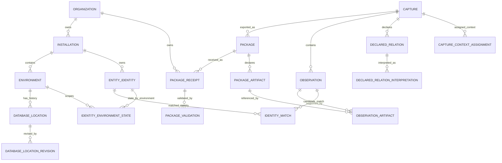

# PHC Knowledge — Modelo de domínio 0.2

> **Revisão vinculativa — 21-11-2026:** este modelo 0.2 é um desenho anterior e não é autoridade para o modelo Cliente/Instalação/Captura actualmente aprovado. A estrutura Organization → Installation → Environment → DatabaseLocation e a retenção permanente do ZIP descritas em secções posteriores ficam supersedidas. Consultar [Decisões arquitecturais aprovadas](decisoes-aprovadas-2026-11-21.md) antes de qualquer implementação ou migration.


| Campo | Valor |
|---|---|
| Revisão | 2026-11-17 |
| Estado | Modelo conceptual anterior; parcialmente supersedido pelas decisões aprovadas em 2026-11-21; não é schema SQL definitivo |
| Stack física | Microsoft SQL Server central (edição/versão por decidir); dados e artefactos permanentes no SQL Server; ZIP temporário; SQLite apenas workspace/cache Scanner |
| Implementação atual | Primeira fatia Receive / Validate / Archive em PhcKnowledge.Import |

Este documento preserva a referência conceptual do modelo de domínio 0.2. Distingue decisões de domínio, estado físico implementado e capacidades futuras. Não autoriza por si só migrations ou alterações ao contrato IKP. A identidade cross-installation, o catálogo PHC Standard e as correspondências são regidos por [D-023](d-023-cross-installation-identity-correspondence-contract.md); em caso de conflito, D-023 prevalece. As secções conceptuais antigas sobre IdentityMatch, cardinalidade ou isolamento por Organization não constituem contrato normativo actual.

## 1. Princípios e fronteiras

- PHC Knowledge é uma plataforma central de conhecimento técnico PHC, não um clone ERP nem um Digital Twin.
- O Scanner é autónomo e produz IKP; Knowledge não executa Scanner em runtime nem acede ao SQLite do workspace.
- Microsoft SQL Server é a base central; edição/versão por decidir. PostgreSQL está excluído. SQLite é limitado ao workspace/cache local do Scanner.
- O ZIP IKP é apenas transporte temporário e é eliminado após materialização e verificação. Os dados e artefactos originais necessários são persistidos no SQL Server.
- Existe uma única organização (a empresa utilizadora); clientes são contextos técnicos, não tenants. O conhecimento PHC Standard é central e curado.
- Captura, pacote, recepção, observação, identidade lógica e contexto são conceitos distintos.
- Receber/validar/arquivar não equivale a materializar, associar contexto ou publicar conhecimento.
- RAG é capacidade futura de consumo, não entidade obrigatória nem motivo para antecipar embeddings/base vetorial.

## 2. Legenda de estado

| Estado | Significado |
|---|---|
| **Implementado** | Existe no código/migration/testes atuais |
| **Parcial — apenas no ZIP** | O dado é transportado no IKP, mas ainda não está materializado em tabelas Knowledge |
| **Destino 0.2** | Decisão de domínio para orientar evolução; não significa implementação |
| **Futuro** | Capacidade ainda sem contrato/implementação suficiente |

## 3. Core e contexto organizacional

### 3.1 Cliente, instalação e captura — modelo aprovado

O modelo vinculativo aprovado em 21-11-2026 é:

```
Cliente 1 ───── N Instalação 1 ───── N Captura
```

Regras:
- Existe uma única organização interna (a empresa utilizadora da plataforma). Os clientes PHC não são organizações/tenants.
- Cada cliente tem um registo próprio no Knowledge e representa contexto técnico.
- Cada base de dados PHC registada corresponde a uma instalação própria e recebe o seu próprio `InstallationId`.
- Cada instalação pode ter várias capturas; cada captura pertence exclusivamente a uma instalação.
- Uma cópia de uma base de dados recebe uma nova identidade de instalação e mantém uma relação de linhagem com a origem.
- Mudar de servidor não implica nova instalação se a continuidade da mesma base de dados puder ser confirmada.
- Ambiente e localização são inicialmente atributos da instalação, não entidades obrigatórias independentes.
- Alterações de ambiente/localização podem ser registadas historicamente quando forem relevantes.
- Comparações entre capturas respeitam sempre a identidade da instalação e a cobertura efectiva de cada captura.
- Nomes, servidor e nome de base de dados são atributos/evidência; não substituem o InstallationId.

**Estado:** decisão de domínio aprovada; entidades e migrations completas ainda por implementar. O OrganizationId existente na recepção representa o contexto global único da plataforma e não deve evoluir para tenancy por cliente.

### 3.2 Ambiente e localização da instalação

Ambiente (por exemplo, produção, teste ou desenvolvimento) e localização técnica (servidor/instância/nome de base de dados) são inicialmente atributos da instalação.

Não criar nesta fase uma hierarquia Organization → Installation → Environment → DatabaseLocation nem exigir entidades autónomas para cada localização. A necessidade de histórico é satisfeita por revisões/auditoria dos atributos relevantes, sem alterar automaticamente a identidade da instalação.

## 4. Captura, pacote e recepção

### 4.1 Capture

- CaptureId é UUID lógico criado pelo Scanner no início da recolha.
- Uma Capture pode originar vários pacotes IKP.
- Capture não é Package nem PackageReceipt.
- A plataforma não infere InstallationId a partir de CaptureId, server/database ou originFingerprint.

**Estado:** CaptureId é emitido no IKP; entidade Capture no Knowledge ainda não está materializada.

### 4.2 Package — envelope temporário de transporte

**Revisão vinculativa de 21-11-2026:** o ZIP não é uma entidade de conhecimento nem um arquivo permanente.

- `PackageId` identifica o pacote de transporte no âmbito do contrato IKP.
- `ZipSha256` e `ZipByteLength` verificam os bytes recebidos e suportam idempotência/recuperação durante a ingestão.
- O ZIP pode ser mantido em staging/arquivo transitório enquanto a recepção, análise e materialização não estiverem concluídas.
- Depois da materialização verificada, os bytes do ZIP são eliminados.
- O conteúdo original de artefactos que tenha de ser preservado é extraído e armazenado no SQL Server, associado à captura, instalação, objecto e proveniência.
- A deduplicação de artefactos no SQL Server não elimina a proveniência de cada captura.

A semântica de PackageId e ZipSha256 não deve ser confundida com identidade de instalação, captura ou objecto técnico.

### 4.3 PackageReceipt — registo da recepção

- PackageReceipt regista a recepção e o resultado da validação do pacote.
- Como existe uma única organização interna, OrganizationId não representa tenancy por cliente.
- O receipt não prova que os dados já foram materializados no modelo de conhecimento.
- O estado de recepção e o estado de materialização são estados distintos.
- A eliminação do ZIP depende exclusivamente da conclusão e verificação da materialização, não apenas do receipt Completed.

### 4.4 Estado real da ingestão

**Implementado:**
- IkpPackageValidator: valida estrutura, schemas, checksums e referências cruzadas (engine partilhado com o Reader).
- IkpPackageIngestionService: coordena validação, arquivo e receipt.
- FileSystemImmutablePackageStore: arquivo content-addressed global por SHA-256; reopen read-only com re-verificação SHA; não sobrescreve.
- SqlServerPackageReceiptRepository / attempts: persiste receipts em SQL Server.
- Migration 001_package_ingestion_receipts.sql.
- API HTTP IKP (upload + consulta de estado + GET de análise) com OrganizationId a partir do principal autenticado.
- Incremento A: `IkpPackageReader`, reopen do arquivo, `PackageImportAnalysis`.
- Incremento B: tabela `dbo.PackageImportAnalyses` (migration 004); POST/GET de análise com persistência, idempotência e `AnalysisSchemaVersion` `0.2`. Ver `phase-report-ikp-package-analysis-a-2026-11-19.md`.
- Testes unitários/HTTP sobre fixture IKP; validação real CSDefault202603 da análise via harness efémero (fora do repo).

**Limites comprovados:**
- OrganizationId é exigido quando o serviço usa receipt repository; sem repositório de receipts, o harness pode validar/arquivar sem Organization.
- Confirmação e materialização não existem.
- O percurso SQL receipt real + POST/GET HTTP com o ZIP real CSDefault202603 ainda não foi demonstrado em conjunto nesta máquina sem `PHC_KNOWLEDGE_SQL_TEST_CONNECTION_STRING`.
- A ordem de arquivo ZIP antes da gravação SQL do receipt pode deixar um ZIP sem receipt se SQL falhar; reconciliação/retry permanece relevante.
- O ZIP é retido apenas durante o processamento e eliminado após materialização verificada; a implementação actual ainda mantém arquivo transitório até existir o novo fluxo.

**Estado da migration atual:** índices únicos (OrganizationId, PackageId) e (OrganizationId, ZipSha256). Isto descreve a fatia atual, não o destino global. Não alterar migrations nesta fase.

## 5. Artefactos e integridade

No destino:
- PackageArtifact representa entradas semânticas declaradas no manifesto.
- PackageFileIntegrity representa entradas de checksums.json.
- Não criar terceira entidade duplicada para a mesma informação.
- ObservationArtifact liga uma Observation aos PackageArtifacts que a suportam; pode usar chave composta se não tiver atributos próprios.
- Bytes permanecem no arquivo ZIP original; não são copiados para BLOB SQL nesta fase.

**Estado:** artefactos, manifesto e checksums são validados e preservados dentro do ZIP; tabelas PackageArtifact/PackageFileIntegrity/ObservationArtifact ainda não existem.

## 6. Materialização e Observation

### 6.1 Pipeline de destino

1. Receber, validar e arquivar ZIP.
2. Registar Capture e PackageReceipt.
3. Persistir os dados/artefactos necessários antes de marcar processamento como Accepted.
4. Materializar Observations, factos REL/DTL e referências a artefactos, mesmo que contexto ainda não esteja confirmado.
5. Associar contexto via CaptureContextAssignment.
6. Resolver IdentityMatch/EntityIdentity após contexto confirmado.
7. Comparar/atualizar estado por Environment apenas quando contexto e coverage permitirem.

A fatia de ingestão termina no receipt/arquivo. Os Incrementos A/B acrescentam análise (com auditoria SQL no B). Não afirmar que já materializa conhecimento nem que a importação está confirmada.

### 6.2 Observation

Observation representa um objeto técnico observado numa Capture, independente do contexto organizacional.

Campos conceptuais:
- ObservationId PK interno;
- CaptureId FK;
- SourceObjectId exato do IKP;
- ObjectKind (valor IKP objectKind, não ObjectType);
- SourceIdentityScheme, SourceIdentityValue, SourceIdentityScope opcionais;
- Name e SchemaName quando aplicáveis;
- Metadata JSON opcional, validado como JSON;
- MetadataFingerprint e DefinitionFingerprint, quando aplicáveis;
- DefinitionStatus: Available, Empty, Unavailable, NotCollected;
- OperationId;
- ParentSourceObjectId opcional.

Regras:
- UNIQUE(CaptureId, SourceObjectId).
- Não colocar OrganizationId, InstallationId, EnvironmentId ou EntityIdentityId na Observation.
- SourceObjectId é referência da origem dentro da Capture, não identidade permanente.
- MetadataFingerprint e DefinitionFingerprint são hashes SHA-256 distintos; não presumir que todos os kinds têm ambos.
- IKP representa fingerprints como hex minúsculo de 64 caracteres. Se a BD usar binary(32), a conversão hex↔bytes tem de ser explicitada no contrato físico.

### 6.3 Dimensão de SourceObjectId — evidência real

Medição no IKP real CSDefault202603:
- 16.618 SourceObjectIds;
- mínimo 12, máximo 54 caracteres;
- zero duplicados com comparação ordinal;
- zero espaços nas extremidades;
- zero valores não-ASCII;
- REL/DTL sourceObjectId máximo 32;
- interpretationId máximo 39.

Proposta física de destino:
- NVARCHAR(256) NOT NULL;
- unicidade por (CaptureId, SourceObjectId);
- comparação ordinal no importador;
- collation binária Latin1_General_100_BIN2 como suporte à comparação;
- rejeitar vazio e espaços nas extremidades antes de persistir.

Nota SQL Server: BIN2 não elimina por si só a regra de comparação que ignora espaços finais em strings; validação explícita de espaços nas extremidades é obrigatória. A medição real suporta o dimensionamento proposto, mas não prova limites de todos os kinds futuros.

**Estado:** proposta de modelo físico; ainda não existe tabela Observation nem migration.

## 7. REL/DTL — factos e interpretações

O Scanner atual exporta um ficheiro físico:
payload/relations/declared-relations.json

Envelope: schemaVersion, captureId, declaredRelations e interpretations.

Na captura real:
- 921 factos declarados: 295 REL e 626 DTL;
- 921 interpretações;
- zero interpretações órfãs;
- máximo 32 caracteres em sourceObjectId REL/DTL.

Separação de domínio:
- DeclaredRelation: facto original PHC, expressão original, tipo/origem e referências;
- DeclaredRelationInterpretation: interpretação derivada, parser/version, AST, estado, confiança, diagnósticos e métricas.

As entidades são logicamente separadas mesmo residindo no mesmo ficheiro. Interpretações são regeneráveis e nunca substituem o facto original. A especificação IKP 0.1 foi alinhada ao payload efetivamente emitido; não é necessário bump de versão.

**Estado:** formato e evidência real confirmados; materialização SQL futura.

## 8. Identidade e continuidade entre capturas

- EntityIdentity pertence a uma Installation, não a Organization isoladamente.
- A identidade pertence exclusivamente à Installation; não é partilhada entre instalações.
- Nunca fundir identidades entre Installations, mesmo perante stamps, nomes ou definições coincidentes.
- A correspondência é uma relação autónoma conforme D-023; não assumir limite universal de um match confirmado por Observation nem cardinalidade 1:1.
- Criar nova EntityIdentity apenas por decisão explícita.
- SourceObjectId não é EntityIdentity.
- SourceIdentity é evidência de origem, não identidade interna do Knowledge.

Estados de identidade por Environment: Present, NotObserved, PendingReview, Removed. Ausência de registo = NotYetEvaluated.

Remoção:
- duas capturas consecutivas, completas e comparáveis sem observar a identidade no mesmo Environment;
- primeira ausência = NotObserved;
- segunda ausência = PendingReview;
- confirmação humana obrigatória para Removed;
- todas as decisões auditadas.

**Estado:** destino conceptual; não implementado na primeira fatia.

## 9. Contexto da captura

- Capture é independente do contexto no momento da receção.
- CaptureContextAssignment guarda histórico de associação.
- Apenas uma atribuição ativa de cada vez.
- Corrigir contexto revoga/supersede atribuição anterior e cria nova.
- Installation/Environment não são obrigatórios para receber o pacote.
- DatabaseLocation não é identidade permanente da Installation.

**Estado:** futuro; sem associação automática na ingestão atual.

## 10. Catálogo e governação

- Catálogo PHC Standard é central e versionado.
- Organizações podem propor alterações, não publicar diretamente.
- O texto histórico de isolamento por Organization não define a segregação actual: existe uma única organização interna. O âmbito de acesso e reutilização por cliente/instalação depende da governação e permissões aprovadas, conforme D-023.
- Promoção para conhecimento standard exige curadoria humana.
- Eliminação histórica bloqueada; desativação permitida; eventos append-only.
- RAG é consumidor futuro da base estruturada, não entidade obrigatória do modelo.

**Estado:** conceptual/futuro. A integração inicial do catálogo de triggers PHC Standard está especificada em [standard-catalog-integration-specification.md](standard-catalog-integration-specification.md), ainda sem implementação física ou aprovação de migrations.

A especificação reutiliza estas entidades conceptuais e define a separação entre catálogo standard, versões de definição, conhecimento funcional curado e observações por Capture. Não constitui um schema SQL definitivo.

## Mapa global de entidades — destino 0.2

O catálogo abaixo é um mapa de responsabilidades, não uma ordem de implementação nem uma exigência de criar todas as tabelas na primeira migration.

| Área | Entidades de destino | Estado |
|---|---|---|
| Core | Organization (única), Customer, Installation, InstallationContextRevision/Lineage | OrganizationId já é usado no receipt como contexto global; Customer/Installation e histórico ainda não materializados |
| Ingestion | Capture, Package, PackageReceipt, PackageReceiptAttempt, PackageValidation, PackageCapability, PackageOperationCoverage, PackageIssue, PackageProcessing, PackageProcessingAttempt, PackageFileIntegrity, PackageArtifact | PackageReceipt parcial implementado; restante modelo é destino/parcial no ZIP |
| Materialização | CaptureMaterialization, CaptureMaterializationAttempt, Observation, ObservationArtifact, DeclaredRelation, DeclaredRelationInterpretation | Não implementado; após materialização, dados e artefactos necessários ficam no SQL Server; ZIP é eliminado |
| Identity | CaptureAssociationCandidate, CaptureContextAssignment, EntityIdentity, IdentityMatch, EntityIdentityLifecycleEvent | Destino conceptual; ambiente/localização são atributos da instalação, não entidades obrigatórias |
| Governance | DomainEvent, OutboxMessage, InstallationLineageEvent | Futuro; Outbox só quando existir protocolo transacional concreto |
| Knowledge | StandardCatalog, CatalogEntry, CatalogEntryVersion, KnowledgeEntry, KnowledgeEntryVersion, KnowledgeProposal | Futuro; catálogo standard curado; observações e conhecimento específico associados ao cliente/instalação de origem |

### Relações principais



O diagrama omite entidades de tentativa, processamento, auditoria e governação para manter legibilidade. Todas as relações são conceptuais; cardinalidades e constraints físicas só serão fechadas quando a fatia correspondente for desenhada e validada.

## 11. Decisões físicas e de evolução

- Microsoft SQL Server é a base central de conhecimento; edição/versão por decidir.
- SQL Server armazena dados estruturados, metadados, histórico e artefactos originais necessários.
- O ZIP IKP é transporte temporário; não é persistido permanentemente fora da BD.
- O armazenamento binário dos artefactos originais no SQL Server está aprovado; tipo de coluna, limites e estratégia física ainda carecem de especificação.
- SQLite permanece apenas no workspace/cache local do Scanner.
- A materialização tem de ser idempotente e verificável antes de eliminar o ZIP.
- Não inferir remoções a partir de operações falhadas, não executadas ou de cobertura parcial.
- Não introduzir PostgreSQL, peer sync, modo offline, Discovery/Fusion ou Digital Twin.
- Outbox/DomainEvent só devem ser introduzidos com protocolo concreto.
- O modelo é mapa de destino; não é autorização para gerar migrations globais de uma só vez.

## 12. Próximos bloqueios

1. Testar repository e migration contra SQL Server real.
2. Definir protocolo de reconciliação/retry para arquivo sem receipt SQL.
3. Cobrir idempotência e conflitos globais PackageId/SHA, incluindo receção em várias Organizations.
4. Desenhar endpoint HTTP/autenticação e assegurar OrganizationId a partir do principal autenticado.
5. Só depois decidir a próxima fatia de materialização; não gerar migrations globais antes disso.

## Referências

- [Especificação IKP 0.1](ikp-0.1-specification.md)
- [Matriz de compatibilidade](ikp-0.1-scanner-compatibility-matrix.md)
- [Avaliação de arquitetura e importação](technology-and-import-contract-assessment.md)
- [Contrato de observação, identidade e linhagem](observation-identity-and-lineage-contract.md)
- [Especificação de integração do catálogo PHC Standard](standard-catalog-integration-specification.md)


## Revisão de decisões — 21-11-2026

O modelo conceptual vigente é Cliente 1 → N Instalações 1 → N Capturas. Cada base de dados PHC registada recebe a sua própria instalação/InstallationId; cada captura pertence a uma única instalação. Cópias de bases de dados recebem nova identidade, ligada por linhagem; mudanças de servidor não criam automaticamente nova identidade se a continuidade for confirmada. Ambiente/localização são inicialmente atributos da instalação. Os detalhes normativos constam em [Decisões arquitecturais aprovadas](decisoes-aprovadas-2026-11-21.md).


> **Correcção de leitura do mapa 0.2 — 21-11-2026:** a tabela acima foi alinhada ao modelo aprovado. Não criar hierarquia multi-organização, Environment ou DatabaseLocation como entidades nesta fase. O ZIP não é arquivo de origem permanente: o SQL Server guarda os dados materializados e artefactos originais necessários.


## Adenda normativa — D-023 (24-11-2026)

O modelo de domínio deve distinguir:

- `EntityIdentity`: identidade local e independente por Installation;
- `StandardEntityIdentity`: identidade conceptual do catálogo PHC Standard versionado;
- `Correspondence`: relação auditável entre identidades, sem fusão.

A correspondência não prova igualdade de definição nem autoriza reutilização/publicação do conteúdo local. Os tipos de relação, estados, evidências, cardinalidade e critérios de classificação são os definidos em [D-023](d-023-cross-installation-identity-correspondence-contract.md). A matriz por `objectKind` e a validação com capturas reais são pré-condições antes de schema físico, migrations ou implementação.

Este modelo 0.2 continua a ser conceptual e parcialmente supersedido; não deve ser usado como schema SQL definitivo.
