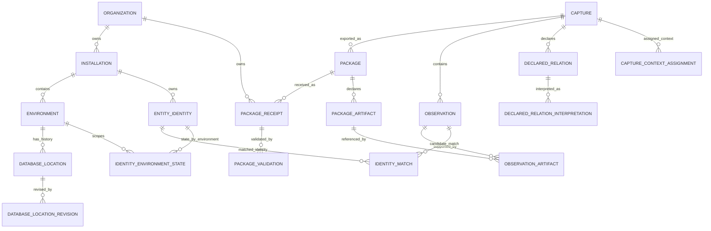

> Nota de precedência (2026-11-20): este modelo é uma fotografia conceptual datada de 17-11-2026. A baseline e decisões atuais estão em ../../PROJECT_BASELINE.md e ../../DECISIONS.md. Referências a SQL Server Express obrigatório, arquivo permanente de ZIPs e modelo multi-organização estão substituídas. ZIP é transporte temporário e deve ser eliminado apenas após materialização e confirmação íntegra.

# PHC Knowledge — Modelo de domínio 0.2

| Campo | Valor |
|---|---|
| Revisão | 2026-11-17 |
| Estado | Modelo conceptual de destino consolidado; não é schema SQL definitivo |
| Stack física | SQL Server central; arquivo de ZIPs fora da base relacional; SQLite apenas workspace/cache Scanner |
| Implementação atual | Primeira fatia Receive / Validate / Archive em PhcKnowledge.Import |

Este documento é a referência consolidada do modelo de domínio 0.2. Distingue decisões de domínio, estado físico implementado e capacidades futuras. Não autoriza por si só migrations ou alterações ao contrato IKP.

## 1. Princípios e fronteiras

- PHC Knowledge é uma plataforma central de conhecimento técnico PHC, não um clone ERP nem um Digital Twin.
- O Scanner é autónomo e produz IKP; Knowledge não executa Scanner em runtime nem acede ao SQLite do workspace.
- SQL Server Express é a base central. SQLite é limitado ao workspace/cache local do Scanner.
- O ZIP IKP é transporte temporário; após materialização e confirmação de persistência íntegra, o pacote e os temporários devem ser eliminados.
- Cliente/instalação delimita contexto e permissões; conhecimento PHC Standard é separado, central e curado.
- Captura, pacote, recepção, observação, identidade lógica e contexto são conceitos distintos.
- Receber/validar/arquivar não equivale a materializar, associar contexto ou publicar conhecimento.
- RAG é capacidade futura de consumo, não entidade obrigatória nem motivo para antecipar embeddings/base vetorial.

## 2. Legenda de estado

| Estado | Significado |
|---|---|
| **Implementado** | Existe no código/migration/testes atuais |
| **Parcial — apenas no ZIP** | O dado é transportado no IKP, mas ainda não está materializado em tabelas Knowledge |
| **Destino 0.2** | Decisão de domínio para orientar evolução; não significa implementação |
| **Futuro** | Capacidade ainda sem contrato/implementação suficiente |

## 3. Core e contexto organizacional

### 3.1 Organização e estrutura

Modelo de destino:
- Organization 1-N Installation.
- Installation 1-N Environment.
- Environment 0..1 DatabaseLocation ativa.
- DatabaseLocationRevision regista enriquecimentos/correções auditáveis da localização técnica.
- NameChangeAudit regista alterações de nome dos níveis Core.

Regras:
- Organization, Installation e Environment têm IDs próprios; nomes podem mudar sem alterar IDs.
- Nome de Installation é único dentro de Organization; nome de Environment é único dentro de Installation, case-insensitive e ignorando espaços exteriores na validação. Preservar o texto original introduzido.
- ServerName pode ser desconhecido e enriquecido/corrigido com revisão auditada.
- DatabaseName é obrigatório e imutável numa DatabaseLocation; mudar de base de dados encerra a localização anterior e cria outra.
- Uma única DatabaseLocation ativa por Environment; ValidToUtc IS NULL define a ativa.
- Desativar Environment encerra a localização ativa na mesma transação; reativar não reabre automaticamente a localização anterior.
- Desativar Installation exige todos os Environments desativados; desativar Organization exige todas as Installations desativadas. Reativação é explícita por nível.
- Core é histórico: desativação/encerramento, não eliminação física.

**Estado:** Organization existe apenas como requisito no percurso de receipt SQL atual; as entidades Core completas e relações Installation/Environment/DatabaseLocation ainda não estão materializadas.

### 3.2 DatabaseLocation

Representa uma localização técnica de uma base de dados num Environment, não a identidade da instalação nem a identidade de origem IKP.

Campos conceptuais principais: DatabaseLocationId, EnvironmentId, ServerName nullable, DatabaseName obrigatório, ValidFromUtc, ValidToUtc nullable, CreatedAtUtc e RowVersion.

DatabaseLocationRevision preserva valores anterior/novo, tipo (Enrichment/Correction), actor, data, motivo e evidência. DatabaseName é imutável dentro de uma revisão; mudança cria nova localização.

## 4. Captura, pacote e recepção

### 4.1 Capture

- CaptureId é UUID lógico criado pelo Scanner no início da recolha.
- Uma Capture pode originar vários pacotes IKP.
- Capture não é Package nem PackageReceipt.
- A plataforma não infere InstallationId a partir de CaptureId, server/database ou originFingerprint.

**Estado:** CaptureId é emitido no IKP; entidade Capture no Knowledge ainda não está materializada.

### 4.2 Package — identidade global de conteúdo

Modelo de destino:
- Package representa a identidade global de um pacote IKP válido.
- PackageId é chave global do pacote, contido em manifest.json.
- ZipSha256 identifica os bytes exatos do ZIP e é global.
- ZipByteLength, StorageKey, produtor/versão e timestamps descrevem o conteúdo recebido.
- Arquivo content-addressed: sha256/{prefix}/{hash}.ikp.zip.
- ZIP protegido contra alteração durante o processamento e retido apenas até confirmação de materialização íntegra.

Invariantes:
1. Mesmo SHA-256 significa os mesmos bytes; num IKP válido, também o mesmo PackageId do manifesto.
2. Mesmo PackageId com SHA diferente é conflito global de identidade.
3. Mesmo PackageId e SHA na mesma Organization é receção idempotente.
4. Mesmo PackageId e SHA noutra Organization é nova receção organizacional, ligada ao mesmo Package global e ao mesmo arquivo físico.
5. Mesmo CaptureId com PackageIds diferentes é permitido; uma captura pode ser exportada mais do que uma vez.
6. PackageId não é CaptureId nem identidade de entidade observada.

O exportador atual gera novo PackageId por exportação. Reexportar a mesma Capture pode produzir PackageIds e bytes diferentes.

### 4.3 PackageReceipt — receção por organização

- PackageReceipt representa uma receção do Package por uma Organization.
- Cada receipt tem ReceiptId próprio e referencia OrganizationId e PackageId.
- Guarda resultado/resumo de validação, data de receção e metadados de origem necessários à auditoria.
- A mesma Package pode ter receipts em várias Organizations sem duplicar o ZIP físico.
- Idempotência é avaliada no âmbito da Organization + PackageId.

### 4.4 Estado real da ingestão

**Implementado:**
- IkpPackageValidator: valida estrutura, schemas, checksums e referências cruzadas (engine partilhado com o Reader).
- IkpPackageIngestionService: coordena validação, arquivo e receipt.
- FileSystemImmutablePackageStore: arquivo content-addressed global por SHA-256; reopen read-only com re-verificação SHA; não sobrescreve.
- SqlServerPackageReceiptRepository / attempts: persiste receipts em SQL Server.
- Migration 001_package_ingestion_receipts.sql.
- API HTTP IKP (upload + consulta de estado + GET de análise) com OrganizationId a partir do principal autenticado.
- Incremento A: `IkpPackageReader`, reopen do arquivo, `PackageImportAnalysis`.
- Incremento B: tabela `dbo.PackageImportAnalyses` (migration 004); POST/GET de análise com persistência, idempotência e `AnalysisSchemaVersion` `0.2`. Ver `phase-report-ikp-package-analysis-a-2026-11-19.md`.
- Testes unitários/HTTP sobre fixture IKP; validação real CSDefault202603 da análise via harness efémero (fora do repo).

**Limites comprovados:**
- OrganizationId é exigido quando o serviço usa receipt repository; sem repositório de receipts, o harness pode validar/arquivar sem Organization.
- Confirmação e materialização não existem.
- O percurso SQL receipt real + POST/GET HTTP com o ZIP real CSDefault202603 ainda não foi demonstrado em conjunto nesta máquina sem `PHC_KNOWLEDGE_SQL_TEST_CONNECTION_STRING`.
- A ordem de arquivo ZIP antes da gravação SQL do receipt pode deixar um ZIP sem receipt se SQL falhar; reconciliação/retry permanece relevante.
- O ZIP original deve ser eliminado após materialização e confirmação íntegra.

**Estado da migration atual:** índices únicos (OrganizationId, PackageId) e (OrganizationId, ZipSha256). Isto descreve a fatia atual, não o destino global. Não alterar migrations nesta fase.

## 5. Artefactos e integridade

No destino:
- PackageArtifact representa entradas semânticas declaradas no manifesto.
- PackageFileIntegrity representa entradas de checksums.json.
- Não criar terceira entidade duplicada para a mesma informação.
- ObservationArtifact liga uma Observation aos PackageArtifacts que a suportam; pode usar chave composta se não tiver atributos próprios.
- Bytes permanecem no arquivo ZIP original; não são copiados para BLOB SQL nesta fase.

**Estado:** artefactos, manifesto e checksums são validados e preservados dentro do ZIP; tabelas PackageArtifact/PackageFileIntegrity/ObservationArtifact ainda não existem.

## 6. Materialização e Observation

### 6.1 Pipeline de destino

1. Receber, validar e arquivar ZIP.
2. Registar Capture e PackageReceipt.
3. Persistir os dados/artefactos necessários antes de marcar processamento como Accepted.
4. Materializar Observations, factos REL/DTL e referências a artefactos, mesmo que contexto ainda não esteja confirmado.
5. Associar contexto via CaptureContextAssignment.
6. Resolver IdentityMatch/EntityIdentity após contexto confirmado.
7. Comparar/atualizar estado por Environment apenas quando contexto e coverage permitirem.

A fatia de ingestão termina no receipt/arquivo. Os Incrementos A/B acrescentam análise (com auditoria SQL no B). Não afirmar que já materializa conhecimento nem que a importação está confirmada.

### 6.2 Observation

Observation representa um objeto técnico observado numa Capture, independente do contexto organizacional.

Campos conceptuais:
- ObservationId PK interno;
- CaptureId FK;
- SourceObjectId exato do IKP;
- ObjectKind (valor IKP objectKind, não ObjectType);
- SourceIdentityScheme, SourceIdentityValue, SourceIdentityScope opcionais;
- Name e SchemaName quando aplicáveis;
- Metadata JSON opcional, validado como JSON;
- MetadataFingerprint e DefinitionFingerprint, quando aplicáveis;
- DefinitionStatus: Available, Empty, Unavailable, NotCollected;
- OperationId;
- ParentSourceObjectId opcional.

Regras:
- UNIQUE(CaptureId, SourceObjectId).
- Não colocar OrganizationId, InstallationId, EnvironmentId ou EntityIdentityId na Observation.
- SourceObjectId é referência da origem dentro da Capture, não identidade permanente.
- MetadataFingerprint e DefinitionFingerprint são hashes SHA-256 distintos; não presumir que todos os kinds têm ambos.
- IKP representa fingerprints como hex minúsculo de 64 caracteres. Se a BD usar binary(32), a conversão hex↔bytes tem de ser explicitada no contrato físico.

### 6.3 Dimensão de SourceObjectId — evidência real

Medição no IKP real CSDefault202603:
- 16.618 SourceObjectIds;
- mínimo 12, máximo 54 caracteres;
- zero duplicados com comparação ordinal;
- zero espaços nas extremidades;
- zero valores não-ASCII;
- REL/DTL sourceObjectId máximo 32;
- interpretationId máximo 39.

Proposta física de destino:
- NVARCHAR(256) NOT NULL;
- unicidade por (CaptureId, SourceObjectId);
- comparação ordinal no importador;
- collation binária Latin1_General_100_BIN2 como suporte à comparação;
- rejeitar vazio e espaços nas extremidades antes de persistir.

Nota SQL Server: BIN2 não elimina por si só a regra de comparação que ignora espaços finais em strings; validação explícita de espaços nas extremidades é obrigatória. A medição real suporta o dimensionamento proposto, mas não prova limites de todos os kinds futuros.

**Estado:** proposta de modelo físico; ainda não existe tabela Observation nem migration.

## 7. REL/DTL — factos e interpretações

O Scanner atual exporta um ficheiro físico:
payload/relations/declared-relations.json

Envelope: schemaVersion, captureId, declaredRelations e interpretations.

Na captura real:
- 921 factos declarados: 295 REL e 626 DTL;
- 921 interpretações;
- zero interpretações órfãs;
- máximo 32 caracteres em sourceObjectId REL/DTL.

Separação de domínio:
- DeclaredRelation: facto original PHC, expressão original, tipo/origem e referências;
- DeclaredRelationInterpretation: interpretação derivada, parser/version, AST, estado, confiança, diagnósticos e métricas.

As entidades são logicamente separadas mesmo residindo no mesmo ficheiro. Interpretações são regeneráveis e nunca substituem o facto original. A especificação IKP 0.1 foi alinhada ao payload efetivamente emitido; não é necessário bump de versão.

**Estado:** formato e evidência real confirmados; materialização SQL futura.

## 8. Identidade e continuidade entre capturas

- EntityIdentity pertence a uma Installation, não a Organization isoladamente.
- Pode ser partilhada entre Environments da mesma Installation após correspondência confirmada.
- Nunca fundir automaticamente identidades entre Installations.
- IdentityMatch mantém candidatos/evidências; no máximo um match confirmado/ativo por Observation.
- Criar nova EntityIdentity apenas por decisão explícita.
- SourceObjectId não é EntityIdentity.
- SourceIdentity é evidência de origem, não identidade interna do Knowledge.

Estados de identidade por Environment: Present, NotObserved, PendingReview, Removed. Ausência de registo = NotYetEvaluated.

Remoção:
- duas capturas consecutivas, completas e comparáveis sem observar a identidade no mesmo Environment;
- primeira ausência = NotObserved;
- segunda ausência = PendingReview;
- confirmação humana obrigatória para Removed;
- todas as decisões auditadas.

**Estado:** destino conceptual; não implementado na primeira fatia.

## 9. Contexto da captura

- Capture é independente do contexto no momento da receção.
- CaptureContextAssignment guarda histórico de associação.
- Apenas uma atribuição ativa de cada vez.
- Corrigir contexto revoga/supersede atribuição anterior e cria nova.
- Installation/Environment não são obrigatórios para receber o pacote.
- DatabaseLocation não é identidade permanente da Installation.

**Estado:** futuro; sem associação automática na ingestão atual.

## 10. Catálogo e governação

- Catálogo PHC Standard é central e versionado.
- Organizações podem propor alterações, não publicar diretamente.
- Conhecimento privado fica isolado por Organization.
- Promoção para conhecimento standard exige curadoria humana.
- Eliminação histórica bloqueada; desativação permitida; eventos append-only.
- RAG é consumidor futuro da base estruturada, não entidade obrigatória do modelo.

**Estado:** conceptual/futuro.

## Mapa global de entidades — destino 0.2

O catálogo abaixo é um mapa de responsabilidades, não uma ordem de implementação nem uma exigência de criar todas as tabelas na primeira migration.

| Área | Entidades de destino | Estado |
|---|---|---|
| Core | Organization, Installation, Environment, DatabaseLocation, DatabaseLocationRevision, NameChangeAudit | OrganizationId já é usado no receipt; restantes entidades não materializadas |
| Ingestion | Capture, Package, PackageReceipt, PackageReceiptAttempt, PackageValidation, PackageCapability, PackageOperationCoverage, PackageIssue, PackageProcessing, PackageProcessingAttempt, PackageFileIntegrity, PackageArtifact | PackageReceipt parcial implementado; restante modelo é destino/parcial no ZIP |
| Materialização | CaptureMaterialization, CaptureMaterializationAttempt, Observation, ObservationArtifact, DeclaredRelation, DeclaredRelationInterpretation | Não implementado; dados de origem permanecem no ZIP |
| Identity | CaptureAssociationCandidate, CaptureContextAssignment, EntityIdentity, IdentityMatch, IdentityEnvironmentState, EntityIdentityLifecycleEvent | Destino conceptual |
| Governance | DomainEvent, OutboxMessage, InstallationLineageEvent | Futuro; Outbox só quando existir protocolo transacional concreto |
| Knowledge | StandardCatalog, CatalogEntry, CatalogEntryVersion, KnowledgeEntry, KnowledgeEntryVersion, KnowledgeProposal | Futuro; catálogo standard curado e conhecimento privado por Organization |

### Relações principais

O diagrama omite entidades de tentativa, processamento, auditoria e governação para manter legibilidade. Todas as relações são conceptuais; cardinalidades e constraints físicas só serão fechadas quando a fatia correspondente for desenhada e validada.

## 11. Decisões físicas e de evolução

- SQL Server Express central é fonte de verdade relacional.
- ZIP temporário até confirmação de materialização; não é arquivo permanente.
- SQL Server guarda metadados, identidade, relações, proveniência e índices, não ZIPs como BLOB.
- Nenhuma migration global nova até fechar bloqueadores e validar protocolo de ingestão.
- Não introduzir PostgreSQL, peer sync, modo offline, Discovery/Fusion ou Digital Twin.
- Outbox/DomainEvent não são obrigatórios nesta fatia; introduzir apenas com protocolo concreto.
- PackageReceiptAttempt, PackageValidation detalhada, CaptureMaterialization e tentativas podem ser evolução, não requisitos automáticos da primeira fatia.
- O modelo é mapa de destino, não lista obrigatória de tabelas para implementar de uma só vez.

## 12. Próximos bloqueios

1. Testar repository e migration contra SQL Server real.
2. Definir protocolo de reconciliação/retry para arquivo sem receipt SQL.
3. Cobrir idempotência e conflitos globais PackageId/SHA, incluindo receção em várias Organizations.
4. Desenhar endpoint HTTP/autenticação e assegurar OrganizationId a partir do principal autenticado.
5. Só depois decidir a próxima fatia de materialização; não gerar migrations globais antes disso.

## Referências

- [Especificação IKP 0.1](ikp-0.1-specification.md)
- [Matriz de compatibilidade](ikp-0.1-scanner-compatibility-matrix.md)
- [Avaliação de arquitetura e importação](technology-and-import-contract-assessment.md)
- [Contrato de observação, identidade e linhagem](observation-identity-and-lineage-contract.md)
