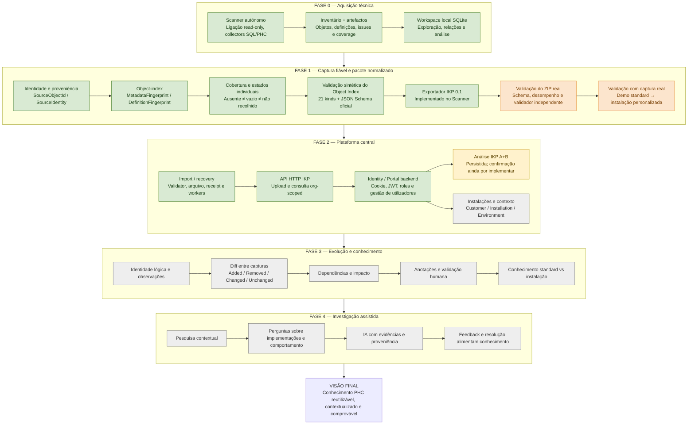

# Roadmap visual do PHC Knowledge — visão, fases e estado atual

> **Revisão vinculativa — 24-11-2026:** o diagrama e as fases anteriores são fotografias históricas. O estado pós-merge do Incremento C está na secção 10 e a decisão de identidade/correspondência cross-installation D-023 está na secção 12. Para decisões normativas prevalece [Decisões aprovadas](decisoes-aprovadas-2026-11-21.md). Não reintroduzir tenancy multi-organização, PostgreSQL ou arquivo permanente do ZIP.

**Data de referência:** 2026-11-23
**Estado:** o roadmap visual original é histórico. A fotografia actual a 23-11-2026 está na secção 10: D-022 integrada na main; Incremento C/UI React fora da main na PR #20; materialização integral e pesquisa por construir.
**Nota:** as percentagens não são estimadas; os estados indicam maturidade qualitativa.

## 1. Objetivo do produto

Construir uma plataforma de conhecimento técnico reutilizável, contextualizado por instalação PHC e sustentado em evidências verificáveis.

A plataforma deverá permitir:
- encontrar implementações semelhantes realizadas anteriormente;
- compreender como funcionalidades e comportamentos PHC são produzidos;
- identificar dependências e impactos antes de alterações;
- relacionar documentação oficial PHC com a realidade de cada instalação;
- recuperar problemas, causas, soluções e decisões técnicas anteriores;
- apoiar consultores e programadores com respostas fundamentadas e rastreáveis.

Não é um clone do PHC, um explorador SQL genérico, um repositório de ficheiros ou apenas um chatbot com documentação solta.

## 2. Roadmap visual

Legenda:
- **Concluído / existente** — existe implementação funcional ou decisão consolidada.
- **Em curso** — investigação, desenho ou implementação parcial.
- **Por construir** — ainda não existe implementação funcional no produto central.
- **Dependente de validação** — precisa de captura real ou validação técnica antes de fechar.

> O diagrama é sequencial para comunicar dependências, mas algumas atividades podem decorrer em paralelo. A análise relacional já existente no Scanner é uma capacidade reaproveitável; não significa que a plataforma central esteja implementada.

## 3. Onde estamos hoje

### Fase 0 — Aquisição técnica

**Estado: existente / funcional no Scanner**

Já temos:
- aplicação Scanner autónoma, com Desktop e CLI;
- collectors para estrutura SQL Server e personalizações PHC;
- recolha de objetos, definições/artefactos, issues e cobertura por operação;
- workspace SQLite;
- inventário pesquisável e exportação ZIP de personalizações;
- relações declaradas REL/DTL;
- interpretação de expressões e projeção relacional com evidências, relações de conhecimento e field mappings;
- testes automatizados no projeto Scanner.

Limites conhecidos:
- a cobertura atual tem diferenças semânticas entre operações e tipos de recolha;
- alguns collectors filtram registos sem conteúdo antes de os emitir;
- a cobertura atual não permite concluir remoções com segurança em todos os casos;
- o exportador IKP 0.1 já existe e está integrado na CLI; o pacote real CSDefault202603 já foi exercitado no harness de receção/arquivo/recovery; a captura cobre 8/21 kinds e não valida estabilidade de identidade entre capturas.

### Fase 1 — Captura fiável e pacote normalizado

**Estado: Object Index e exportador IKP 0.1 implementados; correção de desempenho aplicada; pacote real exercitado no percurso de receção/arquivo/recovery. A validação real cobre apenas os kinds presentes na captura.**

**Atualização de implementação — 2026-11-07**

#### P1.B — Object Index: implementado; validação real parcial

Implementado em `PhcKnowledgeScanner.Export`:
- `ObjectOperationResolver`: mapping explícito dos 21 kinds emitidos para operações observadoras;
- `SourceIdentityResolver`: stamps PHC e IDs nativos SQL, com scopes resolvidos dentro da captura;
- `MetadataProjectionResolver`, `CanonicalJsonSerializer` e `MetadataFingerprintCalculator`: projeção semântica e fingerprints determinísticos;
- `DefinitionProjectionResolver`: estados individuais Available / Empty / Unavailable / NotCollected, sustentados por evidência;
- `ObjectIndexProjectionInputReader`: leitura read-only de CaptureId, coverage, objetos, issues, metadados e bytes de artefactos referenciados;
- `ObjectIndexProjector`: projeção pura e determinística de `object-index.json`;
- `ObjectIndexWorkspaceProjector`: ligação read-only entre workspace e projector.

**Validação confirmada — GitHub Actions run `42419610023`:**
- Build .NET aprovado;
- **275 testes .NET aprovados**;
- cenário sintético do projector cobre os **21 kinds**;
- JSON produzido pelo C# validado contra o JSON Schema oficial IKP 0.1 Draft 2020-12.

A validação sintética cobre os 21 kinds. Em 2026-11-08, a projeção foi também exercitada com a captura real `CSDefault202603`: 16.618 objetos projetados, 8.307 SourceIdentity e 16.581 MetadataFingerprint; foram confirmadas correspondências de tamanho/hash dos 49 artefactos. Esta validação real cobriu apenas os kinds presentes nessa captura (8/21), pelo que não demonstra cobertura real exaustiva nem estabilidade de identidade entre capturas.

Não foram alterados schema SQLite, collectors ou queries PHC/SQL nesta etapa.

#### P1.C / IKP — exportador implementado; pacote real exercitado pelo harness Import

Investigação registada em [`p1b-ikp-package-export-readiness-investigation-2026-11-07.md`](p1b-ikp-package-export-readiness-investigation-2026-11-07.md).

O pacote IKP 0.1 exige cinco documentos de raiz:
1. `manifest.json`
2. `capabilities.json`
3. `coverage.json`
4. `object-index.json`
5. `checksums.json`

O validador de referência também verifica referências cruzadas, paths seguros, artefactos, tamanhos, SHA-256 e `logicalContentDigest`.

**Implementação concluída:** `IkpPackageExporter` dedicado em `PhcKnowledgeScanner.Export`, integrado na CLI através de `scan-ikp` e `export-ikp`. O exportador recebe o manifesto e o workspace como entradas separadas, valida a correspondência, gera os cinco documentos obrigatórios, checksums e digest lógico, e preserva os bytes dos artefactos.

Limitação identificada: o workspace atual não persiste timestamps reais de início/fim, ScanMode, ScannerVersion nem um origin descriptor estruturado. O exportador não pode inventar esses valores nem inferi-los de `created_at_utc` ou do label da instalação. Para a primeira versão, o manifesto completo terá de estar disponível em memória no momento da exportação.

#### P1.C.1 — Desempenho da validação do Object Index: causa isolada; correção aplicada e validada

Em 2026-11-11 foi executado um teste A/B com o mesmo pacote real `CSDefault202603-ikp-validation.zip`, usando JsonSchema.Net 7.3.1:

- Com `uniqueItems: true` no array principal `objects` de `object-index.schema.json`, a validação ultrapassou 120 segundos sem terminar.
- Numa cópia temporária do schema, removendo apenas esse `uniqueItems`, a avaliação do schema terminou em 2,64 segundos; o diagnóstico completo terminou em 2,82 segundos e o pacote foi aceite.
- A leitura do JSON (9.000.983 bytes) demorou cerca de 0,10 segundos e o carregamento do schema cerca de 0,05 segundos. A diferença observada está, portanto, na avaliação da regra `uniqueItems` sobre o array grande, não na leitura do ficheiro.
- `IkpPackageValidator.ValidateObjectIndex` já verifica duplicados de `sourceObjectId` com `HashSet<string>` e `StringComparer.Ordinal`, preservando a unicidade dos identificadores em tempo linear.

**Decisão técnica:** remover exclusivamente `uniqueItems: true` do array raiz `objects`. Manter `uniqueItems: true` em `definition.artifactIds`, que é uma lista pequena e cuja unicidade continua a ser relevante. Não alterar outras regras do schema, o contrato IKP 0.1, o código do Scanner, SQLite, collectors ou a lógica de identidade nesta intervenção.

**Estado: concluído em 2026-11-18.** A regra foi removida apenas do array raiz `objects`; mantém-se a unicidade de `definition.artifactIds` no schema e a validação ordinal de `sourceObjectId` no validador C#. O harness com o ZIP real confirmou receção e recovery em tempos compatíveis (ver relatório do harness).

#### Estado e próximos passos da Fase 1 — atualização 2026-11-18

Concluído desde a revisão anterior:
- Remoção localizada de `uniqueItems: true` do array raiz `objects`; unicidade de `sourceObjectId` preservada no validador C# e de `artifactIds` no schema.
- Harness local opt-in com o ZIP IKP real `CSDefault202603`: receção, idempotência, arquivo imutável e recovery após interrupção simulada, com tempos medidos e registados em [real-ikp-receipt-integration-harness-2026-11-18.md](real-ikp-receipt-integration-harness-2026-11-18.md).

Continua por validar:
- Os 13 kinds que não surgem na captura real (a captura cobre 8/21).
- Estabilidade de identidade lógica entre capturas distintas.
- Validação real exaustiva de categorias/artefactos e todos os cenários de compatibilidade do exportador.
- Validador independente end-to-end como verificação adicional; o harness real atual valida o percurso do Import com o ZIP real, não substitui todas as verificações externas.

Não alterar SQLite/collectors sem evidência concreta de lacuna.

#### Fase 1 — estado resumido (2026-11-18)

- **Concluído:** P0 CaptureId/capabilities/coverage.
- **Implementado e testado sinteticamente:** P1.B Object Index, identidade, fingerprints e estados individuais; 21 kinds cobertos sinteticamente.
- **Exercitado com captura real:** 8/21 kinds presentes na `CSDefault202603`; 16.618 objetos e 52 artefactos no pacote real usado pelo harness.
- **Implementado:** exportador IKP 0.1 e comandos CLI `scan-ikp` / `export-ikp`.
- **Concluído:** correção de desempenho de `objects.uniqueItems` e validação do percurso real de receção/arquivo/idempotência/recovery.
- **Pendente:** kinds não observados na captura real, estabilidade de identidade entre capturas e validação independente adicional.

### Fase 2 — Plataforma central

**Estado: backend de ingestão, HTTP e Identity/Portal implementado; análise IKP A+B concluída e integrada na `main` (PR #19); confirmação (C), contexto de instalação, UI e materialização ainda incompletos.**

Implementado no código integrado na `main`:
- Host único `WebApplication` / Kestrel com API e workers internos de recovery, cleanup e monitorização.
- Pipeline IKP de validação, receção, arquivo imutável content-addressed, receipts/tentativas org-scoped e recuperação.
- API HTTP IKP: `POST /api/v1/ikp/packages`, `GET /api/v1/ikp/attempts/{attemptId}` e `GET /api/v1/ikp/packages/{packageId}`; JWT Bearer e scopes quando ativados.
- Organização canónica e ASP.NET Identity com `Administrator` e `Collaborator`.
- Portal backend com cookie, login/logout, sessão, antiforgery, validação de SecurityStamp e API administrativa de utilizadores.
- CLI `PhcKnowledge.Install` para scripts SQL, migrations Identity, organização canónica, roles e bootstrap do primeiro administrador.
- **Incremento A:** reopen do ZIP imutável com re-verificação SHA-256/comprimento; `IkpPackageInspectionEngine` partilhado entre Validator e Reader; `PackageImportAnalysis` com Object Index, artefactos, REL/DTL, readiness (`Ready` / `ReadyWithWarnings` / `Blocked`); validação com captura real CSDefault202603 via harness efémero (sem dados de clientes no repositório).
- **Incremento B:** persistência append-only em `dbo.PackageImportAnalyses` (migration 004, após 001–003); chave canónica `(OrganizationId, PackageId, ZipSha256, AnalysisSchemaVersion)`; POST executa/reutiliza e GET só lê; `AnalysisSchemaVersion` `0.2` (independente de `ContractVersion`); `SemanticFingerprint` / `SemanticEquals` com projeção semântica explícita (excluem `ReceiptId` e `AnalyzedAtUtc`, mantidos no JSON de auditoria); `ReceiptId` como proveniência first-writer (fora da chave única); isolamento por organização; retry limitado SQL 1205; migration 004 no Install e no Host preflight; helper `EnsureSqlScriptsAsync` com migrations 001–004.
- Endpoints: `POST|GET /api/v1/ikp/packages/{packageId}/analysis` com política `IkpRead`.

Publicação e validação pós-merge (PR #19):
- PR #19 — `PHC Knowledge — IKP Package Analysis (Increments A+B)`; merge commit `98a0b200cf99098bc37eddf754c3d0bb360ca309`.
- Build Release da solução: sucesso, zero erros (estabilização pós-merge).
- `PhcKnowledge.Import.Tests`: **224 passed** (inclui HTTP de Package Analysis).
- Testes SQL relevantes: **12 passed** — `SqlServerPackageImportAnalysisTests` **3**; `SqlServerInstallBootstrapTests` **9**.
- Migration 004 na sequência de instalação 001 → 002 → 003 → 004; sem aplicação de migrations em produção nesta estabilização.
- Harness local opt-in com ZIP IKP real `CSDefault202603` (receção/arquivo/recovery e análise A ReadyWithWarnings); ver relatório de fase.
- Evidências anteriores à publicação: SQL análise 3/3×2 e bootstrap 9/9×2; GitHub Actions da PR #15 (.NET #253, SQL #39). A PR #15 permanece na main (`6c619bfc`).

Melhorias futuras de cobertura (não falhas dos testes já executados):
- Forçar deadlock SQL 1205 num teste de integração real (existe teste unitário da política de retry).
- Execução E2E da instalação através do `SqlScriptApplicator` do Install (o bootstrap aplica 004 via helper espelhado).
- Validação de recuperação da análise após recriação/rearranque do Host/serviço.
- Suite SQL Server de integração completa (só as suites relevantes A+B foram reexecutadas na estabilização).

Ainda não implementado:
- UI React / experiência de navegação do Portal.
- Confirmação explícita de uma análise antes de qualquer importação/materialização (Incremento C — desenho em `increment-c-package-import-analysis-confirmation-design-2026-11-19.md`; **não implementado**).
- Gestão de Customers, Installations e Environments e associação/correção de contexto da captura.
- Materialização de Capture, Observation, artefactos e REL/DTL em entidades próprias; pesquisa do inventário materializado.
- Próximo incremento de produto após A+B: **confirmação (C) — desenho aprovado; implementação aguarda autorização**.

A plataforma deverá consumir IKP; não deverá ligar-se diretamente às bases de dados dos clientes nem executar o Scanner em runtime. Análise persistida ≠ confirmação ≠ materialização.

### Fase 3 — Evolução e conhecimento

**Estado: arquitetura conceptual / por implementar na plataforma**

Falta construir:
- entidades lógicas e observações por captura;
- correspondência de identidade entre scans;
- comparação segura entre capturas;
- deteção de dependências e análise de impacto;
- anotações humanas persistentes e estados de validação;
- separação entre conhecimento standard PHC e conhecimento específico de cada instalação;
- promoção controlada de conhecimento reutilizável.

A regra essencial é que uma ausência só pode ser considerada remoção quando a cobertura e a compatibilidade permitem essa conclusão.

### Fase 4 — Investigação assistida por IA

**Estado: visão futura / por construir**

Só depois de existir conhecimento estruturado e rastreável faz sentido construir:
- pesquisa semântica contextual;
- perguntas sobre implementações e comportamento;
- explicações que cruzem documentação oficial, estrutura e personalizações;
- respostas com evidências, origem, confiança e incerteza explícita;
- ciclo de feedback em que problemas e soluções validados enriquecem a base de conhecimento.

A IA não deverá inventar factos nem substituir a proveniência. Deve investigar sobre conhecimento já organizado.

## 4. Próximos marcos recomendados

| Ordem | Marco | Estado / critério de conclusão |
|---:|---|---|
| 1 | P0 — CaptureId, capabilities e coverage | **Concluído.** Contratos e testes de captura/cobertura existentes. |
| 2 | P1.B — Object Index | **Implementado.** 21 kinds cobertos sinteticamente; captura real validou 8/21 kinds e 49 artefactos (tamanho/hash). |
| 3 | Exportador IKP 0.1 | **Implementado no Scanner.** `IkpPackageExporter`, `scan-ikp` e `export-ikp`. |
| 4 | Desempenho do schema IKP | **Concluído.** Removido `uniqueItems` do array raiz `objects`; unicidade preservada no validador C# e para `artifactIds` no schema. |
| 5 | Harness de receção IKP real | **Concluído localmente.** ZIP real recebido, arquivado, repetido idempotentemente e recuperado após interrupção simulada. |
| 6 | Host operacional e recovery | **Implementado.** Workers de preflight, recovery, cleanup e monitorização. |
| 7 | API HTTP IKP | **Implementada.** Upload raw ZIP e consultas org-scoped, com JWT/scopes opcionais por configuração. |
| 8 | Identity e Portal backend | **Implementado e integrado na main (PR #15).** Login, sessões, roles, bootstrap e administração de utilizadores. |
| 9 | Análise IKP (Incrementos A+B) | **Concluído e integrado na `main` (PR #19, merge `98a0b20…`).** Reopen/Reader/análise + persistência POST/GET; migration 004 após 001–003 no Install/preflight/bootstrap; build Release OK; Import 224; SQL relevantes 12 (3+9). |
| 10 | Incremento C — confirmação explícita | **Em branch, não integrado.** PR #20 aberta; branch divergente da main actual (97 commits à frente / 89 atrás no compare consultado). Reconciliar, rever e validar antes de qualquer merge. |
| 11 | Associação de contexto | **Futuro.** CaptureContextAssignment / Customer/Installation/Environment; distinto de confirmação e de materialização. |
| 12 | Materialização e comparação | **Futuro.** Capture, Observation, REL/DTL, identidade lógica e diff com cobertura suficiente. |
| 13 | Pesquisa e conhecimento reutilizável | **Futuro.** Consultas com evidências, contexto e anotações rastreáveis. |
| 14 | Investigação assistida por IA | **Futuro.** Respostas fundamentadas em evidências, proveniência e incerteza explícita. |

## 5. Critério para não perder o rumo

Cada fase deve produzir uma capacidade verificável:
1. **Recolher** sem alterar a instalação.
2. **Descrever** exatamente o que foi observado e o que não foi.
3. **Transportar** a captura sem perder integridade ou proveniência.
4. **Importar** sem misturar instalações nem apagar histórico.
5. **Comparar** apenas quando a cobertura permite.
6. **Relacionar** factos, interpretações e conhecimento humano sem os confundir.
7. **Investigar** com respostas justificadas por evidências.

## 6. Referências de arquitetura

- `README.md` — fronteira entre Scanner e plataforma.
- `docs/architecture/product-boundaries.md` — objetivo e limites do produto.
- `docs/architecture/knowledge-layers.md` — camadas de conhecimento e proveniência.
- `docs/architecture/ikp-0.1-specification.md` — pacote de transferência.
- `docs/architecture/p1-identity-provenance-contract.md` — identidade, proveniência e fingerprints.
- `docs/architecture/p1b-static-consistency-audit-2026-11-06.md` — auditoria estática do object-index.
- `docs/architecture/p1b-projector-workspace-read-contract-2026-11-06.md` — leitura read-only do workspace.

**Nota de rigor:** este roadmap é uma síntese do estado documental, do código, dos resultados de CI e dos testes comunicados até 2026-11-19. Não representa percentagens de conclusão. O teste A/B de desempenho do schema IKP foi executado com um pacote real e uma cópia temporária do schema; não equivale à validação end-to-end final do ZIP produzido pelo exportador. A+B estão na `main` (PR #19); isso **não** equivale à implementação do Incremento C nem à cobertura completa das melhorias futuras (deadlock 1205 real, E2E `SqlScriptApplicator`, recuperação pós-rearranque do Host, suite SQL completa).

## 7. Decisão transversal — preparação para RAG

O PHC Knowledge deve ser preparado desde já para poder evoluir para um RAG híbrido e fundamentado em evidências, mas a implementação do motor RAG fica para depois da construção da base de conhecimento estruturada. Não antecipar escolhas de LLM, embeddings ou base vetorial.

Princípio: **conhecimento fiável primeiro; recuperação aumentada por IA depois**.

A decisão arquitetural, os princípios a preservar e os critérios de prontidão estão documentados em [rag-readiness-and-knowledge-first-decision-2026-11-06.md](rag-readiness-and-knowledge-first-decision-2026-11-06.md).

## 8. Visão futura do Scanner — edição e publicação controlada

Foi registada uma possível evolução **da aplicação Scanner**: permitir localizar um objeto/personalização, editar uma versão de trabalho, comparar e validar a alteração e, quando suportado, publicá-la na instalação PHC com aprovação e auditoria.

Esta capacidade pertence ao Scanner, não à plataforma central. Os collectors mantêm-se read-only; edição e publicação serão componentes separados, com adaptadores explícitos por tipo de objeto. A evidência original da captura deverá permanecer imutável.

É uma visão futura e não altera o foco atual em P1.B, Object Index, IKP e validação com captura real. Não existe implementação nem decisão sobre os primeiros tipos de objetos a publicar.

Detalhe e salvaguardas: [scanner-controlled-change-management-vision-2026-11-07.md](scanner-controlled-change-management-vision-2026-11-07.md).

## 9. Estado consolidado — 2026-11-19

A sequência atual é: **Scanner/IKP e captura real → receção/arquivo/recovery → API HTTP IKP → Identity/Portal backend → análise IKP A+B (na `main`, PR #19) → confirmação explícita (C, desenho aprovado) → contexto → materializar conhecimento → investigação assistida**.

A PR #15 permanece na `main` (`6c619bfc…`). Os Incrementos A e B estão na `main` via PR #19 (merge `98a0b200cf99098bc37eddf754c3d0bb360ca309`). A análise é uma fotografia auditável da interpretação do pacote; **não** é confirmação nem materialização.

Estabilização pós-merge: build Release OK (0 erros); `PhcKnowledge.Import.Tests` 224 passed; SQL relevantes 12 passed (3 análise + 9 bootstrap); migration 004 na instalação 001–004. Detalhe: `phase-report-ikp-package-analysis-a-2026-11-19.md`.

A API e o backend de autenticação não equivalem a um Portal utilizável: não existe UI React, confirmação explícita implementada, nem gestão/associação de Cliente/Instalação, com ambiente/localização como atributos. O domínio 0.2 (Capture/Observation/REL/DTL/Identity Matching) ainda não está materializado.

Antes de produção, mantêm-se hardening de Data Protection e de bloqueios administrativos. Melhorias futuras de cobertura da análise: deadlock 1205 real, E2E `SqlScriptApplicator` do Install, recuperação pós-rearranque do Host, suite SQL completa. O Incremento C está proposto na PR #20, mas não está integrado na main; a branch precisa de reconciliação com a main actual e revisão antes de qualquer merge.

## Actualização de direcção — 21-11-2026

### Decisões fechadas
- Modelo: uma organização interna; Cliente 1 → N Instalações 1 → N Capturas; uma instalação por base de dados PHC registada.
- D-015: catálogo PHC Standard central/versionado; manter recolha REL/DTL e comparar no Knowledge.
- D-016: captura completa dentro do âmbito declarado; materialização incremental e deduplicação no Knowledge; ausência só significa remoção com cobertura completa.
- Armazenamento: SQL Server central para dados, histórico e artefactos originais.
- ZIP: transporte temporário, eliminado apenas depois de materialização verificada.

### Próxima etapa
Construir a matriz de classificação por collector/ObjectKind com base na captura real existente. Depois fechar o contrato técnico de materialização SQL e o ciclo upload → análise → decisão → materialização → verificação → eliminação. A edição/versão do SQL Server e detalhes físicos de armazenamento continuam por definir.

## 10. Revisão global da main — estado vinculativo a 23-11-2026

Esta secção substitui as referências de estado e próximos passos anteriores sempre que exista divergência. Os diagramas e relatórios datados mantêm-se como histórico; não são apagados nem reescritos retroactivamente.

### 10.1 Baseline confirmada

- **main:** `31deb2badb91a2b0453099290eaddaaa6afd944e` (commit documental de registo do merge D-022).
- **D-022:** PR #27 integrada em 23-11-2026, merge commit `ad42f53fc3d4f7b654d61dea56f0f501af0905b8`.
- **IKP:** versão global 0.1; Object Index v2; PackageImportAnalysis 0.3.
- **CI no merge D-022:** .NET Knowledge, .NET Scanner, validação do contrato IKP e integração SQL Server 2022 — todos com conclusão success. Scanner: 291 testes aprovados e 2 ignorados.
- **Limite da validação:** CI não equivale a teste numa instalação PHC real. A implementação D-022 ainda precisa de ser exercitada numa nova captura real para confirmar o comportamento ponta-a-ponta do Scanner e do pacote produzido.

### 10.2 Estado por capacidade

| Capacidade | Estado na main | Limite / evidência em falta |
|---|---|---|
| Scanner autónomo e exportador IKP | Implementado | Validar a nova semântica D-022 com captura real |
| Receive / Validate / Archive, receipts e recovery | Implementado | O ciclo completo de materialização ainda não existe |
| API HTTP IKP e Identity/backend de Portal | Implementado | Não equivale a experiência Portal completa |
| Análise IKP A+B | Implementado | Não é confirmação nem materialização |
| Trigger Capability 2.0 | Integrada | Catálogo standard completo e comparação efectiva continuam por fechar |
| D-022 / Object Index v2 / análise 0.3 | Integrado e CI verde | Sem política semântica de produção; sem validação PHC real |
| Incremento C e UI React | Não integrado | PR #20 aberta, branch divergente; reconciliar/rever |
| Contexto Cliente/Instalação/Captura | Parcial / por integrar no fluxo | Associação e correcção de contexto no Portal |
| Materialização SQL Server | Por construir | Contrato físico, persistência, verificação e recovery |
| Comparação histórica / pesquisa contextual | Por construir | Dependem da materialização fiável |
| RAG | Futuro | Só após conhecimento estruturado e pesquisa fundamentada |

### 10.3 PR #20 — risco de integração

A PR #20 (`feat(ikp): Increment C — confirmação de PackageImportAnalysis`) continua aberta, fora da main. No compare consultado em 23-11-2026, a branch apresentava 97 commits à frente e 89 atrás da cabeça da main, com divergência em documentação, solução, backend, frontend, catálogo standard e testes.

Não integrar directamente nem assumir que o diff continua válido contra a main actual. Primeiro reconciliar a branch (ou reaplicar as alterações em branch nova baseada na main), rever o diff integral, actualizar os testes e executar CI. A decisão de merge continua a exigir aprovação explícita do responsável do projecto.

### 10.4 Próxima sequência recomendada

1. **Reconciliar PR #20:** trazer a proposta do Incremento C para uma base actualizada; resolver divergências sem perder decisões já aprovadas; rever backend, UI, migrations e documentação.
2. **Validar D-022 em captura real:** executar Scanner actualizado numa instalação PHC de teste, produzir pacote novo e verificar Object Index v2, integridade e análise 0.3 ponta-a-ponta. Não usar pacotes de teste antigos descartados.
3. **Matriz collector/ObjectKind:** classificar origem, conteúdo original/derivado, natureza, completude, fingerprint, proveniência e destino de materialização, usando a captura real existente.
4. **Contrato físico de materialização:** fechar tabelas/identidades, armazenamento de artefactos, transacções, idempotência, recuperação e critérios de verificação no SQL Server central.
5. **Materialização V1:** implementar apenas depois de contratos e critérios aprovados; eliminar ZIP/staging só após verificação integral.
6. **Comparação e pesquisa:** evoluir para diff histórico e pesquisa contextual após existir conhecimento persistente fiável.

### 10.5 Limites desta revisão

A revisão consultou a main, a documentação, a árvore do repositório, a PR #20, o merge #27 e os workflows associados. Não executou build/testes localmente, não acedeu a uma instalação PHC real nem ao SQL Server do utilizador, e não alterou código, schemas executáveis, collectors, SQLite, migrations ou materialização.

---

## 10. Estado consolidado após merge do Incremento C — 2026-11-24

Esta secção é a referência de estado mais recente e prevalece sobre as secções históricas anteriores sempre que exista divergência.

### Baseline confirmada

- Repositório: `Jhouinho/PhcKnowledge`.
- Branch de referência: `main`.
- Merge commit: `dfb44b5ce4370ccf5b43856c87328f1915c58a99`.
- PR #28 — Incremento C: integrada em 2026-11-24.
- PR #20 original: preservada; não é a candidata de integração nem a baseline actual.
- D-022 / Object Index v2 / DefinitionFingerprint D-021 / PackageImportAnalysis 0.3: mantidos na baseline.

### Estado por capacidade

| Capacidade | Estado em 2026-11-24 | Limite / evidência |
|---|---|---|
| Scanner autónomo e exportação IKP 0.1 | Implementado | CI; captura PHC nova ainda necessária para validar D-022 |
| Receive / Validate / Archive, receipts e recovery | Implementado | CI e harnesses anteriormente registados |
| Análise IKP A+B persistida | Implementado | Mantém-se distinta da decisão |
| Incremento C — confirmar/rejeitar análise | Integrado na main | PR #28; decisões append-only e endpoints |
| UI React do Portal para decisão | Integrada na main | workflow Portal e testes/build/typecheck CI |
| Associação Cliente/Instalação/Captura | Incompleta | Não confundir decisão da análise com associação de contexto |
| Materialização persistente SQL Server | Por implementar | Não há ainda contrato físico fechado nem materialização final |
| Verificação pós-materialização e eliminação ZIP | Por implementar | ZIP continua temporário; apagar apenas após verificação integral |
| Comparação histórica e pesquisa contextual/RAG | Futuro | Depende de conhecimento materializado e rastreável |

### Validação do merge

Os quatro checks da cabeça da PR #28 terminaram com sucesso: `build-and-test`, `dotnet-tests`, `portal` e integração `SQL Server 2022 — receipt recovery and Scanner triggers`. Estes resultados comprovam os pipelines executados na PR; não comprovam deployment, validação numa instalação PHC real ou materialização persistente.

Matriz estática inicial (código, ainda sem validação PHC real): [collector-operation-objectkind-matrix-2026-11-24.md](collector-operation-objectkind-matrix-2026-11-24.md). Procedimento das duas recolhas reais: [scanner-functional-validation-protocol-2026-11-24.md](scanner-functional-validation-protocol-2026-11-24.md).

### Próxima sequência

1. **Investigar `MetadataFingerprint` SQL:** documentar os campos incluídos/excluídos na projecção e avaliar os 4 905 pares cuja metadata completa difere apesar do fingerprint igual.
2. **Validar estabilidade `formb`/`formc`:** obter capturas sucessivas da mesma Installation e evidência de outras instalações/versões, sem promover já o matching a política automática.
3. **Fechar proveniência e classificação:** especificar PHC Standard, desenvolvimento específico, alteração ao standard e origem desconhecida, dependentes do catálogo PHC Standard versionado de D-015.
4. **Fechar comparação de definições:** manter integridade, comparação byte-a-byte e fingerprint semântico separados; definir políticas por kind apenas quando possam ser validadas.
5. **Decidir implementação** no Scanner/modelo de domínio e só depois fechar o contrato físico de materialização incremental SQL Server.

### Regras e limites

- A ausência na CS default não classifica automaticamente um objecto como personalizado.
- Correspondência por nome/`SourceObjectId` não prova identidade permanente.
- Uma correspondência entre instalações não funde EntityIdentity nem históricos.
- Fingerprint semântico indisponível não significa definição ausente nem diferença semântica.
- Não alterar collectors, SQLite, schemas executáveis ou materialização sem decisão explícita.
- A materialização SQL Server continua necessária, mas fica depois do fecho dos contratos de identidade e proveniência.
- RAG continua dependente de conhecimento estruturado, contextualizado e rastreável.

## 12. D-023 aprovado — identidade e correspondência cross-installation — 2026-11-24

D-023 foi aprovado e documentado em [Contrato D-023 — Identidade e correspondência cross-installation](d-023-cross-installation-identity-correspondence-contract.md), com registo na [referência de decisões aprovadas](decisoes-aprovadas-2026-11-21.md).

### Decisões fechadas

- Cada Installation mantém EntityIdentity próprias; não há fusão de identidades ou históricos entre instalações.
- O catálogo PHC Standard mantém identidades conceptuais próprias, versionadas e independentes das identidades locais.
- Correspondence é uma relação auditável entre identidades, não uma operação de merge nem prova de igualdade de definição.
- Tipos e cardinalidades de correspondência dependem da semântica e evidência de cada objectKind; não se presume relação universal 1:1.
- Classificação standard intacto, standard alterado, desenvolvimento da instalação ou desconhecido é independente da identidade e exige evidência/cobertura adequadas.
- Correspondência com standard não autoriza reutilização ou exposição automática de conteúdo de uma instalação. O futuro RAG respeitará proveniência, âmbito e permissões.

### Próxima sequência aprovada

1. **Matriz documental v0.5 actualizada:** [D-023 — Matriz de reconhecimento por ObjectKind](d-023-objectkind-recognition-matrix-2026-11-24.md), com evidência cross-installation, C1/C2, T-A e T-B. Continua draft, sem política automática.
2. **MetadataFingerprint SQL:** investigação concluída; os 4 905 pares com metadata completa diferente divergem exclusivamente em datas de catálogo SQL, sem diferença nos campos projectados.
3. **Validação temporal e mutação controlada:** C1/C2 demonstrou estabilidade observacional sem mutações; T-B demonstrou alteração e reposição byte a byte de uma definição `formc`. Renomeação, eliminação, recriação e generalização a outras famílias/instalações continuam por validar.
4. Manter PHC Standard, classificação e correspondências persistentes sem automatismos até existir catálogo/versão/cobertura e política de evidência suficientes.
5. Só depois apresentar proposta técnica para Scanner, IKP, modelo de domínio e persistência SQL Server; obter aprovação explícita antes de alterações a collectors, workspace SQLite, schemas executáveis ou migrations/materialização.

### Estado e limites

D-023 fecha o contrato conceptual; a matriz por ObjectKind v0.5 incorpora a evidência limitada de T-A e T-B, mas continua draft e não significa que exista implementação física de correspondências. Não iniciar materialização SQL Server enquanto os contratos e critérios de identidade/proveniência necessários não estiverem fechados. A materialização continua no roadmap, depois da validação e decisão técnica.

## 13. Objectivo fundamental — Descoberta Progressiva de Conhecimento Funcional (D-024)

**Aprovado em 24-11-2026.**

O PHC Knowledge tem como objectivo fundamental descobrir, construir, relacionar e validar progressivamente conhecimento sobre o funcionamento do PHC, a partir dos objectos e evidências recolhidos pelo Scanner.

O resultado pretendido vai além de um catálogo técnico: deve permitir partir de uma tabela, campo, ecrã ou funcionalidade, encontrar evidências relacionadas, seguir relações e investigar circuitos funcionais, distinguindo factos observados, relações identificadas, hipóteses e conclusões validadas.

### Evolução no roadmap

1. **Auditoria da evidência:** validar existência, completude, integridade, contexto e relações por tipo/operação do Scanner.
2. **Exploração estrutural e operacional:** pesquisar objectos e perceber quem os consulta ou altera, com proveniência.
3. **Correlação rastreável:** relacionar tabelas, campos, triggers, procedures, funções, regras, eventos, ecrãs e artefactos disponíveis, sem confundir relações declaradas com inferidas.
4. **Investigação funcional:** navegar progressivamente pelas evidências, formular hipóteses e validar circuitos e comportamentos.
5. **Conhecimento acumulado:** guardar conclusões contextualizadas, evidências, limitações e estado de validação, respeitando instalação e permissões.
6. **IA fundamentada:** numa fase posterior, apoiar descoberta e explicação com respostas ligadas às evidências; IA não é requisito para os primeiros níveis.

### Caso de referência

O estudo Frenetikmove da factura 429 (FT → FI → SL → ST) é um caso exploratório de referência para avaliar a capacidade de reconstruir um circuito funcional a partir de várias fontes técnicas. Não é uma regra universal do PHC.

### Consequências para a sequência actual

A auditoria do Scanner deve avaliar se a recolha permite responder a perguntas funcionais reais, e não apenas se os objectos aparecem no pacote. A preparação do Portal deve privilegiar navegação entre objectos, relações e evidências, sem antecipar um motor de inferência ou IA.

D-024 é um objectivo de produto e orientação de roadmap. Não altera a sequência imediata de validação nem autoriza alterações a código, collectors, queries, SQLite, schemas executáveis IKP, migrations, materialização SQL Server ou RAG. Qualquer alteração técnica exige evidência, proposta e aprovação específica.

Referência normativa: [D-024 — Decisões aprovadas](decisoes-aprovadas-2026-11-21.md#15-d-024--descoberta-progressiva-de-conhecimento-funcional).

## 14. D-025 aprovado — camada independente de conhecimento funcional persistente

**Aprovado em 24-11-2026.**

O conhecimento funcional descoberto será persistido numa camada independente no SQL Server central, ligada às evidências técnicas originais e sem alterar ou incorporar os artefactos do Scanner.

### Fluxo evolutivo

1. Investigar artefactos reais da CS Default com Cursor ou análise humana.
2. Produzir descobertas estruturadas com relações, evidências, âmbito e limitações.
3. Avaliar a qualidade e utilidade dos resultados fora da base central.
4. Definir um contrato versionado de entrada e um processo de validação/importação.
5. Persistir descobertas e validações no SQL Server central, mantendo referências às evidências originais.
6. Disponibilizar pesquisa e navegação no Portal entre conclusões, objectos e evidências.

### Salvaguardas

- Evidência original e conhecimento derivado permanecem separados.
- Hipóteses não são conclusões validadas.
- PHC Standard e Installation Knowledge mantêm âmbitos separados.
- Cursor pode propor descobertas, mas não escreve directamente na base central nem governa o conhecimento.
- A proposta de modelo físico, pacote JSON, APIs e importação continua por fechar.

D-025 não altera a sequência imediata da auditoria do Scanner nem autoriza implementação de código, collectors, SQLite, schemas executáveis IKP, migrations, materialização SQL Server ou RAG. A experiência CS Default e a avaliação dos resultados precedem a proposta técnica.

Referência normativa: [D-025 — Decisões aprovadas](decisoes-aprovadas-2026-11-21.md#16-d-025--camada-independente-de-conhecimento-funcional-persistente).
