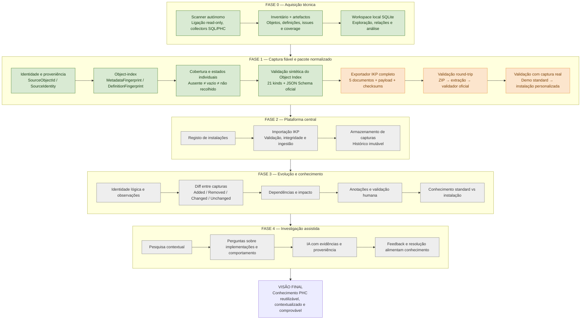

# Roadmap visual do PHC Knowledge — visão, fases e estado atual

**Data de referência:** 2026-11-07  
**Estado:** roadmap estratégico atualizado após validação do Object Index e investigação de prontidão para exportação IKP.  
**Nota:** as percentagens não são estimadas; os estados indicam maturidade qualitativa.

## 1. Objetivo do produto

Construir uma plataforma de conhecimento técnico reutilizável, contextualizado por instalação PHC e sustentado em evidências verificáveis.

A plataforma deverá permitir:
- encontrar implementações semelhantes realizadas anteriormente;
- compreender como funcionalidades e comportamentos PHC são produzidos;
- identificar dependências e impactos antes de alterações;
- relacionar documentação oficial PHC com a realidade de cada instalação;
- recuperar problemas, causas, soluções e decisões técnicas anteriores;
- apoiar consultores e programadores com respostas fundamentadas e rastreáveis.

Não é um clone do PHC, um explorador SQL genérico, um repositório de ficheiros ou apenas um chatbot com documentação solta.

## 2. Roadmap visual

Legenda:
- **Concluído / existente** — existe implementação funcional ou decisão consolidada.
- **Em curso** — investigação, desenho ou implementação parcial.
- **Por construir** — ainda não existe implementação funcional no produto central.
- **Dependente de validação** — precisa de captura real ou validação técnica antes de fechar.

> O diagrama é sequencial para comunicar dependências, mas algumas atividades podem decorrer em paralelo. A análise relacional já existente no Scanner é uma capacidade reaproveitável; não significa que a plataforma central esteja implementada.

## 3. Onde estamos hoje

### Fase 0 — Aquisição técnica

**Estado: existente / funcional no Scanner**

Já temos:
- aplicação Scanner autónoma, com Desktop e CLI;
- collectors para estrutura SQL Server e personalizações PHC;
- recolha de objetos, definições/artefactos, issues e cobertura por operação;
- workspace SQLite;
- inventário pesquisável e exportação ZIP de personalizações;
- relações declaradas REL/DTL;
- interpretação de expressões e projeção relacional com evidências, relações de conhecimento e field mappings;
- testes automatizados no projeto Scanner.

Limites conhecidos:
- a cobertura atual tem diferenças semânticas entre operações e tipos de recolha;
- alguns collectors filtram registos sem conteúdo antes de os emitir;
- a cobertura atual não permite concluir remoções com segurança em todos os casos;
- a exportação ZIP existente não é ainda o pacote IKP.

### Fase 1 — Captura fiável e pacote normalizado

**Estado: Object Index implementado e validado sinteticamente contra o schema oficial; exportador IKP completo por implementar; captura real ainda pendente**

**Atualização de implementação — 2026-11-07**

#### P1.B — Object Index: concluído na vertente sintética

Implementado em `PhcKnowledgeScanner.Export`:
- `ObjectOperationResolver`: mapping explícito dos 21 kinds emitidos para operações observadoras;
- `SourceIdentityResolver`: stamps PHC e IDs nativos SQL, com scopes resolvidos dentro da captura;
- `MetadataProjectionResolver`, `CanonicalJsonSerializer` e `MetadataFingerprintCalculator`: projeção semântica e fingerprints determinísticos;
- `DefinitionProjectionResolver`: estados individuais Available / Empty / Unavailable / NotCollected, sustentados por evidência;
- `ObjectIndexProjectionInputReader`: leitura read-only de CaptureId, coverage, objetos, issues, metadados e bytes de artefactos referenciados;
- `ObjectIndexProjector`: projeção pura e determinística de `object-index.json`;
- `ObjectIndexWorkspaceProjector`: ligação read-only entre workspace e projector.

**Validação confirmada — GitHub Actions run `42419610023`:**
- Build .NET aprovado;
- **275 testes .NET aprovados**;
- cenário sintético do projector cobre os **21 kinds**;
- JSON produzido pelo C# validado contra o JSON Schema oficial IKP 0.1 Draft 2020-12.

Isto prova o contrato e a projeção com dados sintéticos. **Não prova ainda a fidelidade dos collectors a uma instalação PHC real.**

Não foram alterados schema SQLite, collectors ou queries PHC/SQL nesta etapa.

#### P1.C / IKP — prontidão para exportação investigada

Investigação registada em [`p1b-ikp-package-export-readiness-investigation-2026-11-07.md`](p1b-ikp-package-export-readiness-investigation-2026-11-07.md).

O pacote IKP 0.1 exige cinco documentos de raiz:
1. `manifest.json`
2. `capabilities.json`
3. `coverage.json`
4. `object-index.json`
5. `checksums.json`

O validador de referência também verifica referências cruzadas, paths seguros, artefactos, tamanhos, SHA-256 e `logicalContentDigest`.

**Decisão de implementação:** criar um `IkpPackageExporter` dedicado, recebendo o `ScanManifest` completo e o workspace como entradas separadas e validando a correspondência entre ambos. O exportador inicial não exige alterações ao schema SQLite.

Limitação identificada: o workspace atual não persiste timestamps reais de início/fim, ScanMode, ScannerVersion nem um origin descriptor estruturado. O exportador não pode inventar esses valores nem inferi-los de `created_at_utc` ou do label da instalação. Para a primeira versão, o manifesto completo terá de estar disponível em memória no momento da exportação.

#### Próximos passos da Fase 1

1. Implementar o pacote IKP mínimo com os cinco documentos obrigatórios.
2. Incluir os artefactos reais já persistidos no workspace, preservando bytes exatos e paths seguros.
3. Gerar checksums e `logicalContentDigest` segundo o validador de referência.
4. Criar teste end-to-end: workspace sintético → ZIP → extração → validador oficial.
5. Testar falhas de integridade: CaptureId divergente, coverage desatualizada, artefacto em falta, hash/tamanho incorreto, path inseguro e referências inválidas.
6. Só depois validar com captura real: primeiro base PHC demo standard, depois instalação personalizada.

#### Fase 1 — estado resumido

- **Concluído:** P0 CaptureId/capabilities/coverage.
- **Concluído:** P1.B Object Index, identidade, fingerprints e estados individuais, validados sinteticamente.
- **Em curso seguinte:** exportador IKP completo e validação round-trip.
- **Dependente de validação real:** fidelidade dos collectors e artefactos numa captura PHC demo e numa instalação personalizada.

### Fase 2 — Plataforma central

**Estado: por construir**

A pasta `src/` da plataforma central ainda não contém implementação funcional. O contrato define a direção, mas falta construir:
- registo e gestão de instalações;
- receção e validação de pacotes IKP;
- ingestão transacional e idempotente;
- armazenamento de capturas imutáveis e respetivos artefactos;
- consulta do inventário importado.

A plataforma deverá consumir IKP; não deverá ligar-se diretamente às bases de dados dos clientes nem executar o Scanner em runtime.

### Fase 3 — Evolução e conhecimento

**Estado: arquitetura conceptual / por implementar na plataforma**

Falta construir:
- entidades lógicas e observações por captura;
- correspondência de identidade entre scans;
- comparação segura entre capturas;
- deteção de dependências e análise de impacto;
- anotações humanas persistentes e estados de validação;
- separação entre conhecimento standard PHC e conhecimento específico de cada instalação;
- promoção controlada de conhecimento reutilizável.

A regra essencial é que uma ausência só pode ser considerada remoção quando a cobertura e a compatibilidade permitem essa conclusão.

### Fase 4 — Investigação assistida por IA

**Estado: visão futura / por construir**

Só depois de existir conhecimento estruturado e rastreável faz sentido construir:
- pesquisa semântica contextual;
- perguntas sobre implementações e comportamento;
- explicações que cruzem documentação oficial, estrutura e personalizações;
- respostas com evidências, origem, confiança e incerteza explícita;
- ciclo de feedback em que problemas e soluções validados enriquecem a base de conhecimento.

A IA não deverá inventar factos nem substituir a proveniência. Deve investigar sobre conhecimento já organizado.

## 4. Próximos marcos recomendados

| Ordem | Marco | Estado / critério de conclusão |
|---:|---|---|
| 1 | P0 — CaptureId, capabilities e coverage | **Concluído.** Contratos e testes de captura/cobertura existentes. |
| 2 | P1.B — Object Index | **Concluído na vertente sintética.** 21 kinds, identidade, fingerprints, estados de definição, determinismo e validação do JSON Schema oficial; run `42419610023`, 275 testes .NET. |
| 3 | Exportador IKP mínimo | **Próximo.** Cinco documentos obrigatórios, payload de artefactos do workspace, paths seguros e checksums. |
| 4 | Validação round-trip IKP | ZIP extraído e validado por `validate_ikp_fixture.py`; testes positivos e negativos de integridade. |
| 5 | Captura PHC real controlada | Primeiro demo standard, depois instalação personalizada; confirmar collectors, cobertura, artefactos e fidelidade dos dados. |
| 6 | Importador da plataforma central | Pacote validado e importado de forma idempotente, sem duplicação e com captura preservada. |
| 7 | Histórico, identidade e diff | Comparar capturas sem confundir instalação, objeto observado e entidade lógica; só inferir remoções com cobertura suficiente. |
| 8 | Dependências, conhecimento e pesquisa | Consultas devolvem objetos, evidências, contexto e anotações rastreáveis. |
| 9 | Investigação assistida por IA | Respostas fundamentadas em evidências, proveniência e incerteza explícita. |

## 5. Critério para não perder o rumo

Cada fase deve produzir uma capacidade verificável:
1. **Recolher** sem alterar a instalação.
2. **Descrever** exatamente o que foi observado e o que não foi.
3. **Transportar** a captura sem perder integridade ou proveniência.
4. **Importar** sem misturar instalações nem apagar histórico.
5. **Comparar** apenas quando a cobertura permite.
6. **Relacionar** factos, interpretações e conhecimento humano sem os confundir.
7. **Investigar** com respostas justificadas por evidências.

## 6. Referências de arquitetura

- `README.md` — fronteira entre Scanner e plataforma.
- `docs/architecture/product-boundaries.md` — objetivo e limites do produto.
- `docs/architecture/knowledge-layers.md` — camadas de conhecimento e proveniência.
- `docs/architecture/ikp-0.1-specification.md` — pacote de transferência.
- `docs/architecture/p1-identity-provenance-contract.md` — identidade, proveniência e fingerprints.
- `docs/architecture/p1b-static-consistency-audit-2026-11-06.md` — auditoria estática do object-index.
- `docs/architecture/p1b-projector-workspace-read-contract-2026-11-06.md` — leitura read-only do workspace.

**Nota de rigor:** este roadmap é uma síntese do estado documental, do código e dos resultados de CI observados na branch `main`, em 2026-11-07. Não representa percentagens de conclusão. A validação sintética do Object Index não substitui a validação de integração com uma captura PHC real.

## 7. Decisão transversal — preparação para RAG

O PHC Knowledge deve ser preparado desde já para poder evoluir para um RAG híbrido e fundamentado em evidências, mas a implementação do motor RAG fica para depois da construção da base de conhecimento estruturada. Não antecipar escolhas de LLM, embeddings ou base vetorial.

Princípio: **conhecimento fiável primeiro; recuperação aumentada por IA depois**.

A decisão arquitetural, os princípios a preservar e os critérios de prontidão estão documentados em [rag-readiness-and-knowledge-first-decision-2026-11-06.md](rag-readiness-and-knowledge-first-decision-2026-11-06.md).

## 8. Visão futura do Scanner — edição e publicação controlada

Foi registada uma possível evolução **da aplicação Scanner**: permitir localizar um objeto/personalização, editar uma versão de trabalho, comparar e validar a alteração e, quando suportado, publicá-la na instalação PHC com aprovação e auditoria.

Esta capacidade pertence ao Scanner, não à plataforma central. Os collectors mantêm-se read-only; edição e publicação serão componentes separados, com adaptadores explícitos por tipo de objeto. A evidência original da captura deverá permanecer imutável.

É uma visão futura e não altera o foco atual em P1.B, Object Index, IKP e validação com captura real. Não existe implementação nem decisão sobre os primeiros tipos de objetos a publicar.

Detalhe e salvaguardas: [scanner-controlled-change-management-vision-2026-11-07.md](scanner-controlled-change-management-vision-2026-11-07.md).
