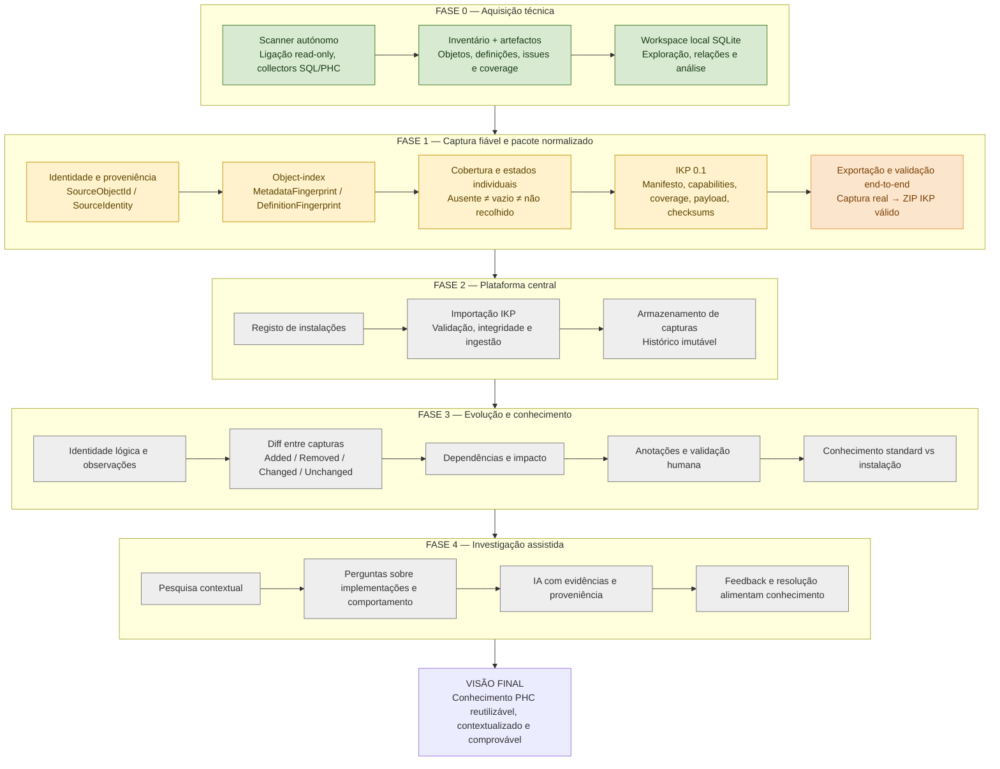

# Roadmap visual do PHC Knowledge — visão, fases e estado atual

**Data de referência:** 2026-11-06  
**Estado:** roadmap estratégico de trabalho, alinhado com as decisões de produto e com o código/documentação existentes.  
**Nota:** as percentagens não são estimadas; os estados indicam maturidade qualitativa.

## 1. Objetivo do produto

Construir uma plataforma de conhecimento técnico reutilizável, contextualizado por instalação PHC e sustentado em evidências verificáveis.

A plataforma deverá permitir:
- encontrar implementações semelhantes realizadas anteriormente;
- compreender como funcionalidades e comportamentos PHC são produzidos;
- identificar dependências e impactos antes de alterações;
- relacionar documentação oficial PHC com a realidade de cada instalação;
- recuperar problemas, causas, soluções e decisões técnicas anteriores;
- apoiar consultores e programadores com respostas fundamentadas e rastreáveis.

Não é um clone do PHC, um explorador SQL genérico, um repositório de ficheiros ou apenas um chatbot com documentação solta.

## 2. Roadmap visual

Legenda:
- **Concluído / existente** — existe implementação funcional ou decisão consolidada.
- **Em curso** — investigação, desenho ou implementação parcial.
- **Por construir** — ainda não existe implementação funcional no produto central.
- **Dependente de validação** — precisa de captura real ou validação técnica antes de fechar.

> O diagrama é sequencial para comunicar dependências, mas algumas atividades podem decorrer em paralelo. A análise relacional já existente no Scanner é uma capacidade reaproveitável; não significa que a plataforma central esteja implementada.

## 3. Onde estamos hoje

### Fase 0 — Aquisição técnica

**Estado: existente / funcional no Scanner**

Já temos:
- aplicação Scanner autónoma, com Desktop e CLI;
- collectors para estrutura SQL Server e personalizações PHC;
- recolha de objetos, definições/artefactos, issues e cobertura por operação;
- workspace SQLite;
- inventário pesquisável e exportação ZIP de personalizações;
- relações declaradas REL/DTL;
- interpretação de expressões e projeção relacional com evidências, relações de conhecimento e field mappings;
- testes automatizados no projeto Scanner.

Limites conhecidos:
- a cobertura atual tem diferenças semânticas entre operações e tipos de recolha;
- alguns collectors filtram registos sem conteúdo antes de os emitir;
- a cobertura atual não permite concluir remoções com segurança em todos os casos;
- a exportação ZIP existente não é ainda o pacote IKP.

### Fase 1 — Captura fiável e pacote normalizado

**Estado: desenho consolidado em partes; implementação do novo contrato ainda incompleta**

Já temos:
- especificação IKP 0.1 documentada;
- schemas e validador de fixture mínima;
- matriz de compatibilidade Scanner ↔ IKP;
- contrato P1 de identidade, proveniência e fingerprints;
- investigação P1.B do emissor do object-index;
- política de fingerprints e matriz de SourceIdentity;
- desenho do projector e projeções de metadata;
- auditoria estática dos 21 tipos de objetos emitidos;
- contrato de leitura do workspace para o projector;
- diagramas ER e de classes do estado atual.

Em curso:
- fechar o projector do object-index com base no comportamento real dos collectors;
- alinhar a fixture IKP com os kinds e operationIds reais;
- preparar APIs de leitura read-only necessárias ao projector;
- consolidar a semântica de cobertura e de estado individual das definições.

Dependência que falta:
- uma captura real do Scanner, com SQLite e artefactos, para validar hashes, tamanhos, caminhos, identidade e projeções sem inventar dados.

**Este é o foco atual do projeto.** O próximo marco útil é conseguir transformar uma captura real numa representação IKP consistente e validada.

### Fase 2 — Plataforma central

**Estado: por construir**

A pasta `src/` da plataforma central ainda não contém implementação funcional. O contrato define a direção, mas falta construir:
- registo e gestão de instalações;
- receção e validação de pacotes IKP;
- ingestão transacional e idempotente;
- armazenamento de capturas imutáveis e respetivos artefactos;
- consulta do inventário importado.

A plataforma deverá consumir IKP; não deverá ligar-se diretamente às bases de dados dos clientes nem executar o Scanner em runtime.

### Fase 3 — Evolução e conhecimento

**Estado: arquitetura conceptual / por implementar na plataforma**

Falta construir:
- entidades lógicas e observações por captura;
- correspondência de identidade entre scans;
- comparação segura entre capturas;
- deteção de dependências e análise de impacto;
- anotações humanas persistentes e estados de validação;
- separação entre conhecimento standard PHC e conhecimento específico de cada instalação;
- promoção controlada de conhecimento reutilizável.

A regra essencial é que uma ausência só pode ser considerada remoção quando a cobertura e a compatibilidade permitem essa conclusão.

### Fase 4 — Investigação assistida por IA

**Estado: visão futura / por construir**

Só depois de existir conhecimento estruturado e rastreável faz sentido construir:
- pesquisa semântica contextual;
- perguntas sobre implementações e comportamento;
- explicações que cruzem documentação oficial, estrutura e personalizações;
- respostas com evidências, origem, confiança e incerteza explícita;
- ciclo de feedback em que problemas e soluções validados enriquecem a base de conhecimento.

A IA não deverá inventar factos nem substituir a proveniência. Deve investigar sobre conhecimento já organizado.

## 4. Próximos marcos recomendados

| Ordem | Marco | Critério de conclusão |
|---:|---|---|
| 1 | Fechar P1.B do object-index | Projector determinístico, mapping fechado e testes unitários puros. |
| 2 | Validar com captura real | SQLite e artefactos lidos em modo read-only; hashes, tamanhos, paths e referências coerentes. |
| 3 | Corrigir compatibilidade IKP | Fixture e validador representam os kinds, operationIds e relações realmente emitidos. |
| 4 | Produzir IKP a partir do Scanner | ZIP com manifesto, capabilities, coverage, object-index, checksums e payload validável. |
| 5 | Implementar importador central | Pacote validado e importado sem duplicação, com captura preservada. |
| 6 | Implementar histórico e identidade | Duas capturas da mesma instalação podem ser comparadas sem confundir instalação com entidade. |
| 7 | Construir pesquisa e conhecimento | Consultas devolvem objetos, evidências, contexto e anotações rastreáveis. |
| 8 | Adicionar investigação assistida | IA responde com referências às evidências e sinaliza incerteza. |

## 5. Critério para não perder o rumo

Cada fase deve produzir uma capacidade verificável:
1. **Recolher** sem alterar a instalação.
2. **Descrever** exatamente o que foi observado e o que não foi.
3. **Transportar** a captura sem perder integridade ou proveniência.
4. **Importar** sem misturar instalações nem apagar histórico.
5. **Comparar** apenas quando a cobertura permite.
6. **Relacionar** factos, interpretações e conhecimento humano sem os confundir.
7. **Investigar** com respostas justificadas por evidências.

## 6. Referências de arquitetura

- `README.md` — fronteira entre Scanner e plataforma.
- `docs/architecture/product-boundaries.md` — objetivo e limites do produto.
- `docs/architecture/knowledge-layers.md` — camadas de conhecimento e proveniência.
- `docs/architecture/ikp-0.1-specification.md` — pacote de transferência.
- `docs/architecture/p1-identity-provenance-contract.md` — identidade, proveniência e fingerprints.
- `docs/architecture/p1b-static-consistency-audit-2026-11-06.md` — auditoria estática do object-index.
- `docs/architecture/p1b-projector-workspace-read-contract-2026-11-06.md` — leitura read-only do workspace.

**Nota de rigor:** este roadmap é uma síntese de estado documental e de código na branch `main), em 2026-11-06. Não representa uma auditoria de execução recente nem percentagens de conclusão.

## 7. Decisão transversal — preparação para RAG

O PHC Knowledge deve ser preparado desde já para poder evoluir para um RAG híbrido e fundamentado em evidências, mas a implementação do motor RAG fica para depois da construção da base de conhecimento estruturada. Não antecipar escolhas de LLM, embeddings ou base vetorial.

Princípio: **conhecimento fiável primeiro; recuperação aumentada por IA depois**.

A decisão arquitetural, os princípios a preservar e os critérios de prontidão estão documentados em [rag-readiness-and-knowledge-first-decision-2026-11-06.md](rag-readiness-and-knowledge-first-decision-2026-11-06.md).
