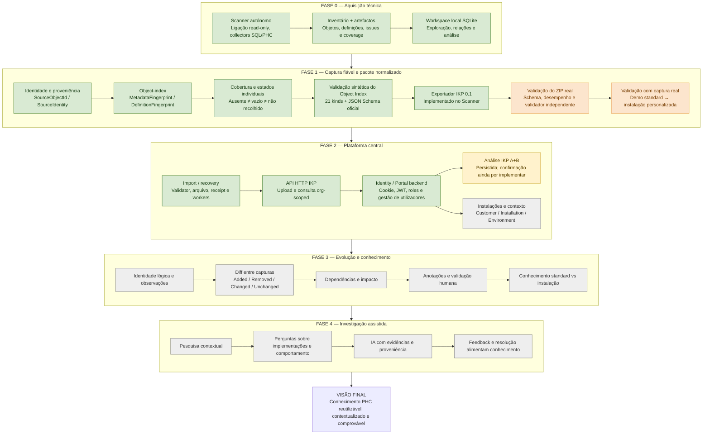

# Roadmap visual do PHC Knowledge — visão, fases e estado atual

**Data de referência:** 2026-11-19
**Estado:** Scanner/IKP, ingestão/recovery, API HTTP IKP, Identity/Portal backend e análise IKP (Incrementos A+B) implementados e tecnicamente validados (incluindo SQL Server de teste) na branch `feature/ikp-package-analysis-a` (ainda sem publicação Git); materialização do domínio, confirmação explícita (Incremento C — desenho aprovado, não implementado), associação a instalações e UI continuam por construir. A PR #15 permanece integrada na main (`6c619bfc`).
**Nota:** as percentagens não são estimadas; os estados indicam maturidade qualitativa.

## 1. Objetivo do produto

Construir uma plataforma de conhecimento técnico reutilizável, contextualizado por instalação PHC e sustentado em evidências verificáveis.

A plataforma deverá permitir:
- encontrar implementações semelhantes realizadas anteriormente;
- compreender como funcionalidades e comportamentos PHC são produzidos;
- identificar dependências e impactos antes de alterações;
- relacionar documentação oficial PHC com a realidade de cada instalação;
- recuperar problemas, causas, soluções e decisões técnicas anteriores;
- apoiar consultores e programadores com respostas fundamentadas e rastreáveis.

Não é um clone do PHC, um explorador SQL genérico, um repositório de ficheiros ou apenas um chatbot com documentação solta.

## 2. Roadmap visual

Legenda:
- **Concluído / existente** — existe implementação funcional ou decisão consolidada.
- **Em curso** — investigação, desenho ou implementação parcial.
- **Por construir** — ainda não existe implementação funcional no produto central.
- **Dependente de validação** — precisa de captura real ou validação técnica antes de fechar.

> O diagrama é sequencial para comunicar dependências, mas algumas atividades podem decorrer em paralelo. A análise relacional já existente no Scanner é uma capacidade reaproveitável; não significa que a plataforma central esteja implementada.

## 3. Onde estamos hoje

### Fase 0 — Aquisição técnica

**Estado: existente / funcional no Scanner**

Já temos:
- aplicação Scanner autónoma, com Desktop e CLI;
- collectors para estrutura SQL Server e personalizações PHC;
- recolha de objetos, definições/artefactos, issues e cobertura por operação;
- workspace SQLite;
- inventário pesquisável e exportação ZIP de personalizações;
- relações declaradas REL/DTL;
- interpretação de expressões e projeção relacional com evidências, relações de conhecimento e field mappings;
- testes automatizados no projeto Scanner.

Limites conhecidos:
- a cobertura atual tem diferenças semânticas entre operações e tipos de recolha;
- alguns collectors filtram registos sem conteúdo antes de os emitir;
- a cobertura atual não permite concluir remoções com segurança em todos os casos;
- o exportador IKP 0.1 já existe e está integrado na CLI; o pacote real CSDefault202603 já foi exercitado no harness de receção/arquivo/recovery; a captura cobre 8/21 kinds e não valida estabilidade de identidade entre capturas.

### Fase 1 — Captura fiável e pacote normalizado

**Estado: Object Index e exportador IKP 0.1 implementados; correção de desempenho aplicada; pacote real exercitado no percurso de receção/arquivo/recovery. A validação real cobre apenas os kinds presentes na captura.**

**Atualização de implementação — 2026-11-07**

#### P1.B — Object Index: implementado; validação real parcial

Implementado em `PhcKnowledgeScanner.Export`:
- `ObjectOperationResolver`: mapping explícito dos 21 kinds emitidos para operações observadoras;
- `SourceIdentityResolver`: stamps PHC e IDs nativos SQL, com scopes resolvidos dentro da captura;
- `MetadataProjectionResolver`, `CanonicalJsonSerializer` e `MetadataFingerprintCalculator`: projeção semântica e fingerprints determinísticos;
- `DefinitionProjectionResolver`: estados individuais Available / Empty / Unavailable / NotCollected, sustentados por evidência;
- `ObjectIndexProjectionInputReader`: leitura read-only de CaptureId, coverage, objetos, issues, metadados e bytes de artefactos referenciados;
- `ObjectIndexProjector`: projeção pura e determinística de `object-index.json`;
- `ObjectIndexWorkspaceProjector`: ligação read-only entre workspace e projector.

**Validação confirmada — GitHub Actions run `42419610023`:**
- Build .NET aprovado;
- **275 testes .NET aprovados**;
- cenário sintético do projector cobre os **21 kinds**;
- JSON produzido pelo C# validado contra o JSON Schema oficial IKP 0.1 Draft 2020-12.

A validação sintética cobre os 21 kinds. Em 2026-11-08, a projeção foi também exercitada com a captura real `CSDefault202603`: 16.618 objetos projetados, 8.307 SourceIdentity e 16.581 MetadataFingerprint; foram confirmadas correspondências de tamanho/hash dos 49 artefactos. Esta validação real cobriu apenas os kinds presentes nessa captura (8/21), pelo que não demonstra cobertura real exaustiva nem estabilidade de identidade entre capturas.

Não foram alterados schema SQLite, collectors ou queries PHC/SQL nesta etapa.

#### P1.C / IKP — exportador implementado; pacote real exercitado pelo harness Import

Investigação registada em [`p1b-ikp-package-export-readiness-investigation-2026-11-07.md`](p1b-ikp-package-export-readiness-investigation-2026-11-07.md).

O pacote IKP 0.1 exige cinco documentos de raiz:
1. `manifest.json`
2. `capabilities.json`
3. `coverage.json`
4. `object-index.json`
5. `checksums.json`

O validador de referência também verifica referências cruzadas, paths seguros, artefactos, tamanhos, SHA-256 e `logicalContentDigest`.

**Implementação concluída:** `IkpPackageExporter` dedicado em `PhcKnowledgeScanner.Export`, integrado na CLI através de `scan-ikp` e `export-ikp`. O exportador recebe o manifesto e o workspace como entradas separadas, valida a correspondência, gera os cinco documentos obrigatórios, checksums e digest lógico, e preserva os bytes dos artefactos.

Limitação identificada: o workspace atual não persiste timestamps reais de início/fim, ScanMode, ScannerVersion nem um origin descriptor estruturado. O exportador não pode inventar esses valores nem inferi-los de `created_at_utc` ou do label da instalação. Para a primeira versão, o manifesto completo terá de estar disponível em memória no momento da exportação.

#### P1.C.1 — Desempenho da validação do Object Index: causa isolada; correção aplicada e validada

Em 2026-11-11 foi executado um teste A/B com o mesmo pacote real `CSDefault202603-ikp-validation.zip`, usando JsonSchema.Net 7.3.1:

- Com `uniqueItems: true` no array principal `objects` de `object-index.schema.json`, a validação ultrapassou 120 segundos sem terminar.
- Numa cópia temporária do schema, removendo apenas esse `uniqueItems`, a avaliação do schema terminou em 2,64 segundos; o diagnóstico completo terminou em 2,82 segundos e o pacote foi aceite.
- A leitura do JSON (9.000.983 bytes) demorou cerca de 0,10 segundos e o carregamento do schema cerca de 0,05 segundos. A diferença observada está, portanto, na avaliação da regra `uniqueItems` sobre o array grande, não na leitura do ficheiro.
- `IkpPackageValidator.ValidateObjectIndex` já verifica duplicados de `sourceObjectId` com `HashSet<string>` e `StringComparer.Ordinal`, preservando a unicidade dos identificadores em tempo linear.

**Decisão técnica:** remover exclusivamente `uniqueItems: true` do array raiz `objects`. Manter `uniqueItems: true` em `definition.artifactIds`, que é uma lista pequena e cuja unicidade continua a ser relevante. Não alterar outras regras do schema, o contrato IKP 0.1, o código do Scanner, SQLite, collectors ou a lógica de identidade nesta intervenção.

**Estado: concluído em 2026-11-18.** A regra foi removida apenas do array raiz `objects`; mantém-se a unicidade de `definition.artifactIds` no schema e a validação ordinal de `sourceObjectId` no validador C#. O harness com o ZIP real confirmou receção e recovery em tempos compatíveis (ver relatório do harness).

#### Estado e próximos passos da Fase 1 — atualização 2026-11-18

Concluído desde a revisão anterior:
- Remoção localizada de `uniqueItems: true` do array raiz `objects`; unicidade de `sourceObjectId` preservada no validador C# e de `artifactIds` no schema.
- Harness local opt-in com o ZIP IKP real `CSDefault202603`: receção, idempotência, arquivo imutável e recovery após interrupção simulada, com tempos medidos e registados em [real-ikp-receipt-integration-harness-2026-11-18.md](real-ikp-receipt-integration-harness-2026-11-18.md).

Continua por validar:
- Os 13 kinds que não surgem na captura real (a captura cobre 8/21).
- Estabilidade de identidade lógica entre capturas distintas.
- Validação real exaustiva de categorias/artefactos e todos os cenários de compatibilidade do exportador.
- Validador independente end-to-end como verificação adicional; o harness real atual valida o percurso do Import com o ZIP real, não substitui todas as verificações externas.

Não alterar SQLite/collectors sem evidência concreta de lacuna.

#### Fase 1 — estado resumido (2026-11-18)

- **Concluído:** P0 CaptureId/capabilities/coverage.
- **Implementado e testado sinteticamente:** P1.B Object Index, identidade, fingerprints e estados individuais; 21 kinds cobertos sinteticamente.
- **Exercitado com captura real:** 8/21 kinds presentes na `CSDefault202603`; 16.618 objetos e 52 artefactos no pacote real usado pelo harness.
- **Implementado:** exportador IKP 0.1 e comandos CLI `scan-ikp` / `export-ikp`.
- **Concluído:** correção de desempenho de `objects.uniqueItems` e validação do percurso real de receção/arquivo/idempotência/recovery.
- **Pendente:** kinds não observados na captura real, estabilidade de identidade entre capturas e validação independente adicional.

### Fase 2 — Plataforma central

**Estado: backend de ingestão, HTTP e Identity/Portal implementado; análise IKP A+B implementada e tecnicamente validada (unitária, HTTP e SQL Server de teste) na branch de trabalho; confirmação (C), contexto de instalação, UI e materialização ainda incompletos.**

Implementado no código integrado na `main`:
- Host único `WebApplication` / Kestrel com API e workers internos de recovery, cleanup e monitorização.
- Pipeline IKP de validação, receção, arquivo imutável content-addressed, receipts/tentativas org-scoped e recuperação.
- API HTTP IKP: `POST /api/v1/ikp/packages`, `GET /api/v1/ikp/attempts/{attemptId}` e `GET /api/v1/ikp/packages/{packageId}`; JWT Bearer e scopes quando ativados.
- Organização canónica e ASP.NET Identity com `Administrator` e `Collaborator`.
- Portal backend com cookie, login/logout, sessão, antiforgery, validação de SecurityStamp e API administrativa de utilizadores.
- CLI `PhcKnowledge.Install` para scripts SQL, migrations Identity, organização canónica, roles e bootstrap do primeiro administrador.

Implementado e tecnicamente validado na branch `feature/ikp-package-analysis-a` (A+B; ainda sem commit/push/PR):
- **Incremento A:** reopen do ZIP imutável com re-verificação SHA-256/comprimento; `IkpPackageInspectionEngine` partilhado entre Validator e Reader; `PackageImportAnalysis` com Object Index, artefactos, REL/DTL, readiness (`Ready` / `ReadyWithWarnings` / `Blocked`); validação com captura real CSDefault202603 via harness efémero (sem dados de clientes no repositório).
- **Incremento B:** persistência append-only em `dbo.PackageImportAnalyses` (migration 004); chave canónica `(OrganizationId, PackageId, ZipSha256, AnalysisSchemaVersion)`; POST executa/reutiliza e GET só lê; `AnalysisSchemaVersion` `0.2` (independente de `ContractVersion`); `SemanticFingerprint` / `SemanticEquals` com projeção semântica explícita (excluem `ReceiptId` e `AnalyzedAtUtc`, mantidos no JSON de auditoria); `ReceiptId` como proveniência first-writer (fora da chave única); isolamento por organização; retry limitado SQL 1205; migration 004 no Install e no Host preflight; helper `EnsureSqlScriptsAsync` com migrations 001–004.
- Endpoints: `POST|GET /api/v1/ikp/packages/{packageId}/analysis` com política `IkpRead`.

Validação registada (execuções já realizadas; não reexecutadas na consolidação documental):
- Harness local opt-in com ZIP IKP real `CSDefault202603`, incluindo receção, idempotência, arquivo e recovery; ver relatório específico.
- Análise A validada com o mesmo ZIP real (ReadyWithWarnings) sem persistir fixtures de cliente.
- `PhcKnowledge.Import.Tests`: **224 passed**.
- Testes SQL de análise (`SqlServerPackageImportAnalysisTests`): **3/3**, em **duas** execuções (`PHC_KNOWLEDGE_SQL_TEST_CONNECTION_STRING` → `PhcKnowledgeReceiptTests`).
- `SqlServerInstallBootstrapTests` (helper 001–004): **9/9**, em **duas** execuções.
- Migration 004 aplicada e reaplicada com sucesso.
- `git diff --check`: exit 0 (validações anteriores / auditoria).
- GitHub Actions na branch da PR #15: .NET workflow #253 e SQL Server integration workflow #39 concluídos com sucesso. A execução SQL descobriu 64 testes: 62 aprovados e 2 ignorados por dependerem do ZIP real, não disponibilizado em CI.
- A PR #15 foi integrada em 2026-11-18; merge commit `6c619bfc`.

Melhorias futuras de cobertura (não falhas atuais da funcionalidade A+B):
- Forçar deadlock SQL 1205 num teste de integração real (existe teste unitário da política de retry).
- Teste SQL que invoque o `SqlScriptApplicator` do Install (o bootstrap aplica 004 via helper espelhado).
- Validação de recuperação da análise após recriação do Host/serviço.

Ainda não implementado:
- UI React / experiência de navegação do Portal.
- Confirmação explícita de uma análise antes de qualquer importação/materialização (Incremento C — desenho em `increment-c-package-import-analysis-confirmation-design-2026-11-19.md`; **não implementado**).
- Gestão de Customers, Installations e Environments e associação/correção de contexto da captura.
- Materialização de Capture, Observation, artefactos e REL/DTL em entidades próprias; pesquisa do inventário materializado.
- Próximo incremento de produto após A+B: **confirmação (C) — desenho aprovado; implementação aguarda autorização**.

A plataforma deverá consumir IKP; não deverá ligar-se diretamente às bases de dados dos clientes nem executar o Scanner em runtime. Análise persistida ≠ confirmação ≠ materialização.

### Fase 3 — Evolução e conhecimento

**Estado: arquitetura conceptual / por implementar na plataforma**

Falta construir:
- entidades lógicas e observações por captura;
- correspondência de identidade entre scans;
- comparação segura entre capturas;
- deteção de dependências e análise de impacto;
- anotações humanas persistentes e estados de validação;
- separação entre conhecimento standard PHC e conhecimento específico de cada instalação;
- promoção controlada de conhecimento reutilizável.

A regra essencial é que uma ausência só pode ser considerada remoção quando a cobertura e a compatibilidade permitem essa conclusão.

### Fase 4 — Investigação assistida por IA

**Estado: visão futura / por construir**

Só depois de existir conhecimento estruturado e rastreável faz sentido construir:
- pesquisa semântica contextual;
- perguntas sobre implementações e comportamento;
- explicações que cruzem documentação oficial, estrutura e personalizações;
- respostas com evidências, origem, confiança e incerteza explícita;
- ciclo de feedback em que problemas e soluções validados enriquecem a base de conhecimento.

A IA não deverá inventar factos nem substituir a proveniência. Deve investigar sobre conhecimento já organizado.

## 4. Próximos marcos recomendados

| Ordem | Marco | Estado / critério de conclusão |
|---:|---|---|
| 1 | P0 — CaptureId, capabilities e coverage | **Concluído.** Contratos e testes de captura/cobertura existentes. |
| 2 | P1.B — Object Index | **Implementado.** 21 kinds cobertos sinteticamente; captura real validou 8/21 kinds e 49 artefactos (tamanho/hash). |
| 3 | Exportador IKP 0.1 | **Implementado no Scanner.** `IkpPackageExporter`, `scan-ikp` e `export-ikp`. |
| 4 | Desempenho do schema IKP | **Concluído.** Removido `uniqueItems` do array raiz `objects`; unicidade preservada no validador C# e para `artifactIds` no schema. |
| 5 | Harness de receção IKP real | **Concluído localmente.** ZIP real recebido, arquivado, repetido idempotentemente e recuperado após interrupção simulada. |
| 6 | Host operacional e recovery | **Implementado.** Workers de preflight, recovery, cleanup e monitorização. |
| 7 | API HTTP IKP | **Implementada.** Upload raw ZIP e consultas org-scoped, com JWT/scopes opcionais por configuração. |
| 8 | Identity e Portal backend | **Implementado e integrado na main (PR #15).** Login, sessões, roles, bootstrap e administração de utilizadores. |
| 9 | Análise IKP (Incrementos A+B) | **Implementado e tecnicamente validado** na branch `feature/ikp-package-analysis-a` (sem publicação Git). Reopen/Reader/análise + persistência POST/GET; migration 004 no Install/preflight/bootstrap; evidências Import 224, SQL análise 3/3×2, bootstrap 9/9×2. |
| 10 | Incremento C — confirmação explícita | **Desenho aprovado; não implementado.** Documento: `increment-c-package-import-analysis-confirmation-design-2026-11-19.md`. Implementação aguarda autorização. |
| 11 | Associação de contexto | **Futuro.** CaptureContextAssignment / Customer/Installation/Environment; distinto de confirmação e de materialização. |
| 12 | Materialização e comparação | **Futuro.** Capture, Observation, REL/DTL, identidade lógica e diff com cobertura suficiente. |
| 13 | Pesquisa e conhecimento reutilizável | **Futuro.** Consultas com evidências, contexto e anotações rastreáveis. |
| 14 | Investigação assistida por IA | **Futuro.** Respostas fundamentadas em evidências, proveniência e incerteza explícita. |

## 5. Critério para não perder o rumo

Cada fase deve produzir uma capacidade verificável:
1. **Recolher** sem alterar a instalação.
2. **Descrever** exatamente o que foi observado e o que não foi.
3. **Transportar** a captura sem perder integridade ou proveniência.
4. **Importar** sem misturar instalações nem apagar histórico.
5. **Comparar** apenas quando a cobertura permite.
6. **Relacionar** factos, interpretações e conhecimento humano sem os confundir.
7. **Investigar** com respostas justificadas por evidências.

## 6. Referências de arquitetura

- `README.md` — fronteira entre Scanner e plataforma.
- `docs/architecture/product-boundaries.md` — objetivo e limites do produto.
- `docs/architecture/knowledge-layers.md` — camadas de conhecimento e proveniência.
- `docs/architecture/ikp-0.1-specification.md` — pacote de transferência.
- `docs/architecture/p1-identity-provenance-contract.md` — identidade, proveniência e fingerprints.
- `docs/architecture/p1b-static-consistency-audit-2026-11-06.md` — auditoria estática do object-index.
- `docs/architecture/p1b-projector-workspace-read-contract-2026-11-06.md` — leitura read-only do workspace.

**Nota de rigor:** este roadmap é uma síntese do estado documental, do código, dos resultados de CI e dos testes comunicados até 2026-11-19. Não representa percentagens de conclusão. O teste A/B de desempenho do schema IKP foi executado com um pacote real e uma cópia temporária do schema; não equivale à validação end-to-end final do ZIP produzido pelo exportador. A+B estão implementados e tecnicamente validados (incluindo SQL Server de teste no âmbito descrito); isso **não** equivale a publicação Git nem à implementação do Incremento C. Melhorias de cobertura (deadlock 1205 real, SqlScriptApplicator do Install, recuperação pós-recriação do Host) permanecem trabalho futuro.

## 7. Decisão transversal — preparação para RAG

O PHC Knowledge deve ser preparado desde já para poder evoluir para um RAG híbrido e fundamentado em evidências, mas a implementação do motor RAG fica para depois da construção da base de conhecimento estruturada. Não antecipar escolhas de LLM, embeddings ou base vetorial.

Princípio: **conhecimento fiável primeiro; recuperação aumentada por IA depois**.

A decisão arquitetural, os princípios a preservar e os critérios de prontidão estão documentados em [rag-readiness-and-knowledge-first-decision-2026-11-06.md](rag-readiness-and-knowledge-first-decision-2026-11-06.md).

## 8. Visão futura do Scanner — edição e publicação controlada

Foi registada uma possível evolução **da aplicação Scanner**: permitir localizar um objeto/personalização, editar uma versão de trabalho, comparar e validar a alteração e, quando suportado, publicá-la na instalação PHC com aprovação e auditoria.

Esta capacidade pertence ao Scanner, não à plataforma central. Os collectors mantêm-se read-only; edição e publicação serão componentes separados, com adaptadores explícitos por tipo de objeto. A evidência original da captura deverá permanecer imutável.

É uma visão futura e não altera o foco atual em P1.B, Object Index, IKP e validação com captura real. Não existe implementação nem decisão sobre os primeiros tipos de objetos a publicar.

Detalhe e salvaguardas: [scanner-controlled-change-management-vision-2026-11-07.md](scanner-controlled-change-management-vision-2026-11-07.md).

## 9. Estado consolidado — 2026-11-19

A sequência atual é: **Scanner/IKP e captura real → receção/arquivo/recovery → API HTTP IKP → Identity/Portal backend → análise IKP A+B (implementada e validada) → confirmação explícita (C, desenho aprovado) → contexto → materializar conhecimento → investigação assistida**.

A PR #15 permanece na `main` (`6c619bfc…`). Os Incrementos A e B estão na working tree de `feature/ikp-package-analysis-a`, sem commit/push/PR. A análise é uma fotografia auditável da interpretação do pacote; **não** é confirmação nem materialização.

O harness local opt-in com CSDefault202603 cobriu receção/arquivo/recovery e, no Incremento A, reopen/análise com `ReadyWithWarnings`. Evidências A+B já realizadas: `PhcKnowledge.Import.Tests` 224 passed; SQL de análise 3/3 em duas execuções; `SqlServerInstallBootstrapTests` 9/9 em duas execuções; migration 004 aplicada/reaplicada; `git diff --check` exit 0. Detalhe: `phase-report-ikp-package-analysis-a-2026-11-19.md`.

A API e o backend de autenticação não equivalem a um Portal utilizável: não existe UI React, confirmação explícita implementada, nem gestão/associação de Customer/Installation/Environment. O domínio 0.2 (Capture/Observation/REL/DTL/Identity Matching) ainda não está materializado.

Antes de produção, mantêm-se hardening de Data Protection e de bloqueios administrativos. Melhorias futuras de cobertura da análise: deadlock 1205 real, teste do `SqlScriptApplicator` do Install, recuperação pós-recriação do Host. O Incremento C (confirmação) tem desenho aprovado e **aguarda autorização de implementação**; não iniciar React nem materialização sem decisão explícita.
