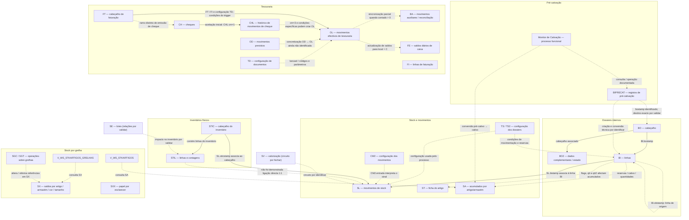
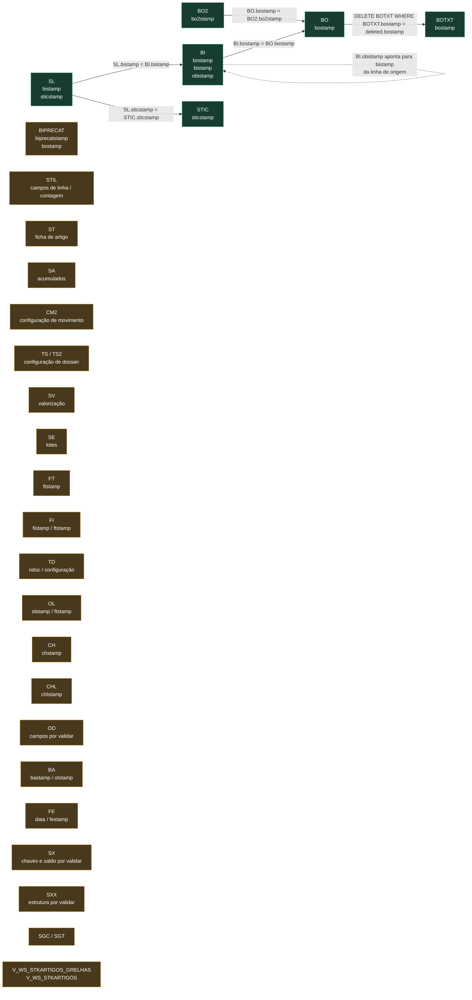

# Grafos PHC — modelo funcional e relações estruturais observadas

**Data:** 25-11-2026  
**Estado:** representação demonstrativa baseada na investigação consolidada; não é um esquema físico completo nem uma especificação universal do PHC.  
**Âmbito:** dossiers internos, stock, reservas, pré-cativação e inventários físicos.  
**Repositório:** `Jhouinho/PhcKnowledge`.

## 1. Objectivo e convenções

Este documento mantém dois grafos separados porque respondem a perguntas diferentes:

1. **Grafo funcional:** que tabelas participam nos processos e que efeitos/conexões funcionais foram identificados.
2. **Grafo estrutural:** que predicados de ligação entre colunas foram efectivamente observados na evidência consultada.

A separação é importante: uma relação funcional não prova a existência de uma foreign key SQL, e uma coluna com nome sugestivo não prova, por si só, a sua tabela de destino.

### Legenda

- **Linha contínua:** associação/predicado directamente observado ou estrutura funcional documentada.
- **Linha tracejada:** efeito funcional, dependência de configuração, associação indirecta ou mecanismo ainda por validar.
- **Caixa isolada no grafo estrutural:** tabela/colunas identificadas, mas sem predicado de junção suficientemente demonstrado nesta investigação.

As setas indicam a direcção de leitura do grafo, não necessariamente cardinalidade. Não são inferidas cardinalidades 1:1, 1:N ou N:N sem evidência.

## 2. Grafo funcional — processos PHC

Este grafo mostra como os elementos participam nos processos de dossiers, stock e inventários. Não representa exclusivamente relações PK/FK.

### 2.1 Leitura do grafo funcional

- **BO / BO2 / BI:** cabeçalho, estado complementar e linhas do dossier. A linha BI pode manter referência à linha de origem através de `obistamp`.
- **BI / SL:** o código consultado associa movimentos de stock a linhas BI através de `SL.bistamp`. A criação de SL depende de condições e configuração; não é garantida para todas as linhas.
- **BI / ST / SA:** flags de reserva/cativo e quantidades, incluindo `qtt - qtt2`, participam na actualização de acumulados. Reserva/cativo não deve ser confundido com saída física.
- **TS / TS2 / CM2:** são elementos de configuração que condicionam ou permitem interpretar os processos. As linhas tracejadas não afirmam uma FK.
- **STIC / STIL / SL:** STIC identifica o inventário e STIL conserva as contagens. SL pode associar-se ao cabeçalho através de `sticstamp`; não foi encontrada uma ligação directa demonstrada entre cada STIL e um SL.
- **BIPRECAT:** a tabela e os campos `biprecatstamp` e `bostamp` foram identificados. A criação e conversão técnica do pré-cativo continuam por localizar.
- **SV / SE:** foram identificadas no âmbito do stock/inventário, mas o circuito de valorização e as relações de lotes não estão fechados.

### 2.2 Tesouraria — relações funcionais e lacunas

O subgrafo de tesouraria cruza a análise FT/FI/TD já integrada na `main` com as observações recuperadas sobre OD, OL, BA e FE. Não se deve ler como um ERD físico.

- **FT/FI/TD → OL:** o script standard analisado contém criação de OL a partir de FT condicionada por `TD.lancaol=1` e por correspondências em TD, FT2, FT3 e OC. A criação de CH é um ramo separado.
- **FT → CH → CHL:** o trigger de FT pode criar CH em condições próprias; a aceitação inicial gera CHL com `cm=1` e não gera OL. Alguns ramos `cm=3` de CHL podem criar OL sob condições específicas.
- **OD → OL:** permanece uma pergunta em aberto. A seta tracejada é deliberadamente uma ligação por investigar, não uma conversão demonstrada.
- **OL → BA:** o trigger OL analisado sincroniza BA apenas em condições como `contado > 0`; BA não é réplica integral de OL e o processo completo de reconciliação não está demonstrado.
- **OL → FE:** o trigger OL actualiza saldos diários FE para movimentos com `local = 'C'`. O controlo operacional de dias fechados permanece por esclarecer.
- **TD:** representa configuração que condiciona o lançamento; não é uma relação estrutural inferida com OL.

O detalhe de configuração e as limitações do circuito FT/CH/CHL estão no relatório [FT/FI/TD](investigacao-funcional-csdefault-ft-fi-td-2026-11-25.md). A investigação OD/BA/FE ainda carece de relatório técnico completo e de confirmação das consultas propostas.

### 2.3 Grelhas SX/SXX

O subgrafo de grelhas acrescenta a evidência disponível no PR #34:
- `V_WS_STKARTIGOS_GRELHAS` consulta SX para apresentar saldos por artigo/armazém/cor/tamanho;
- `V_WS_STKARTIGOS` consulta SA;
- os triggers SL analisados não demonstram escrita de saldos em SX/SXX;
- SGC/SGT alteram ou eliminam referências de cor/tamanho em SX, mas não demonstram o cálculo de `SX.stock`;
- o papel de SXX e a rotina de manutenção dos saldos SX continuam por identificar.

As setas são funcionais/de leitura. Não representam predicados PK/FK.

### 2.4 BO e BOTXT

A investigação inicial de BO no PR #35 identificou validações de assinatura/importação envolvendo BO, BO2, TS e TS2, e uma limpeza de BOTXT por `bostamp` no trigger de eliminação. O grafo estrutural inclui apenas o predicado de limpeza observado; não inventa as chaves de associação entre BO/BO2/TS/TS2 usadas nas validações.

## 3. Grafo estrutural — predicados de ligação observados

Este segundo grafo é deliberadamente mais restrito. Só inclui ligações cuja expressão foi registada na análise do script ou dos dados. **Não afirma que estas colunas estejam declaradas como PK/FK no SQL Server.**

### 3.1 Predicados efectivamente observados

| Origem | Predicado / coluna | Destino | Interpretação permitida |
|---|---|---|---|
| BO2 | `BO.bostamp = BO2.bo2stamp` | BO | Associação entre BO e BO2 usada no código consultado |
| BI | `BI.bostamp = BO.bostamp` | BO | Linha BI associada ao cabeçalho BO |
| SL | `SL.bistamp = BI.bistamp` | BI | Movimento SL associado a uma linha BI |
| BI | `BI.obistamp` aponta para `BI.bistamp` de origem | BI (auto-relação funcional) | Ligação da linha de destino à linha de origem; não classificar como REL/DTL sem validar |
| SL | `SL.sticstamp = STIC.sticstamp` | STIC | Movimento associado ao cabeçalho do inventário |
| BOTXT | `BOTXT.bostamp = deleted.bostamp` no trigger de eliminação BO | BO (registo eliminado) | Predicado de limpeza executado por `tr_bo_delete`; não afirmar FK declarada |

A direcção das setas no Mermaid foi escolhida para facilitar a leitura; a igualdade indicada na tabela é a referência principal para interpretar cada associação.

### 3.2 Elementos identificados sem ligação estrutural fechada

| Tabela | O que está identificado | O que não se deve ainda afirmar |
|---|---|---|
| BIPRECAT | Colunas `biprecatstamp` e `bostamp` | Não afirmar qual a tabela/coluna de destino de `bostamp`, nem o ciclo de escrita, sem validar o esquema e o código |
| STIL | Linhas de inventário e campos de contagem | Não afirmar a coluna exacta de junção a STIC nem uma ligação a SL sem evidência estrutural adicional |
| ST / SA | Ficha e acumulados por artigo/armazém | Não representar chaves de artigo/armazém como confirmadas neste grafo |
| CM2 | Configuração que determina o sentido do movimento através de `entrada` | Não inventar o predicado usado para chegar a CM2 a partir de SL |
| TS / TS2 | Configuração de tipos de dossier e opções | Não representar relações físicas às linhas BI sem identificar os campos e predicados concretos |
| SV | Elementos de valorização identificados | Não afirmar a ligação exacta a SL, STIC ou documentos |
| SE | Tabela de lotes identificada; na amostra blivo2026 não tinha registos | Não inferir as ligações de lote a artigo, armazém ou movimento |
| OD / OL / BA / FE | Tabelas e funções funcionais identificadas parcialmente | Não inferir a chave de passagem OD→OL, a relação estrutural OL–BA nem a ligação por data OL–FE sem predicado verificado |
| FT / FI / TD / CH / CHL | Circuito funcional descrito pelos triggers standard | Não inferir PK/FK entre estes elementos apenas a partir do fluxo |
| SX / SXX | SX consultada por view; SGC/SGT operam sobre referências de grelha; SXX por esclarecer | Não inferir junção SX/SXX nem a rotina de cálculo do saldo |
| BOTXT | Limpeza por `bostamp` no trigger de eliminação BO | Não classificar o predicado do trigger como FK declarada |

## 4. O que este grafo não representa

- Não é um diagrama ERD completo nem uma exportação do catálogo SQL Server.
- Não enumera todas as colunas, índices, constraints, PKs, FKs, views, procedures, functions ou triggers.
- Não garante que os predicados observados sejam iguais em todas as versões, módulos ou instalações PHC.
- Não transforma dependências funcionais em relações físicas.
- Não representa cardinalidades quando estas não foram medidas.
- Não prova que a ausência de uma ligação no grafo signifique que ela não exista na base de dados.

## 5. Próxima recolha necessária para um ERD físico completo

Para passar do grafo estrutural mínimo para um ERD físico por instalação, a recolha read-only deverá obter, para cada base de dados e schema:

1. Tabelas e schemas existentes.
2. Colunas, tipos, nulabilidade e ordem.
3. Primary keys e unique constraints.
4. Foreign keys declaradas, incluindo colunas de origem/destino.
5. Índices relevantes.
6. Views, procedures, functions e triggers que implementem relações lógicas não declaradas como FK.
7. Predicados de junção usados nos processos PHC, quando não exista constraint física.

A recolha deve manter os resultados separados por base de dados — por exemplo, `CSDefault202603`, `blivo2026`, `Digicanola` e `dfblock` — sem assumir que o esquema ou a configuração são idênticos.

### 5.1 Critérios de classificação futura

Cada aresta do grafo estrutural deverá receber uma classificação:

- **FK declarada:** constraint encontrada no catálogo SQL Server.
- **PK/UK + predicado observado:** ligação lógica sustentada por chave/índice e consulta/código.
- **Predicado de código:** igualdade ou condição encontrada em trigger, procedure, view ou código aplicacional.
- **Associação funcional:** relação descrita pela Enciclopédia ou comportamento observado, sem predicado estrutural demonstrado.
- **Hipótese:** possibilidade ainda sem evidência suficiente; deve ficar fora do grafo de relações confirmadas.

## 6. Fontes e limites

Este documento deriva da investigação consolidada nos seguintes documentos:

- [Dossiers internos, stock cativo e pré-cativo](investigacao-funcional-dossiers-internos-stock-cativo-precativo-2026-11-25.md).
- [Stock e inventários físicos](investigacao-funcional-stock-inventarios-2026-11-25.md).
- [Síntese e rastreabilidade — dossiers, stock e inventários](sintese-rastreabilidade-dossiers-stock-inventarios-2026-11-25.md).
- [Investigação FT/FI/TD e tesouraria](investigacao-funcional-csdefault-ft-fi-td-2026-11-25.md).
- [Investigação técnica de SX/SXX](investigacao-tecnica-stock-grelhas-sx-sxx-2026-11-26.md) — disponível no PR #34, ainda não integrado na main.
- [Investigação inicial de BO](investigacao-funcional-csdefault-bo-2026-11-26.md) — disponível no PR #35, ainda não integrado na main.

A evidência estrutural actualmente disponível é parcial. Em particular, a identificação de nomes de colunas não equivale a uma inspecção integral do catálogo SQL Server. O grafo deve ser actualizado quando forem obtidos os metadados físicos de cada base.

**Estado:** grafo funcional demonstrativo criado; grafo estrutural mínimo limitado aos predicados observados; ERD físico completo pendente de recolha de metadados read-only.
