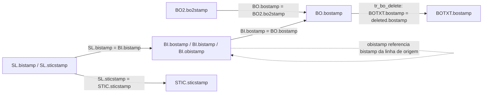

# Grafo funcional PHC e relações estruturais observadas

**Criação:** 25-11-2026  
**Revisão:** 27-11-2026  
**Base principal de análise:** `CSDefault202603`, com fontes complementares identificadas por relatório  
**Estado:** grafo de conhecimento em evolução; não é ERD físico nem especificação universal do PHC.

## 1. Para que serve este grafo

O grafo organiza o conhecimento funcional recolhido nos últimos dias e ajuda a escolher a próxima investigação. Mantém duas vistas independentes:

- **Grafo funcional:** processos, origens, efeitos e dependências de configuração.
- **Grafo estrutural:** apenas predicados de ligação concretamente observados em código ou dados.

Uma relação REL/DTL não é automaticamente uma FK SQL. Uma ligação funcional não prova uma relação física. Uma tabela sem registos na captura não é uma tabela sem função.

### Classificação das arestas

| Marca | Significado |
|---|---|
| **Observado** | Predicado, chamada ou efeito directamente identificado numa fonte concreta |
| **Condicional** | O efeito depende de configuração, estado ou condições do trigger |
| **Declarado/documentado** | Relação ou processo descrito em Dic/Rel/Enciclopédia, sem prova de FK SQL |
| **Pendente** | Pergunta de investigação; não deve ser interpretada como relação confirmada |

As setas mostram a direcção de leitura do processo, não cardinalidade. Não se inferem relações 1:1, 1:N ou N:N sem evidência.

## 2. Grafo funcional — processos e efeitos

O diagrama representa os circuitos identificados e assinala explicitamente as áreas ainda abertas.

```mermaid
flowchart TB
  subgraph DOC["Dossiers e documentos"]
    BO["BO — cabeçalho de dossier"]
    BO2["BO2 — dados complementares"]
    BI["BI — linhas de dossier"]
    FI["FI — linhas de faturação"]
    FT["FT — cabeçalho de faturação"]
    FN["FN — documentos de compra"]
    TD["TD — configuração de documentos"]
    TS["TS / TS2 — configuração de dossiers"]
    BO -->|"associação BO / BO2 observada"| BO2
    BO -->|"BI.bostamp"| BI
    BI -.->|"BI.obistamp: referência de origem"| BI
    FT --> FI
  end

  subgraph STOCK["Movimentos e saldos de stock"]
    SL["SL — movimentos físicos de stock"]
    ST["ST — ficha e acumulados globais"]
    SA["SA — saldos por artigo/armazém"]
    CM1["CM1 — configuração de movimentos FN"]
    CM2["CM2 — configuração/sentido do movimento"]
    SV["SV — movimentos de valorização"]
    BI -->|"condicional: dossier / linha / TS-TS2"| SL
    FI -->|"condicional: TD.lancasl e cmsl"| SL
    FN -->|"condicional: CM1.folansl"| SL
    SL -->|"tr_sl_* actualiza/reverte"| ST
    SL -->|"tr_sl_* actualiza/reverte"| SA
    FI -.->|"SV condicionado por TD e regras por linha"| SV
    CM1 -.->|"configuração"| FN
    CM2 -.->|"interpreta entrada e efeitos do movimento"| SL
    TS -.->|"configuração e estado do dossier"| BI
    TD -.->|"lancasl / cmsl / cmsv"| FI
  end

  subgraph GRID["Grelhas e inventário físico"]
    SX["SX — saldo por artigo/armazém/cor/tamanho"]
    SXX["SXX — papel operacional por esclarecer"]
    SGC["SGC / SGT — catálogo de cores e tamanhos"]
    STIC["STIC — cabeçalho do inventário"]
    STIL["STIL — contagens do inventário"]
    VGRID["V_WS_STKARTIGOS_GRELHAS"]
    VSTOCK["V_WS_STKARTIGOS"]
    VGRID -.->|"consulta SX.stock"| SX
    VSTOCK -.->|"consulta SA"| SA
    SGC -.->|"altera/elimina referências em SX"| SX
    STIC -.->|"inventário contém linhas"| STIL
    STIC -.->|"SL.sticstamp"| SL
    STIL -.->|"lançamento em SL por localizar"| SL
    SL -.->|"actualização de SX não demonstrada"| SX
    SX -.->|"relação operacional por esclarecer"| SXX
  end

  subgraph TREASURY["Tesouraria"]
    OL["OL — movimentos efectivos"]
    OD["OD — movimentos previstos"]
    CH["CH — cheques"]
    CHL["CHL — histórico de movimentos de cheque"]
    OC["OC — códigos de tesouraria"]
    BA["BA — apoio a reconciliação bancária"]
    FE["FE — saldos diários de caixa"]
    FT -->|"condicional: TD.lancaol + TD/FT2/FT3/OC"| OL
    TD -.->|"lancaol / códigos / local / moeda"| OL
    OC -.->|"código de tesouraria configurado"| OL
    FT -.->|"ramo independente: multi=0 e cheque=1"| CH
    CH -->|"aceitação inicial: CHL cm=1"| CHL
    CHL -.->|"cm=3 e condições específicas"| OL
    OD -.->|"concretização OD → OL não identificada"| OL
    OL -.->|"sincronização parcial se contado > 0"| BA
    OL -.->|"actualiza saldos quando local = C"| FE
  end

  subgraph PRE["Pré-cativação e reservas"]
    BIPRECAT["BIPRECAT — pré-cativação"]
    MON["Monitor de Cativação"]
    MON -.->|"consulta/operação documentada"| BIPRECAT
    BIPRECAT -.->|"bostamp identificado; destino por confirmar"| BO
    BIPRECAT -.->|"criação/conversão técnica por localizar"| BI
    MON -.->|"conversão funcional pré-cativo → cativo"| SA
  end

  BO -.->|"assinatura/importação: validações em triggers"| TS
  BO -.->|"assinatura em BO2 e condições de TS2"| BO2
```

### 2.1 Leitura por domínio

#### Dossiers internos — BO, BO2 e BI
- BO é o foco de uma primeira passagem estática; a contagem comunicada em `CSDefault202603` foi zero.
- Foram identificados `tr_bo_insert`, `tr_bo_update` e `tr_bo_delete`.
- INSERT/UPDATE incluem validações de assinatura digital/documentos importados envolvendo BO, BO2, TS e TS2. A expressão integral deve ser reconfirmada no script antes de detalhar a regra.
- `tr_bo_delete` elimina BOTXT por correspondência de `bostamp`.
- Não está demonstrado que BO origine BI, SL, SV ou outros documentos. A análise BO permanece incompleta.

#### Stock, movimentos e reservas
- SL representa movimentos de stock; ST e SA são actualizados/revertidos pelos triggers SL analisados.
- BI pode originar SL, condicionado por configuração TS/TS2 e estado da linha.
- FI pode originar SL segundo TD.lancasl e cmsl; FN pode originar SL segundo CM1.folansl.
- Transferências BI podem produzir dois movimentos SL, um por armazém; `SL.trfa` tem tratamento próprio nos acumulados.
- Reservas/cativações não são saídas físicas. A existência de uma reserva não prova consumo nem movimento SL.
- SV é um circuito de valorização distinto, condicionado por regras próprias; não o confundir com movimento físico SL.
- O ciclo completo de produção — consumo de componentes e entrada de acabado — ainda não está demonstrado. A documentação Manufactor é contexto específico e não deve ser generalizada ao PHC Gestão/CS.

#### SX/SXX e inventário físico
- `V_WS_STKARTIGOS_GRELHAS` consulta SX e apresenta saldo por artigo/armazém/cor/tamanho.
- `V_WS_STKARTIGOS` consulta SA.
- Os triggers SL analisados actualizam ST/SA, mas não demonstram escrita em SX/SXX.
- SGC/SGT alteram ou eliminam referências de cor/tamanho em SX; não demonstram cálculo de `SX.stock`.
- STIC/STIL contêm dados do inventário físico; a rotina que transforma as contagens em movimentos SL e actualiza SX não foi localizada.
- `usp_stinvclc` não foi demonstrada como responsável por SX/SXX.
- SXX é descrita em Rel como stock global por armazém/cor/tamanho, mas o seu papel operacional não está provado.

#### Tesouraria — FT, CH, CHL, OD, OL, BA e FE
- FT pode criar OL quando `TD.lancaol=1` e existem correspondências necessárias em TD, FT2, FT3 e OC.
- A criação de CH a partir de FT é um ramo separado. A aceitação inicial do cheque cria CHL (`cm=1)) e não cria, nesse ramo, OL.
- Alguns ramos CHL (`cm=3)) podem criar OL sob condições específicas; não generalizar a semântica de cm=3.
- Na configuração consultada, Fatura-Recibo e Fatura Simplificada usam `olcodigo=R10001`, local Caixa, moeda EURO e contado 0; OC classifica R10001 como Recebimentos de Clientes.
- A passagem OD → OL continua por identificar. Existem apontamentos divergentes sobre as origens de OD; nenhuma lista deve ser tratada como final.
- BA recebe sincronização parcial de OL sob condições como `contado > 0`; não é uma réplica integral nem prova o processo completo de reconciliação.
- FE é actualizado por movimentos OL com `local='C'`; o controlo efectivo de movimentos em dias fechados permanece por esclarecer.

#### Pré-cativação
- BIPRECAT e os campos `biprecatstamp` e `bostamp` foram identificados.
- O processo funcional de pré-cativação está associado ao Monitor de Cativação, mas o ciclo técnico de criação, conversão e ligação a BI/SA ainda não está fechado.
- Não converter as setas pendentes em relações estruturais.

## 3. Grafo estrutural — apenas predicados observados

Este grafo é intencionalmente pequeno. Inclui apenas predicados de ligação identificados no material analisado. Não afirma que sejam constraints FK declaradas no SQL Server.

### 3.1 Registo dos predicados

| # | Predicado observado | Fonte / contexto | Classificação e limite |
|---:|---|---|---|
| 1 | `BO.bostamp = BO2.bo2stamp` | Associação BO/BO2 observada na análise estrutural/código | Predicado observado; não afirmar FK declarada sem catálogo SQL |
| 2 | `BI.bostamp = BO.bostamp` | Relação de linha BI com cabeçalho BO | Predicado observado |
| 3 | `SL.bistamp = BI.bistamp` | Associação do movimento SL à linha BI | Predicado observado; criação de SL é condicional |
| 4 | `BI.obistamp` referencia `BI.bistamp` de uma linha de origem | Auto-relação funcional de BI | Predicado de origem identificado; validar contexto e cardinalidade |
| 5 | `SL.sticstamp = STIC.sticstamp` | Associação do movimento ao cabeçalho de inventário | Predicado observado |
| 6 | `BOTXT.bostamp = deleted.bostamp` | `tr_bo_delete` | Predicado de limpeza no trigger; não prova FK nem ciclo de vida completo de BOTXT |

### 3.2 Elementos conhecidos sem aresta estrutural demonstrada

| Elementos | Conhecimento disponível | Não afirmar ainda |
|---|---|---|
| BO / TS / TS2 / BO2 | Validações de assinatura/importação nos triggers BO | Junções físicas ou cardinalidades sem rever Dic/Rel e expressão integral |
| FT / FI / TD / OL | Circuito funcional condicional descrito nos triggers standard | FK entre documentos, linhas, configuração e OL |
| FT / CH / CHL | Ramos funcionais de criação e histórico de cheques | Relações físicas completas ou semântica universal de cm=3 |
| OD / OL / BA / FE | Funções parciais e efeitos dos triggers OL | Chave OD→OL, relação estrutural OL–BA e chave temporal OL–FE |
| BI / FI / FN / SL | Origens condicionais de movimentos de stock | Uma ligação universal para todos os tipos de documento |
| SL / ST / SA | Actualização de acumulados nos triggers SL | Chaves físicas completas de artigo/armazém neste grafo |
| SX / SXX / SGC / SGT | Views e operações de manutenção de dimensões em SX | Junção SX/SXX, rotina de saldo e relação directa SL→SX |
| STIC / STIL | Cabeçalho e linhas de inventário | Predicado estrutural STIC–STIL e ligação de cada STIL a SL |
| BIPRECAT | Campos e processo de pré-cativação parcialmente identificados | Destino de `bostamp`, criação/conversão e relações físicas |
| SV / SE | Objectos identificados em stock/valorização/lotes | Relações completas com documentos, SL, STIC ou STIL |

## 4. O que falta para um ERD físico

O grafo estrutural acima não é um ERD físico. Para produzir um ERD por instalação, é necessário recolher e manter separados:
1. schemas e tabelas;
2. colunas, tipos, nulabilidade e ordem;
3. PKs e unique constraints;
4. FKs declaradas e colunas de origem/destino;
5. índices relevantes;
6. views, triggers, procedures e funções que implementem ligações lógicas;
7. predicados usados pela aplicação PHC quando não exista FK.

Cada ligação futura deve ser classificada como:
- FK declarada;
- PK/UK mais predicado observado;
- predicado de código;
- associação funcional documentada;
- hipótese (fora do grafo confirmado).

## 5. Prioridades para continuar a investigação

1. **OD → OL / BA / FE:** resolver primeiro o mecanismo de concretização e a divergência das origens de OD.
2. **SX/SXX:** localizar quem cria e actualiza `SX.stock`, esclarecer SXX e o circuito do inventário com grelhas.
3. **BO / dossiers internos:** cruzar Dic, Rel, triggers integrais e Enciclopédia; determinar apenas depois os efeitos em BI, stock e tesouraria.
4. **Produção:** fechar o percurso real de consumo/entrada no PHC Gestão/CS, sem extrapolar Manufactor.
5. **VO:** recuperar as evidências originais; não assumir equivalência com BI.

## 6. Fontes de continuidade e proveniência

- [FT/FI/TD e tesouraria — relatório integrado na main](investigacao-funcional-csdefault-ft-fi-td-2026-11-25.md).
- [Recuperação da investigação VO e dossiers internos — main](recuperacao-investigacao-funcional-vo-dossiers-2026-11-25.md).
- [PR #32 — dossiers, stock cativo e grafo](https://github.com/Jhouinho/PhcKnowledge/pull/32).
- [PR #34 — stocks, produção, transferências e SX/SXX](https://github.com/Jhouinho/PhcKnowledge/pull/34).
- [PR #35 — primeira passagem BO](https://github.com/Jhouinho/PhcKnowledge/pull/35).
- [PR #36 — índice de continuidade](https://github.com/Jhouinho/PhcKnowledge/pull/36).

O script `docs/sources/triggers phc.sql` é uma fonte standard legível, não prova automática de que as definições instaladas em cada base sejam idênticas. A análise estática não equivale a execução em runtime. Os ZIP da Enciclopédia e das capturas não devem ser adicionados ao repositório.

**Estado final desta revisão:** grafo funcional reorganizado por domínio; grafo estrutural reduzido aos predicados registados; relações pendentes explicitamente isoladas; ERD físico completo continua dependente de recolha própria.
