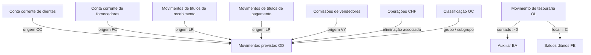

# Circuito de movimentos previstos e tesouraria: OD, OL, BA e FE

> Estado da análise: levantamento estático de dicionário, relações e código de triggers.  
> Base de referência: `CSDefault202603` (base standard, sem movimentos transaccionais nas tabelas analisadas).  
> Data de consolidação: 2026-11-27.

## 1. Objectivo e limites

Este documento consolida as descobertas da investigação sobre a relação entre movimentos previstos (`OD`), movimentos de tesouraria (`OL`), estrutura auxiliar (`BA`) e saldos diários de caixa (`FE`).

A evidência disponível permite descrever o comportamento implementado nos triggers analisados. Não permite afirmar que os circuitos foram validados em execução com documentos reais: na consulta efectuada, todas as tabelas `CC`, `FC`, `LR`, `LM`, `LP`, `LO`, `VY`, `CHF`, `OD` e `OL` devolveram zero registos.

Consequentemente:
- **Estrutura**: observada através do esquema e dos índices.
- **Comportamento definido**: inferido da leitura dos triggers.
- **Execução real**: ainda não validada nesta base.
- Não criar documentos artificiais na base standard para testar estes circuitos; os efeitos em cadeia podem contaminar a referência.

## 2. OD: agregador de movimentos previstos

A análise dos triggers identificou várias origens funcionais de registos em `OD`. A tabela não deve ser interpretada como uma extensão exclusiva da conta corrente.

| Origem em OD | Tabela(s) de origem | Ligação observada | Interpretação funcional |
|---|---|---|---|
| `CC` | CC | `ccstamp` | Pendentes de clientes |
| `FC` | FC | `fcstamp` | Pendentes de fornecedores |
| `LR` | LR / LM | `lrstamp`, `lmstamp` | Títulos de recebimento |
| `LP` | LP / LO | `lpstamp`, `lostamp` | Títulos de pagamento |
| `VY` | VY | `vystamp` | Comissões de vendedores |
| `CHF` | CHF | `oristamp` associado a `chfstamp` | Movimento associado a CHF |

A classificação de movimentos também é mantida por operações sobre `OC`: o trigger `tr_oc_update` actualiza `grupo` e `sgrupo` em `OD` quando mudam os grupos associados ao código de tesouraria. Este trigger não foi identificado como criador ou eliminador de movimentos.

### 2.1 CC — conta corrente de clientes

Os triggers de CC analisados criam, actualizam e eliminam previsões em OD. A ligação identificadora observada é `OD.ccstamp = CC.ccstamp`, com origem `CC`.

### 2.2 FC — conta corrente de fornecedores

- `tr_fc_insert`: cria um movimento previsto por cada FC elegível.
- `tr_fc_update`: elimina o movimento anterior e recria-o a partir do FC actualizado.
- `tr_fc_delete`: elimina o OD associado ao FC.

A ligação observada usa `FC.fcstamp` (`OD.fcstamp` e `OD.odstamp` associados ao stamp do FC) e `OD.origem = 'FC'`.

O valor previsto corresponde ao saldo pendente do documento, considerando valores debitados/creditados, valores regularizados e IVA de caixa activado/registado. A mesma lógica é aplicada à moeda alternativa. O código analisado só cria o movimento quando os dois saldos calculados são diferentes de zero.

O trigger também trata regularizações entre documentos FC quando `cr > 0` e `cradoc` está preenchido, localizando o documento relacionado por `cm`, `adoc` e `no`. Actualiza os valores regularizados; em UPDATE desfaz o efeito anterior antes de aplicar o novo, e em DELETE reverte-o.

### 2.3 LM / LR — títulos de recebimento

Os triggers `tr_lm_insert` e `tr_lm_update` mantêm movimentos OD associados a títulos de recebimento:
- `OD.lrstamp = LR.lrstamp`
- `OD.lmstamp = LM.lmstamp`
- `OD.odstamp = LM.lmstamp`
- `OD.origem = 'LR'`

O valor previsto observado é `LR.valor - LR.regvalor` e, em moeda alternativa, `LR.evalor - LR.eregvalor`. A classificação identificada usa `OC.olcodigo = 'R10001'`.

O comportamento depende do tipo de movimento em `LM.cm`: há operações que eliminam o OD do título em vez de o criar/actualizar. `tr_lm_delete` elimina registos associados em OD, CC, OL e CH, conforme o código analisado.

### 2.4 LO / LP — títulos de pagamento

Os triggers `tr_lo_insert` e `tr_lo_update` mantêm movimentos OD associados a títulos de pagamento:
- `OD.lpstamp = LP.lpstamp`
- `OD.lostamp = LO.lostamp`
- `OD.odstamp = LO.lostamp`
- `OD.origem = 'LP'`

O valor previsto observado é `LP.valor - LP.regvalor` e, em moeda alternativa, `LP.evalor - LP.eregvalor`. A classificação identificada usa `OC.olcodigo = 'P10001'`.

Também aqui o tipo de movimento condiciona se o OD é criado/actualizado ou eliminado. `tr_lo_delete` elimina o OD associado e também registos FC e OL ligados ao movimento. Determinados tipos de movimento LO criam FC, pelo que o circuito de pagamentos pode alimentar simultaneamente a conta corrente de fornecedores e a tesouraria.

### 2.5 VY — comissões de vendedores

Os triggers `tr_vy_insert`, `tr_vy_update` e `tr_vy_delete` mantêm previsões com:
- `OD.vystamp = VY.vystamp`
- `OD.odstamp = VY.vystamp`
- `OD.origem = 'VY'`

O valor é lançado como saída (`said` / `esaid`) a partir de `VY.valornp` / `VY.evalornp`. Foi observada uma diferença de condições: INSERT aceita valores não nulos em pelo menos uma moeda, enquanto UPDATE exige ambos diferentes de zero. Esta diferença deve ser preservada como observação de código até validação funcional.

### 2.6 CHF

`tr_chf_delete` elimina movimentos OD com `origem = 'CHF'`, associados por `OD.oristamp = CHF.chfstamp`, e elimina também o movimento OL correspondente.

## 3. OL: movimento de tesouraria e efeitos derivados

A leitura dos três triggers de OL revelou dois efeitos derivados distintos.

### 3.1 tr_ol_insert

Quando é inserido um movimento em OL:

1. **BA**: se `OL.contado > 0`, cria um registo auxiliar:
   - `BA.bastamp = OL.olstamp`
   - `BA.olstamp = OL.olstamp`
   - `BA.origem = 'OL'`
   - copia os dados relevantes do movimento, incluindo data, documento, cheque, descrição, entradas/saídas, moeda e centros de custo.
2. **FE**: se `OL.local = 'C'`, cria o registo diário em FE se necessário e actualiza o saldo da data do movimento e dos dias seguintes.

A variação de saldo observada é:
- Moeda base: `entrada - saida`
- Moeda alternativa: `eentr - esaid`

As condições `contado > 0` e `local = 'C'` são independentes. Um movimento pode cumprir ambas, apenas uma ou nenhuma.

### 3.2 tr_ol_update

- **BA**: se `contado` passar a zero, elimina BA; se continuar positivo e BA existir, actualiza; se passar a positivo sem BA existente, cria.
- **FE**: desfaz o efeito dos valores antigos usando `deleted` e aplica os novos usando `inserted`. A lógica considera alterações de valor, data e local, incluindo a entrada/saída do circuito de caixa.

### 3.3 tr_ol_delete

- Elimina o BA associado.
- Se o movimento pertencer ao local `C`, desfaz o seu efeito nos saldos FE.
- Actualiza os saldos dos dias posteriores.

### 3.4 Atenção a operações multi-linha

Os triggers usam as tabelas lógicas `inserted` e `deleted`. A análise identificou operações com agregações e junções para recalcular FE. É necessário rever especificamente instruções que afectem várias linhas com datas distintas. Isto é um **risco de auditoria**, não um erro confirmado.

## 4. BA — estrutura auxiliar de movimentos

A estrutura consultada contém, entre outros, os campos:
- Identidade: `bastamp` (PK), `olstamp`.
- Dados do movimento: `data`, `documento`, `descricao`, `entrada`, `saida`, `eentrada`, `esaida`, `contado`, `cheque`, `moeda`.
- Reconciliação / extracto: `reco`, `extracto`.
- Classificação e contexto: `origem`, `olcodigo`, `fref`, `ccusto`, `ncusto`.
- Outros: `dvalor`, `intid`, `brstamp`, `entradam`, `saidam`, campos de auditoria e `marcada`.

Índices observados:
- PK única em `bastamp`.
- Índice em `olstamp`, que suporta a pesquisa de BA pelo movimento OL.
- Índices em `extracto`, `contado` e `data`.
- Índices compostos para listagem/ordenação, incluindo `in_ba_balist` e `in_ba_dataes`.

O trigger `tr_ol_*` não preenche nem sincroniza todos os campos de BA. No código analisado, campos como `olcodigo`, `extracto`, `reco`, `brstamp` e `marcada` não fazem parte do INSERT/UPDATE do trigger. A sua gestão pertence a outras operações ou a valores por defeito; não se deve assumir que BA é uma réplica integral de OL.

A existência de `reco` e `extracto` sugere participação no circuito de reconciliação bancária, mas os triggers OL analisados, isoladamente, não demonstram o fluxo completo dessa reconciliação.

## 5. FE — saldos diários de caixa

A estrutura consultada contém:
- `festamp`: identificador com índice único.
- `data`: chave primária.
- `saldof` e `esaldof`: saldos acumulados em moeda base e alternativa.
- `fechado` e `quemfechou`: estado e responsável pelo fecho.
- `marcada` e campos de auditoria.

A chave primária em `data` e a lógica dos triggers sustentam a interpretação de FE como saldo diário, não como detalhe de cada movimento.

Questão em aberto: a presença de `fechado` / `quemfechou` levanta a necessidade de localizar as validações que impedem ou permitem alterações em dias fechados. Os triggers OL analisados não bastam para concluir onde essa regra é aplicada.

## 6. Mapa funcional provisório

**Importante:** este diagrama representa relações e efeitos demonstrados pelos triggers analisados. Ainda não demonstra uma transformação genérica e automática `OD → OL`. A passagem de previsão a movimento efectivo pode ocorrer por operações de utilizador, rotinas PHC ou triggers específicos, que ainda têm de ser localizados.

## 7. Estado das validações

| Tema | Estado |
|---|---|
| Origens de OD em triggers analisados | Identificadas estaticamente |
| Efeitos de OL sobre BA e FE | Identificados estaticamente |
| Estrutura e índices de BA / FE | Consultados na base standard |
| Dados transaccionais para validação | Inexistentes nas tabelas consultadas |
| Operações multi-linha em OL | Requerem auditoria de código/testes |
| Regras de fecho diário FE | Por localizar |
| Reconciliação bancária BA | Fluxo completo por investigar |
| Mecanismo concreto de passagem OD → OL | Por localizar |
| Validação em execução com documentos reais | Pendente |

## 8. Próximos passos da investigação

A investigação deve prosseguir sem voltar a pedir queries de estrutura quando essa informação já existir no dicionário PHC e nos artefactos do projecto.

Ordem recomendada:

1. Cruzar `DIC`, `REL` e Enciclopédia PHC para confirmar semântica e relações de OD, OL, BA e FE.
2. Localizar no conjunto completo de triggers, procedures e código PHC todas as escritas em `OL`, especialmente operações que também leiam ou eliminem `OD`.
3. Investigar operações de utilizador/rotinas PHC que concretizam previsões em recebimentos e pagamentos.
4. Localizar as regras de fecho de FE e o circuito de reconciliação de BA.
5. Auditar os triggers OL para operações multi-linha, com atenção a datas diferentes.
6. Só depois desenhar o fluxo integral Documento → Conta Corrente / Título → OD → OL → BA / FE, distinguindo caminhos directos e alternativos.

## 9. Regra metodológica para esta investigação

Usar as fontes por esta ordem:
- `DIC`: tabelas e campos.
- `REL`: relações documentadas pelo PHC (não necessariamente foreign keys físicas).
- Enciclopédia PHC: significado funcional.
- Triggers e procedures: comportamento implementado.
- Queries SQL: apenas para confirmar dados, propriedades específicas da instalação ou resultados que não estejam nas fontes disponíveis.
- Testes controlados numa base adequada: comportamento em execução.

Não pedir novamente consultas de estrutura já cobertas por DIC/REL. Quando for necessária uma query, explicitar qual a incerteza concreta que ela resolve e por que razão não pode ser respondida pelas fontes existentes.
