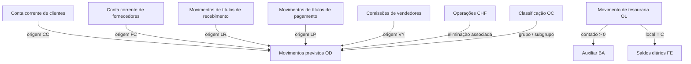
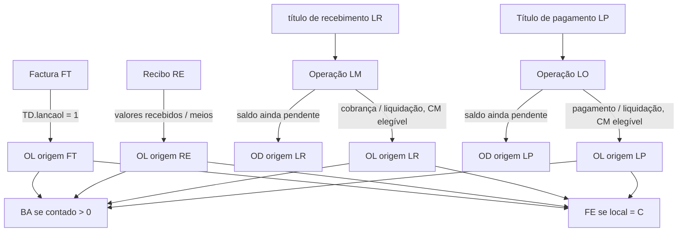
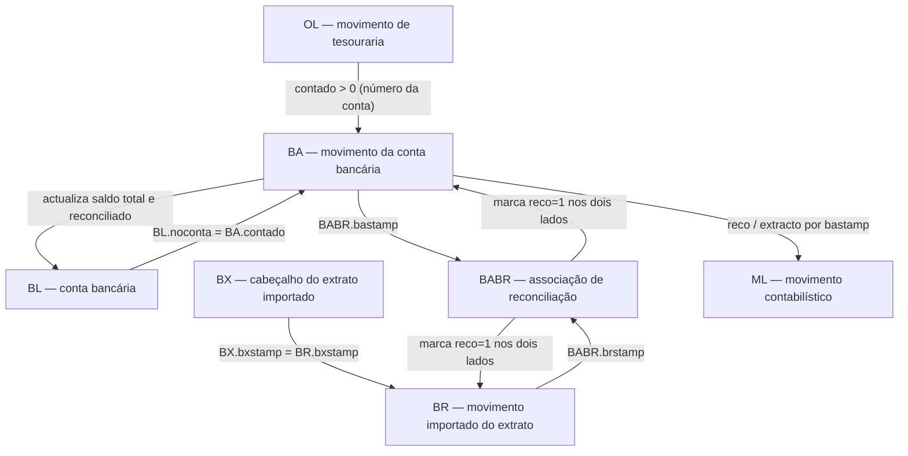

# Circuito de movimentos previstos e tesouraria: OD, OL, BA e FE

> Estado da análise: levantamento estático de dicionário, relações e código de triggers.  
> Base de referência: `CSDefault202603` (base standard, sem movimentos transaccionais nas tabelas analisadas).  
> Data de consolidação: 2026-11-27.

## 1. Objectivo e limites

Este documento consolida as descobertas da investigação sobre a relação entre movimentos previstos (`OD`), movimentos de tesouraria (`OL`), estrutura auxiliar (`BA`) e saldos diários de caixa (`FE`).

A evidência disponível permite descrever o comportamento implementado nos triggers analisados. Não permite afirmar que os circuitos foram validados em execução com documentos reais: na consulta efectuada, todas as tabelas `CC`, `FC`, `LR`, `LM`, `LP`, `LO`, `VY`, `CHF`, `OD` e `OL` devolveram zero registos.

Consequentemente:
- **Estrutura**: observada através do esquema e dos índices.
- **Comportamento definido**: inferido da leitura dos triggers.
- **Execução real**: ainda não validada nesta base.
- Não criar documentos artificiais na base standard para testar estes circuitos; os efeitos em cadeia podem contaminar a referência.

## 2. OD: agregador de movimentos previstos

A análise dos triggers identificou várias origens funcionais de registos em `OD`. A tabela não deve ser interpretada como uma extensão exclusiva da conta corrente.

| Origem em OD | Tabela(s) de origem | Ligação observada | Interpretação funcional |
|---|---|---|---|
| `CC` | CC | `ccstamp` | Pendentes de clientes |
| `FC` | FC | `fcstamp` | Pendentes de fornecedores |
| `LR` | LR / LM | `lrstamp`, `lmstamp` | Títulos de recebimento |
| `LP` | LP / LO | `lpstamp`, `lostamp` | Títulos de pagamento |
| `VY` | VY | `vystamp` | Comissões de vendedores |
| `CHF` | CHF | `oristamp` associado a `chfstamp` | Movimento associado a CHF |

A classificação de movimentos também é mantida por operações sobre `OC`: o trigger `tr_oc_update` actualiza `grupo` e `sgrupo` em `OD` quando mudam os grupos associados ao código de tesouraria. Este trigger não foi identificado como criador ou eliminador de movimentos.

### 2.1 CC — conta corrente de clientes

Os triggers de CC analisados criam, actualizam e eliminam previsões em OD. A ligação identificadora observada é `OD.ccstamp = CC.ccstamp`, com origem `CC`.

### 2.2 FC — conta corrente de fornecedores

- `tr_fc_insert`: cria um movimento previsto por cada FC elegível.
- `tr_fc_update`: elimina o movimento anterior e recria-o a partir do FC actualizado.
- `tr_fc_delete`: elimina o OD associado ao FC.

A ligação observada usa `FC.fcstamp` (`OD.fcstamp` e `OD.odstamp` associados ao stamp do FC) e `OD.origem = 'FC'`.

O valor previsto corresponde ao saldo pendente do documento, considerando valores debitados/creditados, valores regularizados e IVA de caixa activado/registado. A mesma lógica é aplicada à moeda alternativa. O código analisado só cria o movimento quando os dois saldos calculados são diferentes de zero.

O trigger também trata regularizações entre documentos FC quando `cr > 0` e `cradoc` está preenchido, localizando o documento relacionado por `cm`, `adoc` e `no`. Actualiza os valores regularizados; em UPDATE desfaz o efeito anterior antes de aplicar o novo, e em DELETE reverte-o.

### 2.3 LM / LR — títulos de recebimento

Os triggers `tr_lm_insert` e `tr_lm_update` mantêm movimentos OD associados a títulos de recebimento:
- `OD.lrstamp = LR.lrstamp`
- `OD.lmstamp = LM.lmstamp`
- `OD.odstamp = LM.lmstamp`
- `OD.origem = 'LR'`

O valor previsto observado é `LR.valor - LR.regvalor` e, em moeda alternativa, `LR.evalor - LR.eregvalor`. A classificação identificada usa `OC.olcodigo = 'R10001'`.

O comportamento depende do tipo de movimento em `LM.cm`: há operações que eliminam o OD do título em vez de o criar/actualizar. `tr_lm_delete` elimina registos associados em OD, CC, OL e CH, conforme o código analisado.

### 2.4 LO / LP — títulos de pagamento

Os triggers `tr_lo_insert` e `tr_lo_update` mantêm movimentos OD associados a títulos de pagamento:
- `OD.lpstamp = LP.lpstamp`
- `OD.lostamp = LO.lostamp`
- `OD.odstamp = LO.lostamp`
- `OD.origem = 'LP'`

O valor previsto observado é `LP.valor - LP.regvalor` e, em moeda alternativa, `LP.evalor - LP.eregvalor`. A classificação identificada usa `OC.olcodigo = 'P10001'`.

Também aqui o tipo de movimento condiciona se o OD é criado/actualizado ou eliminado. `tr_lo_delete` elimina o OD associado e também registos FC e OL ligados ao movimento. Determinados tipos de movimento LO criam FC, pelo que o circuito de pagamentos pode alimentar simultaneamente a conta corrente de fornecedores e a tesouraria.

### 2.5 VY — comissões de vendedores

Os triggers `tr_vy_insert`, `tr_vy_update` e `tr_vy_delete` mantêm previsões com:
- `OD.vystamp = VY.vystamp`
- `OD.odstamp = VY.vystamp`
- `OD.origem = 'VY'`

O valor é lançado como saída (`said` / `esaid`) a partir de `VY.valornp` / `VY.evalornp`. Foi observada uma diferença de condições: INSERT aceita valores não nulos em pelo menos uma moeda, enquanto UPDATE exige ambos diferentes de zero. Esta diferença deve ser preservada como observação de código até validação funcional.

### 2.6 CHF

`tr_chf_delete` elimina movimentos OD com `origem = 'CHF'`, associados por `OD.oristamp = CHF.chfstamp`, e elimina também o movimento OL correspondente.

## 3. OL: movimento de tesouraria e efeitos derivados

A leitura dos três triggers de OL revelou dois efeitos derivados distintos.

### 3.1 tr_ol_insert

Quando é inserido um movimento em OL:

1. **BA**: se `OL.contado > 0`, cria um registo auxiliar:
   - `BA.bastamp = OL.olstamp`
   - `BA.olstamp = OL.olstamp`
   - `BA.origem = 'OL'`
   - copia os dados relevantes do movimento, incluindo data, documento, cheque, descrição, entradas/saídas, moeda e centros de custo.
2. **FE**: se `OL.local = 'C'`, cria o registo diário em FE se necessário e actualiza o saldo da data do movimento e dos dias seguintes.

A variação de saldo observada é:
- Moeda base: `entrada - saida`
- Moeda alternativa: `eentr - esaid`

As condições `contado > 0` e `local = 'C'` são independentes. Um movimento pode cumprir ambas, apenas uma ou nenhuma.

### 3.2 tr_ol_update

- **BA**: se `contado` passar a zero, elimina BA; se continuar positivo e BA existir, actualiza; se passar a positivo sem BA existente, cria.
- **FE**: desfaz o efeito dos valores antigos usando `deleted` e aplica os novos usando `inserted`. A lógica considera alterações de valor, data e local, incluindo a entrada/saída do circuito de caixa.

### 3.3 tr_ol_delete

- Elimina o BA associado.
- Se o movimento pertencer ao local `C`, desfaz o seu efeito nos saldos FE.
- Actualiza os saldos dos dias posteriores.

### 3.4 Atenção a operações multi-linha

Os triggers usam as tabelas lógicas `inserted` e `deleted`. A análise identificou operações com agregações e junções para recalcular FE. É necessário rever especificamente instruções que afectem várias linhas com datas distintas. Isto é um **risco de auditoria**, não um erro confirmado.

## 4. BA — movimentos bancários derivados de OL

A leitura conjunta de `tr_ol_*`, `tr_ba_*`, `tr_babr_*`, `tr_br_*` e da Enciclopédia permite corrigir a interpretação inicial de BA.

**BA não é uma cópia integral de OL nem é apenas uma tabela de reconciliação.** É uma estrutura de movimentos associados a contas bancárias, derivada de OL, que alimenta os saldos da tabela de contas bancárias `BL` e participa na reconciliação com movimentos importados de extratos.

### 4.1 Criação e correspondência com OL

- `tr_ol_insert` cria BA para movimentos OL com `contado > 0`.
- O trigger copia `OL.olstamp` para `BA.bastamp` e `BA.olstamp`; copia também data, data-valor, documento, cheque, descrição, entradas/saídas, moeda, conta (`contado`) e identificação interna.
- `tr_ol_update` actualiza BA quando o OL correspondente muda; elimina BA quando `contado=0`; cria BA se o movimento passar a ter conta bancária e ainda não existir BA.
- `tr_ol_delete` elimina BA pelo `olstamp`.

A coluna `contado` **não é um booleano de “contado/reconciliado”**. `tr_ba_insert/update/delete` usam `BA.contado = BL.noconta` para localizar a conta bancária; `tr_ol_insert/update` transportam para BA o valor de `OL.contado`. No `tr_bl_update` consultado, quando mudam `BL.banco` ou `BL.conta`, são actualizados os campos de apresentação `ollocal` nas tabelas que guardam o número `contado`; o trigger não atribui `OL.contado`. Assim, `contado` funciona como identificador/número interno da conta bancária, mas a origem exacta do seu preenchimento em OL deve ser atribuída aos documentos/configurações que o fornecem, não a `tr_bl_update`. A reconciliação é representada separadamente por `reco`.

### 4.2 Saldos de contas bancárias — BL

Os triggers BA mantêm os saldos em BL:
- `tr_ba_insert`: acrescenta o movimento aos saldos da conta.
- `tr_ba_update`: desfaz o valor antigo e aplica o novo quando mudam valores, conta ou estado de reconciliação.
- `tr_ba_delete`: retira o movimento dos saldos.

São mantidos saldos globais e saldos reconciliados:
- `saldo`, `esaldo`, `saldom`: valores totais;
- `rsaldo`, `ersaldo`, `rsaldom`: valores cuja BA tem `reco=1`.

O trigger `tr_ba_update` também propaga `reco` e `extracto` para `ML` através de `ML.bastamp = BA.bastamp`. A relação é comportamento observado em código; `ML` é identificada no REL consultado como Movimentos Contabilísticos.

### 4.3 Reconciliação bancária — BX / BR / BABR

A documentação PHC descreve a reconciliação entre:
- movimentos da tesouraria;
- movimentos importados do extrato bancário.

O código analisado permite identificar os elementos:
- `BX`: cabeçalho do extrato importado, com conta, número/data do extrato e saldos inicial/final;
- `BR`: movimentos importados que pertencem ao extrato (`BR.bxstamp`);
- `BA`: movimentos da conta bancária derivados de OL;
- `BABR`: associação entre movimentos BA e BR, pelos campos `bastamp` e `brstamp`.

Evidência dos triggers:
- `tr_babr_insert` marca BA e BR como reconciliados (`reco=1`).
- `tr_babr_delete` repõe `reco=0` em ambos.
- `tr_br_insert/update/delete` chama `usp_Act_Extratos_Bancarios` para recalcular os saldos inicial/final do BX a partir dos movimentos BR.
- A procedure recalcula os totais do extrato; não transforma OD em OL nem cria movimentos de tesouraria.

A Enciclopédia descreve reconciliação de um movimento importado com vários movimentos de tesouraria e vice-versa. Isto é consistente com a existência de `BABR` como tabela de associação, mas a cardinalidade física deve continuar a ser validada pelos índices e pela estrutura integral.

### 4.4 Limites e relações não declaradas

- BA só é criado a partir de OL quando existe uma conta bancária indicada em `contado`; não representa todos os movimentos OL.
- O trigger OL não copia todos os campos de OL para BA. Campos como `olcodigo`, `grupo`, `sgrupo`, `extracto`, `reco`, `brstamp` e `marcada` não são preenchidos nesse INSERT/UPDATE.
- A pesquisa no extracto REL consultado não encontrou relações declaradas para BA, BL, BR, BX ou BABR. As ligações acima são predicados e efeitos de código, não FKs demonstradas.
- O processo de reconciliação não se reduz a marcar `BA.reco`: a associação BA–BR e a actualização de BL/ML também fazem parte do circuito.


### 4.5 Inventário de colunas stamp e limites da evidência estrutural

Foi cruzado o extracto disponível com cabeçalho `TABLE_NAME / COLUMN_NAME`, que lista colunas de identidade/referência terminadas em `stamp`. Para as tabelas em análise, o extracto apresenta:

| Tabela | Colunas stamp presentes no extracto |
|---|---|
| BA | `bastamp`, `brstamp`, `olstamp` |
| BL | `blstamp` |
| BR | `bastamp`, `brstamp`, `bxstamp` |
| BX | `bxstamp` |
| BABR | Sem entrada encontrada no extracto |

Este extracto não contém tipos, nulabilidade, índices, PK/UK ou FKs; também não contém uma entrada para BABR, apesar de existirem triggers `tr_babr_insert/delete`. Por isso, não é suficiente para concluir cardinalidades físicas. A presença de `BA.brstamp` e `BR.bastamp` no inventário também não prova que sejam as ligações activas no circuito de reconciliação: nos triggers standard pesquisados não foram encontradas referências qualificadas `BA.brstamp` ou `BR.bastamp`; o mecanismo demonstrado é a tabela de associação BABR, pelos campos `bastamp` e `brstamp`.

O trigger `tr_ol_insert` cria BA com `BA.bastamp = OL.olstamp` e `BA.olstamp = OL.olstamp`; a condição é `OL.contado > 0`. Isto demonstra a identidade usada pelo código para o movimento bancário derivado, mas não demonstra por si só uma restrição UNIQUE/PK sobre `BA.olstamp` nem uma FK física. A cardinalidade física continua por confirmar nos índices/constraints.

## 5. FE — saldos diários de caixa e fecho

A estrutura FE representa os saldos diários da tesouraria no local Caixa, não os históricos de abertura/fecho de caixas POS.

- `tr_ol_insert/update/delete` actualizam FE quando `OL.local='C'`.
- A variação diária é `entr - said` e `eentr - esaid`.
- A alteração de um movimento afecta o saldo do dia e os saldos dos dias seguintes.
- FE contém `data`, `festamp`, `saldof`, `esaldof`, `fechado` e `quemfechou`.

A Enciclopédia, no tópico **Fechar a Caixa**, confirma que:
- fechar a caixa marca o saldo desse dia como fechado e regista o utilizador;
- dias anteriores ainda abertos também são fechados nesse momento;
- existe um parâmetro que controla o bloqueio de movimentos de tesouraria no local Caixa em dias fechados;
- os parâmetros **Password para movimentar a caixa em dias já fechados** e **Só se pode movimentar a caixa em dias já fechados com password** controlam a autorização para ultrapassar o bloqueio.

No script standard analisado não foi encontrado trigger `tr_fe_*` nem validação de `FE.fechado` nos triggers OL. A manutenção do saldo é feita por SQL; o controlo de autorização/fecho descrito no manual é, portanto, aplicação/configuração, não um bloqueio demonstrado nos triggers SQL analisados.

## 6. Mapa funcional provisório



**Importante:** este diagrama representa relações e efeitos demonstrados pelos triggers analisados. Não representa uma transformação genérica `OD → OL`: a análise transversal posterior não encontrou triggers que leiam OD para criar OL. Os movimentos OL são gerados directamente por documentos/operações de origem.

## 7. Estado das validações

| Tema | Estado |
|---|---|
| Origens de OD em triggers analisados | Identificadas estaticamente |
| Efeitos de OL sobre BA e FE | Identificados estaticamente |
| Estrutura e índices de BA / FE | FE consultada anteriormente; índices/constraints de BA/BL/BR/BX/BABR ainda por confirmar |
| Dados transaccionais para validação | Inexistentes nas tabelas consultadas |
| Operações multi-linha em OL | Requerem auditoria de código/testes |
| Regras de fecho diário FE | Por localizar |
| Reconciliação bancária BA | Fluxo completo por investigar |
| Conversão genérica OD → OL em triggers | Não identificada; evidência aponta para geração paralela a partir da operação/documento |
| Validação em execução com documentos reais | Pendente |

## 8. Próximos passos da investigação

A investigação deve prosseguir sem voltar a pedir queries de estrutura quando essa informação já existir no dicionário PHC e nos artefactos do projecto.

Ordem recomendada:

1. Cruzar `DIC`, `REL` e Enciclopédia PHC para confirmar semântica e relações de OD, OL, BA e FE.
2. Continuar a análise das rotinas/código PHC que iniciam as operações de liquidação; nos triggers SQL analisados, OD não é a fonte directa de OL.
3. Investigar operações de utilizador/rotinas PHC que concretizam previsões em recebimentos e pagamentos.
4. Localizar as regras de fecho de FE e o circuito de reconciliação de BA.
5. Auditar os triggers OL para operações multi-linha, com atenção a datas diferentes.
6. Desenhar o fluxo integral por circuitos paralelos: Documento / título → OD (previsão) e Documento / operação de liquidação → OL (movimento efectivo) → BA / FE.

## 9. Regra metodológica para esta investigação

Usar as fontes por esta ordem:
- `DIC`: tabelas e campos.
- `REL`: relações documentadas pelo PHC (não necessariamente foreign keys físicas).
- Enciclopédia PHC: significado funcional.
- Triggers e procedures: comportamento implementado.
- Queries SQL: apenas para confirmar dados, propriedades específicas da instalação ou resultados que não estejam nas fontes disponíveis.
- Testes controlados numa base adequada: comportamento em execução.

Não pedir novamente consultas de estrutura já cobertas por DIC/REL. Quando for necessária uma query, explicitar qual a incerteza concreta que ela resolve e por que razão não pode ser respondida pelas fontes existentes.


## 10. Descoberta adicional: OD não é convertido genericamente em OL

Foi feita uma leitura transversal do ficheiro completo `docs/sources/triggers phc.sql` (552 triggers no ficheiro). A pesquisa incidiu sobre triggers que escrevem em `OL` e sobre referências a `OD`.

**Resultado principal:** nos triggers analisados que escrevem em `OL`, não foi encontrada uma operação que leia um registo de `OD` e o transforme directamente em `OL`. As referências a OD nos triggers de LM/LO correspondem à manutenção paralela dos movimentos previstos; não são a origem dos valores inseridos em OL.

Isto corrige a hipótese inicial de uma passagem técnica genérica `OD → OL`. O modelo mais consistente com o código é: o documento/operação de liquidação gera ou actualiza, no mesmo circuito, o movimento previsto OD (quando aplicável) e o movimento efectivo OL. São registos relacionados pela origem documental e pelos stamps, mas não se observou uma conversão do próprio registo OD.

### 10.1 Facturas de venda — FT

Em `tr_ft_insert`, a criação de OL depende de `TD.lancaol = 1`. O trigger constrói o movimento a partir de `FT`, `FT2`, `FT3`, `TD` e `OC`:
- origem `FT`, ligação por `ftstamp`;
- valor de entrada calculado a partir de `total - rdtotal - virs`, com dedução do IVA de caixa activado em `FT3`;
- classificação `TD.olcodigo`, grupos/subgrupos de `OC`;
- local, contado e moeda determinados por `TD` ou, quando `TD.altollocal = 1`, por `FT2`;
- dados de pagamento, dinheiro, acertos e cheques também transportados de `FT2` / `FT`.

Em `tr_ft_update`, o movimento OL existente é actualizado e, quando necessário, inserido; a anulação da FT elimina o OL associado. Portanto, para documentos FT configurados com `TD.lancaol=1`, o trigger cria o movimento efectivo directamente a partir do documento e dos dados de pagamento, não a partir de OD.

### 10.2 Recibos — RE

A leitura dos triggers corrige a versão anterior desta secção:

- `tr_re_insert` não é o trigger que cria OL; o INSERT trata os movimentos de conta-corrente associados ao recibo.
- `tr_re_update` cria/actualiza OL quando o recibo fica processado (`process=1`) e a série não está configurada para movimentos incobráveis (`TSRE.movinc=0)).
- O trigger usa `RE.olcodigo` para obter a classificação em OC; `TSRE` não tem campo `olcodigo` no esquema consultado.
- Pode criar um movimento OL principal e uma segunda componente, com stamp derivado de `restamp`, quando existem valores no segundo local (`totol2`, `etotol2`, `valor2m3`).
- `tr_re_delete` elimina os movimentos associados.

A Enciclopédia explica que um recibo apenas gravado não altera a conta-corrente; quando é processado, é lançado em C/C. A configuração de recibos também distingue as séries normais das séries para movimentos incobráveis, nas quais ficam inibidos os campos de lançamento na tesouraria. Esta descrição é consistente com a condição `TSRE.movinc=0` do trigger.\n\n**Validação de configuração em `CSDefault202603` (consulta read-only):** foram devolvidas duas linhas em TSRE: `ndoc=1` e `ndoc=2`, ambas com `movinc=0` e `cmcc=0`; `cmccn` está vazio/NULL nas duas. Assim, os dois tipos de recibo existentes na configuração consultada passam a condição `movinc=0`. Isto não prova que todas as séries ou instalações tenham a mesma configuração, nem que a criação de OL ocorra sem as restantes condições do trigger. O significado operacional de `cmcc=0` e `cmccn=NULL` não é inferido nesta análise.

### 10.3 Títulos de recebimento — LM / LR

`tr_lm_insert` e `tr_lm_update` mantêm dois resultados distintos:
- **OD**, com origem `LR`, para o valor ainda pendente do título: `LR.valor - LR.regvalor` e equivalente em moeda alternativa;
- **OL**, com origem `LR`, para operações concretas de cobrança/liquidação seleccionadas por tipos de movimento `LM.cm`.

A criação de OL ocorre para os tipos `cm` 11, 26, 13, 3, 5 e 23 no INSERT; no UPDATE o conjunto inclui também `cm=18`, e exige `currec=1`. Os valores de OL são calculados a partir dos valores recebidos e de despesas, juros e imposto de selo, repartindo os montantes entre entradas e saídas. O trigger não consulta o valor do OD para calcular o OL.

Conclusão: no circuito de títulos de recebimento, o movimento efectivo é criado pela operação registada em LM; OD continua a representar o saldo pendente do título.

### 10.4 Títulos de pagamento — LO / LP

`tr_lo_insert` e `tr_lo_update` seguem uma lógica equivalente:
- **OD**, com origem `LP`, para o valor por pagar ainda pendente: `LP.valor - LP.regvalor` e equivalente em moeda alternativa;
- **OL**, com origem `LP`, para os tipos de operação `LO.cm` 4, 29 e 6, com valores calculados a partir do pagamento e de despesas/juros.

O trigger `tr_lo_insert` também cria FC para `cm=22`, isto é, há operações que alimentam a conta corrente de fornecedores além de OD/OL. O trigger de eliminação remove os registos relacionados.

### 10.5 Outros circuitos com efeitos directos em OL

A varredura de `INSERT/UPDATE/DELETE FROM OL` encontrou outros documentos com efeitos directos. É necessário distinguir criação, actualização e limpeza:

- **Criação/actualização confirmada:** RD, PD, PO, PR, VY/VZ, OX, OLBB, OW/OWLI, GPC, FACA/FACC/FACD, CHL, CHF, entre outros.
- **Limpeza sem criação demonstrada:** FO — `tr_fo_delete` elimina OL por `fostamp`, mas não foi encontrado INSERT/UPDATE de OL em `tr_fo_insert/update`.
- A lista é um inventário de operações sobre OL; não é uma lista de origens de criação uniforme. Cada documento exige análise funcional própria.


## 11. Modelo conceptual revisto

O fluxo não deve ser representado como uma cadeia obrigatória `OD → OL`. Deve distinguir:
- **Previsão:** OD mantém o montante ainda previsto/pendente de determinadas origens.
- **Liquidação/operação:** o documento de recebimento, pagamento ou movimento (por exemplo, RE, LM, LO ou FT) regista a operação concreta.
- **Efeito de tesouraria:** triggers desse documento criam/actualizam OL directamente com base nos dados da operação.
- **Efeitos derivados:** OL actualiza BA quando `contado > 0` e FE quando `local = 'C'`.



Este modelo é mais fiel à implementação observada: **OD e OL são resultados paralelos de operações/documentos em determinados circuitos**, e não etapas obrigatórias de uma conversão entre tabelas.

## 12. Próxima investigação

O primeiro cruzamento DIC/REL/Enciclopédia e a leitura dos triggers de LM/LO/RE e BA/BR/BX/BL já foram efectuados. A continuação deve concentrar-se nas lacunas de configuração e de execução:

1. Confirmar os valores de configuração de `TSRE` (`ndoc`, `movinc`, `cmcc`, `cmccn`) e as descrições CM1 dos códigos 30 e 81.
2. Confirmar no catálogo SQL as colunas, nulabilidade, PK/UK, índices e FKs de BA, BL, BR, BX e BABR; o extracto stamp disponível não contém essa informação.
3. Localizar no código aplicacional as operações de reconciliação que criam/eliminam BABR e as validações de fecho de FE.
4. Auditar operações multi-linha nos triggers OL e BA, em especial datas distintas e movimentos de várias contas.
5. Validar em ambiente descartável os circuitos RE, LM, LO, BA/BR e FE. Não usar a base standard de referência para criar transacções artificiais.


## 13. Cruzamento DIC / REL / Enciclopédia — conclusões adicionais

### 13.1 OD e a opção “Dar como realizada”

A Enciclopédia descreve OD como a tabela de movimentos previsionais, alimentada por movimentos manuais ou automáticos provenientes de outros documentos. A opção **Dar como realizada a previsão** só transforma em tesouraria real movimentos directos e movimentos constantes; não permite transformar previsões provenientes de outros documentos.

Isto reforça a conclusão da análise SQL: não existe uma conversão universal OD → OL. Nos circuitos LM/LO, a previsão e a liquidação são resultados paralelos das operações sobre o título.

### 13.2 Códigos de operações de letras — não confundir com CM1

O artigo da Enciclopédia **Códigos das Letras** fornece a semântica dos valores `LM.cm` e `LO.cm`. Estes códigos são códigos internos de operações de letras, não devem ser mapeados indiscriminadamente pela tabela CM1 (Códigos de movimentos de C/C).

**LM — letras a receber**

| CM | Operação documentada | Efeito observado nos triggers |
|---:|---|---|
| 1 | Nova letra a receber | Cria/actualiza OD do saldo pendente |
| 3 | Cobrança directa | Remove OD; cria OL |
| 5 | Amortização directa | Cria/actualiza OD do remanescente e OL do valor amortizado; pode criar CH se `lancach=1` |
| 7 | Reforma de letras a receber | Remove OD |
| 9 | Envio a desconto | Cria/actualiza OD |
| 10 | Envio à cobrança | Cria/actualiza OD |
| 11 | Desconto | Remove OD; cria OL líquido de encargos |
| 13 | Cobrança bancária | Remove OD; cria OL líquido de encargos |
| 14 | Anulação de envio a desconto | Cria/actualiza OD |
| 15 | Anulação de envio à cobrança | Cria/actualiza OD |
| 18 | Regularização | OL tratado no UPDATE; não consta do conjunto de INSERT |
| 19 | Envio a aceite | Cria/actualiza OD |
| 20 | Recepção de aceite | Cria/actualiza OD; manual confirma previsão pelo valor pendente |
| 21 | Débito em C/C de clientes | Remove OD; cria CC com CM1=30 |
| 23 | Registo de encargos | Cria OL dos encargos |
| 26 | Recâmbio | Cria/actualiza OD, cria OL de saída e CC com CM1=30 |
| 27 | Anulação de envio a aceite | Cria/actualiza OD |
| 17 | Sem descrição no artigo consultado | Código usado para remover OD; semântica por esclarecer |

No UPDATE, a manutenção de OD e a criação/actualização de OL exigem `currec=1`. O conjunto de OL inclui `cm=18`; no INSERT analisado o conjunto é mais restrito. Esta diferença entre INSERT e UPDATE deve manter-se como observação, não como erro presumido.

**LO — letras a pagar**

| CM | Operação documentada | Efeito observado nos triggers |
|---:|---|---|
| 2 | Nova letra a pagar | Cria/actualiza OD do saldo pendente |
| 4 | Pagamento | Remove OD; cria OL de saída |
| 6 | Amortização | Cria/actualiza OD do remanescente e OL da amortização |
| 8 | Reforma de letras a pagar | Remove OD |
| 22 | Débito C/C de fornecedores | Remove OD; cria FC com CM1=81 |
| 28 | Registo de n/aceite | Cria/actualiza OD |
| 29 | Registo de encargos | Cria OL dos encargos |
| 17 | Sem descrição no artigo consultado | Código usado para remover OD; semântica por esclarecer |

No UPDATE, os ramos de OD e OL exigem `currec=1`. A criação de OL usa `P10001`; OD representa o saldo pendente do título e usa a mesma classificação de pagamentos.

**Validação de configuração em `CSDefault202603`:** a consulta a `CM1` devolveu `cm=30, cmdesc='Anula. Letra'` e `cm=81, cmdesc='Anula. Letra'`. Portanto, ambos os códigos têm a mesma descrição nesta base. Mantém-se a distinção dos contextos de utilização observados nos triggers: CM1=30 no ramo de criação de CC associado a determinadas operações LM/LO; CM1=81 no ramo LO `cm=22`, que cria FC. CM1 é o catálogo de movimentos de conta-corrente e não deve ser confundido com os códigos operacionais `LM.cm`/`LO.cm`.

### 13.3 RE — configuração e processamento

A configuração de séries de recibos documenta:
- código de movimento de C/C;
- nome do documento para tesouraria real;
- série configurada para movimentos incobráveis;
- classificação e locais de tesouraria no recibo.

A série para movimentos incobráveis inibe os campos de lançamento na tesouraria. Isto é consistente com `TSRE.movinc=1` e com o bloqueio `TSRE.movinc=0` do trigger de criação de OL.

O recibo pode indicar um segundo local de tesouraria; o manual explica que o valor desse segundo local é subtraído ao primeiro. O trigger materializa as componentes em OL separadamente quando os campos de segundo local têm valores.

## 14. Reconciliação bancária — modelo funcional actualizado

O circuito de reconciliação deve ser representado separadamente do circuito OD/OL:



A Enciclopédia descreve reconciliação muitos-para-muitos: um movimento importado pode reconciliar vários movimentos de tesouraria e vice-versa. A tabela BABR é o mecanismo de associação observado nos triggers. A inserção de BABR marca BA e BR como reconciliados; a eliminação desfaz essa marcação.

A procedure `usp_Act_Extratos_Bancarios` recalcula os saldos inicial/final do cabeçalho BX a partir dos movimentos BR, por conta e sequência temporal do extrato. Não é uma rotina de conversão de OD para OL.

## 15. Fecho de FE — regra funcional e limite SQL

O fecho de FE é um controlo do saldo diário de caixa:
- fechar um dia marca FE como fechado e regista quem o fechou;
- dias anteriores ainda abertos também são fechados;
- a configuração **Só se pode movimentar a caixa em dias já fechados com password** exige a password definida em **Password para movimentar a caixa em dias já fechados**;
- o controlo aplica-se às operações de tesouraria em Caixa e a operações/documentos configurados para lançar em Caixa.

Não foi encontrado `tr_fe_*` nem validação de `FE.fechado` nos triggers SQL standard consultados. O cálculo de saldos é SQL; a autorização para movimentar dias fechados é descrita como controlo da aplicação/configuração.

## 16. Validação de configuração e próxima validação estrutural

A consulta de configuração foi executada em `CSDefault202603`; os resultados estão registados abaixo. Permanecem por validar a configuração de outras instalações e a execução transaccional dos circuitos. A próxima consulta estrutural deverá ser executada no catálogo SQL, porque o extracto stamp disponível não inclui índices, constraints ou nulabilidade.

```sql
SELECT ndoc, movinc, cmcc, cmccn
FROM dbo.tsre
ORDER BY ndoc;

SELECT ndoc, regrd
FROM dbo.tsrd
ORDER BY ndoc;

SELECT cm, cmdesc
FROM dbo.cm1
WHERE cm IN (30, 81)
ORDER BY cm;
```

Resultado observado em `CSDefault202603` (não generalizar a outras instalações):\n\n| Origem | ndoc | Campo | Valor |\n|---|---:|---|---|\n| TSRE | 1 | movinc | 0 |\n| TSRE | 1 | cmcc | 0 |\n| TSRE | 1 | cmccn | NULL/vazio |\n| TSRE | 2 | movinc | 0 |\n| TSRE | 2 | cmcc | 0 |\n| TSRE | 2 | cmccn | NULL/vazio |\n| TSRD | 1 | regrd | 0 |\n| TSRD | 2 | regrd | 1 |\n| CM1 | 30 | cmdesc | Anula. Letra |\n| CM1 | 81 | cmdesc | Anula. Letra |\n\nInterpretação de `TSRD.regrd`: 0 corresponde a recibo normal/entrada; 1 corresponde a devolução/saída, de acordo com a lógica dos triggers RD e a configuração documental de séries de devolução.\n\nA consulta não procura redescobrir estrutura: os campos já estavam confirmados no schema. Serve para validar os valores concretos da configuração desta base.

## 17. Estado revisto

| Tema | Estado |
|---|---|
| OD: origens e diferença previsão/real | Compreendido estaticamente; sem validação transaccional |
| LM/LR: códigos e efeitos OD/OL | Mapeados com triggers e Enciclopédia; código 17 por esclarecer |
| LO/LP: códigos e efeitos OD/OL/FC | Mapeados com triggers e Enciclopédia; código 17 por esclarecer |
| RE: processamento e geração de OL | Mapeado; TSRE `ndoc=1,2` com `movinc=0` em CSDefault202603; execução transaccional pendente |
| RD: recibo/devolução de adiantamento | Mapeado; TSRD `ndoc=1/regrd=0` e `ndoc=2/regrd=1` em CSDefault202603; execução transaccional pendente |
| PD / PO: adiantamentos e pagamentos a fornecedores | Mapeados estaticamente; validação de configuração/runtime pendente |
| FO | FC criado/actualizado; apenas limpeza OL em delete encontrada |
| Outras origens directas de OL | Inventário de triggers feito; semântica funcional ainda por estudar |
| BA/BL: movimentos e saldos bancários | Mapeados estaticamente |
| BX/BR/BABR: importação e reconciliação | Mapeados funcionalmente; cardinalidade/índices a confirmar |
| FE: saldo diário e fecho | Regra funcional documentada; controlo de aplicação não localizado no SQL |
| Multi-linha e runtime | Pendente |
| Dados transaccionais na CSDefault202603 | Inexistentes nas tabelas consultadas |


## 18. Fontes consultadas e proveniência

- Script standard `docs/sources/triggers phc.sql` (552 definições CREATE TRIGGER; SHA-256 `ca947c507249a19f4b848ed05a03f321294a8ef81eff223f3cd1b98d0b4d6c08`). A análise não prova que a instalação tenha definições idênticas.
- Exportação REL PHC consultada (260 relações), sem relação declarada encontrada para BA, BL, BR, BX ou BABR.
- Esquema consultado de `CSDefault202603`: TSRE tem `ndoc`, `movinc`, `cmcc`, `cmccn`; TSRD usa `ndoc`, `regrd`; RE tem `ndoc`, `olcodigo`, `totol2`, `valor2m3`; TSRE não tem `olcodigo`.
- Enciclopédia PHC: **Códigos das Letras**; **Movimentos de Letras a Receber**; **Movimentos de Letras a Pagar**; **Constituição da Tabela de Previsões**; **Previsões de Tesouraria**; **Opções disponíveis no ecrã da tabela de previsões**; **Extratos Bancários**; **Reconciliação Automática de Movimentos**; **Fechar a Caixa**; **Parâmetros de Tesouraria**; **Configuração de recibos de C/C para clientes**; **Integrar os Recibos para Clientes**.

Os ZIP da Enciclopédia e as capturas não são adicionados ao Git. Os títulos dos artigos são registados para rastreabilidade sem duplicar o corpus de origem.


## 19. Recibos de adiantamento, pagamentos e adiantamentos a fornecedores

A revisão adicional dos triggers e da Enciclopédia permitiu fechar a primeira classificação de três origens directas de OL e corrigir a classificação de FO.

### 19.1 RD — Recibos de Adiantamento a Clientes

A Enciclopédia identifica RD como **Recibos de Adiantamento**: registo de valores recebidos antecipadamente. A configuração de séries distingue recibos normais e séries de devolução de adiantamentos.

Os triggers `tr_rd_insert/update/delete` mostram:
- RD cria/actualiza CC com origem RD.
- RD cria/actualiza OL directamente, usando `RD.olcodigo` e a classificação OC.
- `TSRD.regrd=0`: o movimento OL é tratado como entrada, com valores baseados em `total - ivacativado` e equivalentes.
- `TSRD.regrd=1`: o movimento OL é tratado como saída/devolução, com valores baseados em `-total + ivacativado` e equivalentes.
- Se `cheque=1` e `regrd=0`, o trigger cria CH.
- A eliminação/anulação do RD limpa CC, CH e OL associados.

O campo `regrd` é consistente com a opção documental de série para devolução de recibos de adiantamento. Na configuração consultada de `CSDefault202603`, `TSRD.ndoc=1` tem `regrd=0` e `TSRD.ndoc=2` tem `regrd=1`; estes valores confirmam a existência de uma série normal e de uma série de devolução nesta base.

### 19.2 PD — Adiantamentos a Fornecedores

A Enciclopédia descreve PD como **Adiantamentos a Fornecedores**.

Os triggers `tr_pd_insert/update/delete` mostram:
- PD cria/actualiza FC com origem PD.
- PD cria/actualiza OL directamente, usando `PD.olcodigo` e OC.
- O valor de tesouraria usa `total - ivacativado`, `etotal - eivacativado` e `valorm2`.
- Quando existe cheque, o trigger associa o cheque CHF ao documento PD (`destino='PD'`, `deststamp=PD.pdstamp`).
- A eliminação do PD limpa FC e OL associados.

A criação de OL não depende de conversão de OD; é efeito directo do documento de adiantamento.

### 19.3 PO — Pagamentos a Fornecedores

A Enciclopédia descreve PO como **Pagamentos a Fornecedores**.

Os triggers `tr_po_insert/update/delete` mostram:
- A criação dos movimentos FC e OL ocorre quando `PO.process=1`.
- O trigger pode criar FC adicionais para desconto financeiro e IRS, com códigos CM1 próprios.
- O trigger cria um OL principal e pode criar um segundo OL quando `totol2` ou `etotol2` têm valor.
- O movimento OL usa `PO.olcodigo`, conta bancária (`contado`), local de tesouraria e campos de segunda localização.
- UPDATE actualiza ou remove os movimentos OL conforme o estado `process` e os valores do segundo local.
- DELETE limpa FC e OL associados.

O pagamento é, portanto, uma origem directa de OL quando processado. O eventual efeito adicional de FC sobre OD depende das condições do trigger FC e não deve ser assumido sem cruzar os valores concretos.

### 19.4 FO — Compras a Fornecedores: distinção necessária

A Enciclopédia identifica FO como **Compras a Fornecedores**. Os triggers FO analisados criam/actualizam FC, mas não foi encontrado INSERT/UPDATE de OL em `tr_fo_insert/update`. `tr_fo_delete` elimina um OL associado por `fostamp`.

Assim, FO não deve ser classificado como origem directa de criação de OL com a evidência actual. O predicado de limpeza pode servir para remover um movimento previamente associado, mas a sua origem permanece por localizar.


### 20. Revisão estrutural BA / BL / BR / BX / BABR — 2026-11-27

O inventário stamp consultado confirma as colunas listadas na secção 4.5, mas não contém metadados suficientes para avaliar PK/UK, índices ou FKs. A leitura dos triggers permite, no entanto, afirmar:

- `BA` é criado por `tr_ol_insert` quando `OL.contado > 0`, com `BA.bastamp = BA.olstamp = OL.olstamp`.
- `BA.contado` é usado para localizar `BL.noconta` nos triggers BA; não é o indicador de reconciliação.
- `tr_ba_insert/update/delete` mantêm saldos totais e reconciliados em BL através do predicado `BL.noconta = BA.contado`.
- `BR.bxstamp` liga cada movimento importado ao cabeçalho BX nos triggers de BR; estes chamam `usp_Act_Extratos_Bancarios` para recalcular os totais do extrato.
- `BABR` é a associação operacional: INSERT marca BA e BR como `reco=1`; DELETE repõe `reco=0`. A documentação PHC descreve associação muitos-para-muitos. Sem índices/constraints e sem dados transaccionais, não se deve declarar cardinalidade física nem exclusividade.
- O inventário inclui `BA.brstamp` e `BR.bastamp`, mas os triggers standard pesquisados não usam esses campos como predicados de ligação; não os representar como caminho principal sem outra evidência.

A consulta de catálogo proposta para fechar a estrutura física é:

```sql
DECLARE @tables TABLE (name sysname PRIMARY KEY);
INSERT INTO @tables (name) VALUES (N'BA'), (N'BL'), (N'BR'), (N'BX'), (N'BABR');

-- Colunas, tipos e nulabilidade
SELECT
    t.name AS table_name,
    c.column_id,
    c.name AS column_name,
    ty.name AS type_name,
    c.max_length,
    c.precision,
    c.scale,
    c.is_nullable
FROM sys.tables AS t
JOIN @tables AS x ON x.name = t.name
JOIN sys.columns AS c ON c.object_id = t.object_id
JOIN sys.types AS ty ON ty.user_type_id = c.user_type_id
ORDER BY t.name, c.column_id;

-- Índices, PK/UK e ordem das colunas
SELECT
    t.name AS table_name,
    i.name AS index_name,
    i.type_desc,
    i.is_primary_key,
    i.is_unique,
    i.is_unique_constraint,
    i.is_disabled,
    ic.key_ordinal,
    ic.is_included_column,
    c.name AS column_name
FROM sys.tables AS t
JOIN @tables AS x ON x.name = t.name
JOIN sys.indexes AS i ON i.object_id = t.object_id
JOIN sys.index_columns AS ic ON ic.object_id = i.object_id AND ic.index_id = i.index_id
JOIN sys.columns AS c ON c.object_id = ic.object_id AND c.column_id = ic.column_id
WHERE i.index_id > 0
ORDER BY t.name, i.name, ic.key_ordinal, ic.index_column_id;

-- Foreign keys físicas (se existirem)
SELECT
    fk.name AS fk_name,
    tp.name AS parent_table,
    cp.name AS parent_column,
    tr.name AS referenced_table,
    cr.name AS referenced_column
FROM sys.foreign_keys AS fk
JOIN sys.foreign_key_columns AS fkc ON fkc.constraint_object_id = fk.object_id
JOIN sys.tables AS tp ON tp.object_id = fkc.parent_object_id
JOIN sys.columns AS cp ON cp.object_id = fkc.parent_object_id AND cp.column_id = fkc.parent_column_id
JOIN sys.tables AS tr ON tr.object_id = fkc.referenced_object_id
JOIN sys.columns AS cr ON cr.object_id = fkc.referenced_object_id AND cr.column_id = fkc.referenced_column_id
WHERE tp.name IN (N'BA',N'BL',N'BR',N'BX',N'BABR')
   OR tr.name IN (N'BA',N'BL',N'BR',N'BX',N'BABR')
ORDER BY tp.name, fk.name, fkc.constraint_column_id;
```
